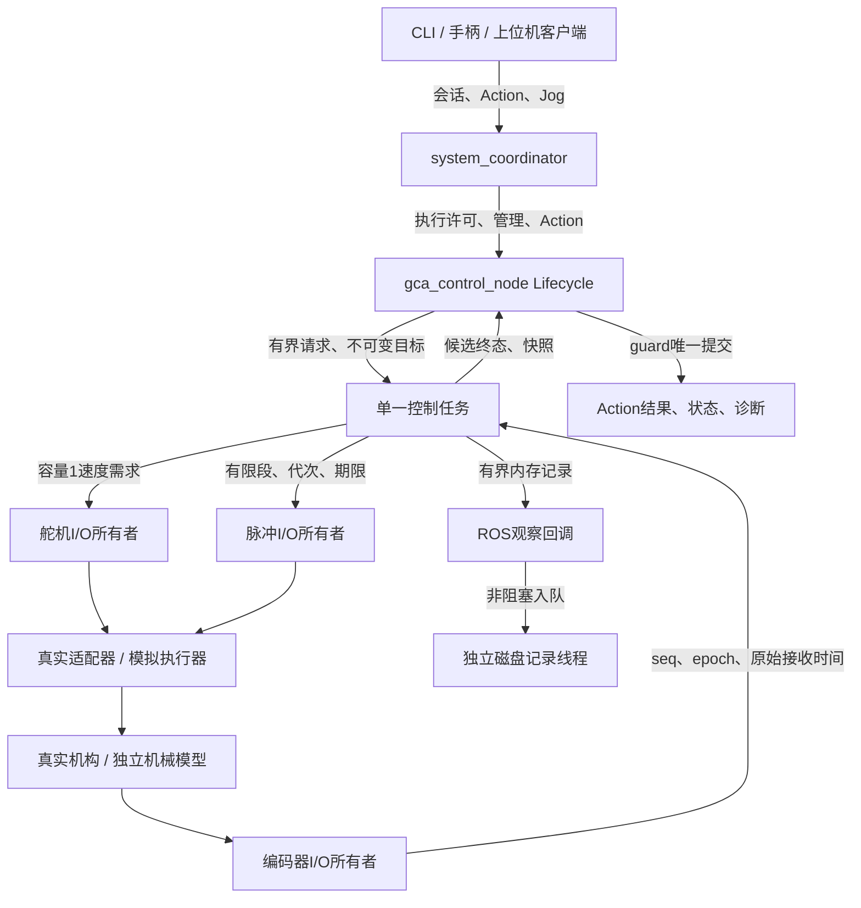

# 实际软件架构

一个 GCA 设备进程统一管理推进与旋转。ROS 2 提供正式命令、生命周期、状态和任务接口；本地闭环与设备截止时间独立于 DDS。这样，遥测仍在发布或 ROS executor 暂停，都不能给旧输出延长期限。

## 包与依赖方向

`gca_system_interfaces` 是独立 IDL 包。`gca_core` 安装唯一 Python 包 `gca`，领域、算法与 runtime 不导入 rclpy。真实硬件库只在 `devices` 内延迟导入。`gca_ros` 做 ROS 与领域对象转换，`system_coordinator` 管理上游会话并代理 GCA-only 动作，`system_bringup` 安装启动和配置资源。

`legacy/` 只提供缺陷证据，不作为任何正式模块的导入来源。没有第二套 TCP 控制核心，也没有逐函数拆出的 PID／采样 ROS 节点。`/system/execute_motion` 明确只表示双轴动作；原系统设计中的 `/system/execute` 联合磁驱动实验仍属未来接口。

## 线程与资源

| 执行者 | 写入／所有权 | 不能承担的工作 |
|---|---|---|
| 协调器 ROS executor | 源会话、目标代理、系统终态 | 设备句柄、脉冲生成 |
| 设备节点 ROS executor | 准入、生命周期、配置请求、结果提交、发布 | 串口轮询、逐脉冲时序 |
| 本地控制线程 | 运动状态、轨迹、PID、脉冲结算、停止判据 | 磁盘写入、DDS publish、阻塞设备事务 |
| 舵机 I/O 线程 | 一条舵机总线的连接、读写、停止 | 第二个调用者并发操作同总线 |
| 编码器 I/O 线程 | 一条编码器总线、解析器和新样本 | 用重复快照假造新数据 |
| 脉冲 I/O 线程 | 有限波形生命周期与硬件资源 | 无限重复波形、Python sleep 定脉冲 |
| 记录线程 | 有界 JSONL 写盘与轮转 | 阻塞上述控制或 I/O 线程 |

短锁用于交换不可变快照和计数；设备 I/O 不在控制状态锁内执行。I/O 线程可以置独立撤销门控，运动状态仍由控制线程推进。每个设备线程检查本地输出期限和许可；即使控制线程冻结也可发零速／中止波形。对不能确认的停止，只报告 `UNKNOWN`，不把 SDK 写成功当作物理停止。

## 状态与授权

Lifecycle 的 unconfigured／inactive／active 与业务 DISARMED／READY／EXECUTING／HOLDING／STOPPING／FAULT 是不同维度。`configure` 连接并核对设备，`activate` 仍保持 DISARMED。动作需要 active、显式 ARM、所选轴有效参考、已应用配置、有效源会话与执行许可同时成立。

源会话令牌只给系统入口使用；设备令牌由协调器领取并传到 `/gca/*`。外部 `generation` 标识授权代次，本地 `output_generation` 标识输出撤销代次，后者不能延长前者。设备重连、参考改变和失去授权不会恢复历史目标。

## Action 桥接

目标回调先校验整份目标并预留槽。接受回调先登记 Future，再提交本地开始事件，最后调用 `goal_handle.execute()`。execute 协程只等待 Future。核心只产生候选结果；ROS guard 在与目标／取消相同的互斥回调组中提交唯一终态。

取消必须进入 ROS 的 CANCELING 后才能提交 canceled。取消先于开始、取消与到位交错，以及 HOLD 成功后的取消交接，都要得到停止证据；停止未知应失败。成功结果 `outputs_held=true` 表示独立保持上下文仍在运行，并继续受反馈与租约监督。

## 推进和旋转

ROS 边界使用 m、rad、s；领域核心使用 mm、deg、s。转换仅在 `gca_ros/conversion.py`；设备方向和原始单位在适配器边界处理。

推进轨迹受速度和加速度限制。PID 只使用新的编码器 seq，以原始采样时间计算 dt；速度与误差需同时满足驻留时间才到位。限幅、加速度限制和边界制动后再做抗饱和；设备回执仅结算额外量化残差，不能重复回算。

旋转目标先映射到累计绝对脉冲再舍入，保留小增量效果。planned／reserved／confirmed 分开，完成需目标确认脉冲满足、没有未结算段且后端 idle。中止计数未知即作废估计与参考。软件脉冲估计不等于真实旋转角反馈，失步可能不可观测。

## 关闭与观测

STOP 使用独立撤销路径；普通运动 token 过期不能阻止受限停车。停止先撤销输出、停止有限波形、核验舵机速度读回与脉冲 idle，再释放资源。该证据描述执行器状态，不能证明导管远端或柔性机构没有残余运动；后者需要 H03 的独立测量。deactivate 在本地状态上有界等待，不等待需要当前 ROS 回调组才能完成的 Future。SIGINT／SIGTERM 执行同样的有界关闭流程。

设备 I/O 与独立期限检查集中在 `runtime/io_owners.py`，状态推进集中在 `runtime/control.py`。待发脉冲由唯一 I/O 所有者拒绝并确认，控制任务不会提前抹掉等待结算的段。真实波形在准备 RPC 完成后、实际发送前再次核对完整段的固定期限。停止时“请求输出为零”和“设备接受零速”分别记录，后者仍不等于测量停止。

内存记录有容量上限，包含采样、目标、轨迹、输出与状态；写盘线程有队列和文件轮转上限。慢盘只增加丢样／错误计数。ROS 状态是快照，`boot_id`、sample age、seq 和有效性说明它的来源与质量；历史 TRANSIENT_LOCAL 状态本身不能授予运动权限。
