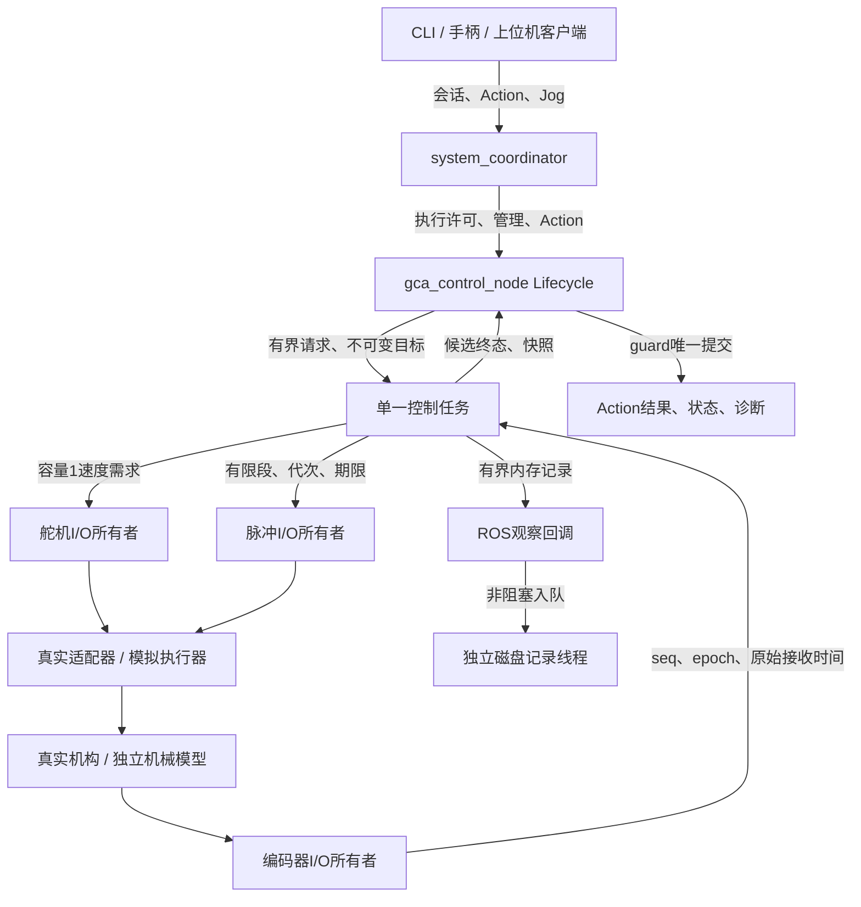

# 实际软件架构

一个 GCA 设备进程统一管理推进与旋转。ROS 2 提供正式命令、生命周期、状态和任务接口；本地闭环与设备截止时间独立于 DDS。这样，遥测仍在发布或 ROS executor 暂停，都不能给旧输出延长期限。

## 包与依赖方向

`gca_system_interfaces` 是独立 IDL 包。`gca_core` 安装唯一 Python 包 `gca`，领域、算法与 runtime 不导入 rclpy。真实硬件库只在 `devices` 内延迟导入。`gca_ros` 做 ROS 与领域对象转换，`system_coordinator` 管理上游会话并代理 GCA-only 动作，`system_bringup` 安装启动和配置资源。

`legacy/` 只提供缺陷证据，不作为任何正式模块的导入来源。没有第二套 TCP 控制核心，也没有逐函数拆出的 PID／采样 ROS 节点。`/system/execute_motion` 明确只表示双轴动作；原系统设计中的 `/system/execute` 联合磁驱动实验仍属未来接口。

`gca_teleop` 已实现独立输入采集、映射/门控、单一 MANUAL 会话 owner、容量1异步派发和同用户本机管理代理。正式路径为 `joydev/ScriptedInput → TeleopPipeline → ManualSession/LatestDispatcher → /system/manual_target → coordinator → /gca/jog → ControlRuntime`；采集、状态和代理均不直接操作执行器。左杆 LY 推进、LX 旋转，LT 为双轴 deadman，B 软件 STOP；右侧磁场输入预留。实际操作见 [手柄指南](TELEOP_USER_GUIDE.md)，实现与测试定位见 [追踪表](TELEOP_TRACEABILITY.md)。

实体入口使用只读 Linux joydev：身份多候选、错误/积压、INIT/重同步和重连都失败关闭并刷新输入 epoch。默认 event_age 不把静态缓存、右侧变化或 reader 心跳当新运动事件；qualified_state 只有匹配真实资格记录时才允许持续观察旧状态。SCRIPT_SAMPLE 仅用于 simulation，PROGRAMMED_JOG 给旧 CLI 一次固定 episode；没有来源的 active Jog 拒绝。实体15步只读映射已复核通过；实体输入→simulation的第五轮仅观察到短暂推进，旋转确认脉冲为0，整体未通过，详见[实际记录](IMPLEMENTATION_STATUS.md)。无线资格仍NOT_RUN，不能声称实体手柄持续双轴控制已经验收。

## 线程与资源

| 执行者 | 写入／所有权 | 不能承担的工作 |
|---|---|---|
| 协调器 ROS executor | 源会话、目标代理、系统终态 | 设备句柄、脉冲生成 |
| 设备节点 ROS executor | 准入、生命周期、配置请求、结果提交、发布 | 串口轮询、逐脉冲时序 |
| 本地控制线程 | 运动状态、轨迹、PID、脉冲结算、停止判据 | 磁盘写入、DDS publish、阻塞设备事务 |
| 舵机 I/O 线程 | 一条舵机总线的连接、读写、停止 | 第二个调用者并发操作同总线 |
| 编码器 I/O 线程 | 一条编码器总线、解析器和新样本 | 用重复快照假造新数据 |
| 脉冲 I/O 线程 | 有限波形生命周期与硬件资源 | 无限重复波形、Python sleep 定脉冲 |
| 记录线程 | 有界 JSONL 写盘与轮转 | 阻塞上述控制或 I/O 线程 |
| teleop输入线程 | 只读设备、健康/epoch、源观察 | ARM、执行器I/O、无限解析积压 |
| teleop owner与本机代理 | 同一源会话、续租、管理、容量1派发 | 暴露token、替缓存续命、占用预留磁场键 |

短锁用于交换不可变快照和计数；设备 I/O 不在控制状态锁内执行。独立STOP事务闸门将最终有效性检查与有界enable/write/submit的开始串行化，以stop_serial区分已经开始的事务和必须拒绝的新事务；它不承担状态快照的全局互斥。I/O 线程可以置独立撤销门控，运动状态仍由控制线程推进。每个设备线程检查本地输出期限和许可；即使控制线程冻结也可发零速／中止波形。对不能确认的停止，只报告 `UNKNOWN`，不把 SDK 写成功当作物理停止。

## 状态与授权

Lifecycle 的 unconfigured／inactive／active 与业务 DISARMED／READY／EXECUTING／HOLDING／STOPPING／FAULT 是不同维度。`configure` 连接并核对设备，`activate` 仍保持 DISARMED。动作需要 active、显式 ARM、所选轴有效参考、已应用配置、有效源会话与执行许可同时成立。

源会话令牌只给系统入口使用；设备令牌由协调器领取并传到 `/gca/*`。外部 `generation` 标识授权代次，本地 `output_generation` 标识输出撤销代次，后者不能延长前者。STOP还记录当前(session,generation)的序号屏障，立即撤输出/待发Jog并提升stop_serial；排队请求、许可回执和最终I/O都核验闸门。ARM跨代交接保留受限STOP通道并需显式确认；超时或迟到回执不使能。设备重连、参考改变和失去授权不会恢复历史目标。

协调器对STOP和Jog在最终共享状态提交锁内再次核验会话与屏障，防止认证后换owner的旧回调清除或覆盖新owner待发槽。异步停车工作绑定固定的session、generation和唯一身份；旧owner或旧代次的RPC响应仍在途时，新授权的停车可独立发出，旧回执不能清除新工作。

## Action 桥接

目标回调先校验整份目标并预留槽。接受回调先登记 Future，再提交本地开始事件，最后调用 `goal_handle.execute()`。execute 协程只等待 Future。核心只产生候选结果；ROS guard 在与目标／取消相同的互斥回调组中提交唯一终态。

取消必须进入 ROS 的 CANCELING 后才能提交 canceled。取消先于开始、取消与到位交错，以及 HOLD 成功后的取消交接，都要得到停止证据；停止未知应失败。成功结果 `outputs_held=true` 表示独立保持上下文仍在运行，并继续受反馈与租约监督。

## 推进和旋转

ROS 边界使用 m、rad、s；领域核心使用 mm、deg、s。转换仅在 `gca_ros/conversion.py`；设备方向和原始单位在适配器边界处理。

推进轨迹受速度和加速度限制。PID 只使用新的编码器 seq，以原始采样时间计算 dt；速度与误差需同时满足驻留时间才到位。限幅、加速度限制和边界制动后再做抗饱和；设备回执仅结算额外量化残差，不能重复回算。

旋转目标先映射到累计绝对脉冲再舍入，保留小增量效果。planned／reserved／confirmed 分开，完成需目标确认脉冲满足、没有未结算段且后端 idle。中止计数未知即作废估计与参考。软件脉冲估计不等于真实旋转角反馈，失步可能不可观测。

Jog推进使用独立速度前馈+外部编码器速度PI，而非积分虚拟位置；真实新采样dt只积分一次，最终限幅/边界与设备接受残差分别一次抗饱和。控制仍推进、当前输入/许可有效且反馈未过期时，无新编码器seq只刷新已受限需求的期限元数据，保留速度/seq/原反馈时间，不重算PI或重复量化结算；回中/反向/降幅仍沿既有slew减速。冻结控制不能执行该刷新，原输入和反馈年龄也不因刷新续期。首次/重入重建时间初态，回中清历史修正，不进入HOLD。Jog旋转以真实时间积分受限相位，保留小数余量；中立/换向丢弃未提交整脉冲债，已接受段仍按真实回执结算。

`PulseSegment.edge_offsets_us` 为可选不可变整型µs上升沿序列；None保留旧定位段接口。Jog、SimPulseEngine和pigpio共用校验，有限段包含DIR建立/保持、最小高低时间和完整原期限，不能忽略profile回退均匀脉冲。每次只保留有界待结算段；planned/reserved/confirmed分开，未知abort不按计划猜已发数。旋转意图是长期平均率，单wave空档的相位补偿可使段内峰值高于意图，但不越过核心限速。段内计划和整数时序可测试，跨空档机械连续加速度与真实失步需H02/H03独立测量。

## 关闭与观测

STOP 使用独立撤销路径；普通运动 token 过期不能阻止受限停车。停止先撤销输出、停止有限波形、核验舵机速度读回与脉冲 idle，再释放资源。该证据描述执行器状态，不能证明导管远端或柔性机构没有残余运动；后者需要 H03 的独立测量。deactivate 在本地状态上有界等待，不等待需要当前 ROS 回调组才能完成的 Future。SIGINT／SIGTERM 执行同样的有界关闭流程。

设备 I/O 与独立期限检查集中在 `runtime/io_owners.py`，状态推进集中在 `runtime/control.py`。待发脉冲由唯一 I/O 所有者拒绝并确认，控制任务不会提前抹掉等待结算的段。真实波形在准备 RPC 完成后、实际发送前再次核对完整段的固定期限。停止时“请求输出为零”和“设备接受零速”分别记录，后者仍不等于测量停止。

内存记录有容量上限，包含采样、目标、轨迹、输出与状态；写盘线程有队列和文件轮转上限。慢盘只增加丢样／错误计数。ROS 状态是快照，`boot_id`、sample age、seq 和有效性说明它的来源与质量；历史 TRANSIENT_LOCAL 状态本身不能授予运动权限。

### 独立手柄诊断入口

`tools/joystick_monitor.py`可由系统Python直接运行，安装后入口为`gca_joystick_monitor`。它将现有纯Python的joydev读取、映射和操作状态机接到有界终端日志队列，使用明确标记的离线诊断上下文，不创建ROS节点、控制会话或执行器。原始缓存与门控意图分别可见，事件到期后仍可观察原始摇杆值；慢终端不阻塞读取。具体操作见[独立终端诊断](TELEOP_USER_GUIDE.md#独立终端读取与操作判定无需-ros-2)。
