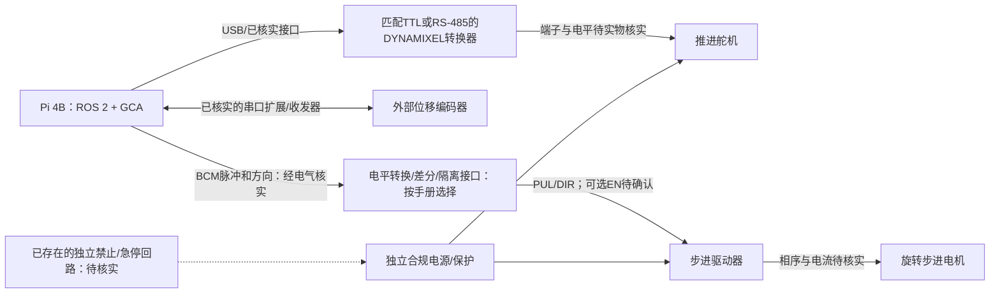

# 硬件接线与配置映射

本文件记录候选连接结构与证据，**不是已验证的整机接线图**。本轮只完成软件开发和无硬件测试，没有打开设备、设置GPIO或执行运动。没有确认的端子、电源电压、光耦输入和急停回路保持“待确认”，不能凭示意图直接接通电源。

## 证据分级与连接结构

- **L 旧代码线索**：来自 `legacy` 的数值、接口名和引脚，可能属于不同实验版本。
- **D 官方资料确认**：对应资料的接口语义或标准引脚定义，尚未证明当前实物匹配该型号。
- **U 待实物核实**：需要铭牌、手册版本、接线照片或测量才能定案。
- **M 实测验证**：有日期、设备序列号、仪器和原始记录。本次没有M项。

虚线“急停”表示需要确认的能力，不表示已经安装。实际电源不能因为画在同一框中就认为共用电压或地线；供电、隔离、屏蔽与接地按每台实际设备手册确认。

## 设备与端子证据表

| 部件/信号 | 现有证据 | 状态 | 定案所需资料 | 新版配置字段 |
|---|---|---|---|---|
| Pi主控 | 当前系统识别Pi 4B、ARM64 | D（系统识别），接线U | 板卡版本、针脚朝向、扩展板型号 | runtime.backend |
| 推进舵机 | 目录出现XM430-W350；旧ID1、57600 | L/U | 铭牌、固件、model_number、TTL/RS-485、电源与接插件 | hardware.servo.port/baudrate/device_id/model_number |
| 舵机转换器 | 旧代码枚举USB0/1 | L/U | 转换器型号、收发方式、稳定设备路径 | hardware.servo.port |
| 外部编码器 | `/dev/ttySC1`、38400、01/03/06帧 | L/U | 型号、物理接口、站号、寄存器/字节序/更新率 | hardware.encoder.* |
| PUL | `use_PIDController/main.py:87` BOARD29 | L；标准映射D；实际排线U | 实物导通、有效沿、输入电气规格 | hardware.pulse.pulse_gpio |
| DIR | `use_PIDController/main.py:88` BOARD31 | L；标准映射D；实际排线U | 正方向、有效电平、建立与保持时间 | hardware.pulse.direction_gpio/positive_direction_level |
| EN | 旧主链未体现可用使能接线 | U | 端子极性、默认状态、禁止能力 | 当前软件后端没有EN输出；不假定存在 |
| 驱动细分 | PID版6400；DM542脚本25600相关值 | L/U（互相冲突） | 驱动型号、拨码照片、每圈实测边沿数 | runtime.pulses_per_motor_rev |
| 传动比 | 旧17/30 | L/U | 传动定义和实测角度比 | runtime.catheter_per_motor_ratio |
| 推进轮/测量轮 | 旧6mm与约10.978mm半径 | L/U | 多点往返位移标定与载荷 | servo.mm_per_revolution、runtime.encoder_mm_per_count |
| 原点/限位 | 没有已确认实物证据 | U | 器件、接线、触发状态与独立停止路径 | 当前只实现软件参考/软限位 |
| 硬件急停 | 没有已确认回路证据 | U | 回路图、失电行为、独立禁止测试 | 不得把ROS STOP命名为硬件急停 |

旧线索出处为 `legacy/Magnetically controlled guide wire thruster/use_PIDController/` 和 `legacy/SteeringGearControl/DM542/DMdriver.py`；详细迁移映射见 [SDK迁移](SDK_MIGRATION.md)。

## Pi针脚、BCM编号与电气边界

标准40针排针中，旧BOARD物理29/31分别对应BCM5/6；pigpio使用BCM编号。配置中应在核对当前板型和排线后写 `pulse_gpio: 5`、`direction_gpio: 6`，**不能把旧29/31直接传入BCM接口**。标准引脚与GPIO电气规则依据 [Raspberry Pi 官方硬件文档](https://www.raspberrypi.com/documentation/computers/raspberry-pi.html#gpio)；本文未对实际排线做导通验证。

| 用途 | 旧BOARD号 | 标准BCM映射 | 软件编号方式 | 本次实物状态 |
|---|---:|---:|---|---|
| PUL候选 | 29 | 5 | BCM | 未验证 |
| DIR候选 | 31 | 6 | BCM | 未验证 |
| EN | 未知 | 未知 | 未实现软件驱动 | 不得猜接 |
| 信号参考地 | 未知 | 不适用 | 无 | 是否共地取决于实际隔离/收发拓扑 |

PUL+/PUL−、DIR+/DIR−不能在输入规格未知时任意接到GPIO。必须先得到输入电压、电流、光耦电路、共阳/共阴/差分方式和高速边沿要求，确认是否需要缓冲、差分或隔离接口。Pi不能承担电机供电；电源与逻辑信号必须分别设计。[GPIO电气依据](https://www.raspberrypi.com/documentation/computers/raspberry-pi.html#gpio)。

## 舵机接口与供电

XM430-W350的TTL与RS-485版本接口不同，具体引脚、额定供电和接插件依实物后缀及手册确认，不能仅因有一个串口就直接接Pi UART。当前软件仅支持XM430-W350的model_number=1020、固件v38或更新版本，生产配置须启用Bus Watchdog；其它型号或旧固件在寄存器写入前拒绝。此支持白名单不表示本项目实物已经确认。

官方型号资料：[XM430-W350-T/R接口及控制表](https://emanual.robotis.com/docs/en/dxl/x/xm430-w350/)。该资料可以说明候选型号能力，不能证明本项目实物就是该型号。本次不填写实机供电电压、转换器针脚或线色。

确定后填写：

| 项目 | 本项目实物记录 |
|---|---|
| 型号/后缀/序列号/固件 | 待确认 |
| 转换器型号及TTL/RS-485端口 | 待确认 |
| 每个连接器针号、信号、线色、导通记录 | 待确认 |
| 电源额定值、保护、接地/屏蔽 | 待确认 |
| 稳定串口路径、ID、波特率 | 待确认 |
| watchdog与失能时机构行为 | 待确认 |

## 编码器接口与参考

`/dev/ttySC1`可能来自扩展串口，路径和38400波特率本身不能证明TTL UART、RS-485或其它电气接口。站号、功能码和寄存器也必须核对手册。

硬件置零、改波特率、改方向不再隐藏于启动过程。新版首选软件参考：确认装置静止和有效计数后，显式设置当前参考并生成新的reference_id。此操作不是机械回零；没有原点传感器时不宣称自动回零。

编码器文档需补齐：电源与输出电平、端子/线色、收发器与终端电阻要求（若适用）、最大响应迟到、真实内部更新率、符号/回绕、掉电行为、量程、安装点和位移标定。最大响应迟到用于填写 `hardware.encoder.quiet_s`，不能用任意sleep代替证明。

## 软件配置与接线的一致性

`RuntimeConfig.hardware`由 `servo`、`encoder`、`pulse`三个显式映射组成。连接字段保存在各映射，运行时标定/速度/行程在runtime字段。配置入口和最终参数见 [配置与标定](CONFIGURATION_AND_CALIBRATION.md)。

- 每个设备的 `verified` 与总 `hardware_verified` 不是自动检测的结果，必须关联真实记录；缺物理字段时工厂报错，不使用仿真默认值。
- 脉冲还要求 `exclusive_wave_owner`、`waveform_hil_verified`，分别关联受控daemon部署和H02记录。本地flock只排除遵守本工程约定的竞争进程，外部客户端访问仍须由部署权限限制。
- 该后端没有软件EN输出，也不自动识别驱动细分；不能把未实现功能填成“受控”。
- 硬件示例中的null表示尚未确认，不可ARM；仿真值只用于模拟。

## 后续核线与上电顺序

以下是取得实机授权并补齐资料后的操作顺序，本次未执行。

1. 断电辨认设备、端子、排针朝向与线缆；记录型号/版本和接线照片。
2. 核对各供电、保护、极性、屏蔽与隔离；测导通，确认没有把供电端当逻辑端。
3. 对照上表逐线核验，确认Pi GPIO编号与真实信号，记录PUL/DIR电气接口及EN/急停是否存在。
4. 在普通输出禁止时先完成只读身份与采集实验；不运行legacy脚本，不自动设零。
5. 完成低速方向、比例、限位和停止策略验证，再允许各轴ARM；使用独立位移/角度仪器校准。
6. 逻辑分析仪确认PUL高低时间、DIR建立/保持、完整段边沿数、取消后的尾部波形和负载下抖动。
7. 按 [HIL验收](HIL_ACCEPTANCE.md) 验证失联、进程故障、重启和停止证据；未测条件保持U/NOT_RUN，不填“通过”。

软件STOP请求、零速设定、扭矩禁止、步进停止脉冲、机械静止和独立急停是不同事实。任何一个成功回执都不能代替其它事实；停止未知必须在状态和实验记录中保留。

当前pigpio后端仅支持本机：host只能为localhost或127.0.0.1，连接前统一为数值127.0.0.1并使用AF_INET socket，不经过DNS/getaddrinfo；远程主机、其它数值IP和IPv6明确拒绝。这样连接期限不被DNS解析绕过；远程波形后端需要单独审查后扩展。
