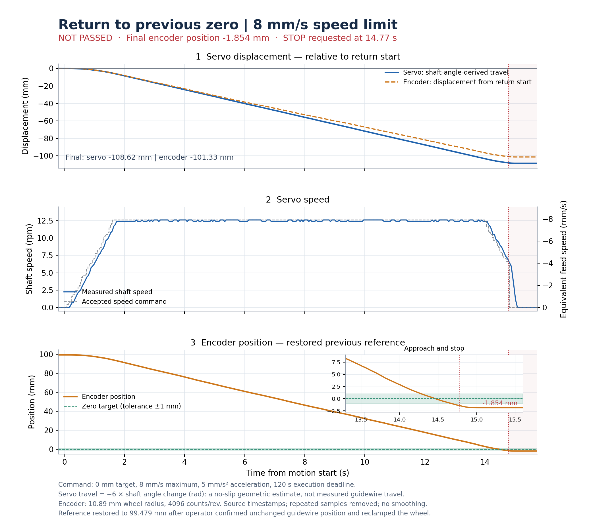

# 上位机位移 PID 闭环实现状态

2026-11-09：软件与 ROS2 仿真联调通过，真实机构已接合并完成有限实机测试。紧固摩擦轮后，100 mm、2 mm/s 推进通过；8 mm/s 回零出现超调，测试脚本停车后停在 −1.854 mm，未通过稳定到位判定。按用户要求，本阶段到此停止迭代，整理操作文档并归档代码，不追加实机测试。最终设备已零速、关闭力矩并退出程序；跨机通信、独立位移精度与制动性能仍未验证。

操作命令见[用户指南](POSITION_USER_GUIDE.md)，控制设计见[实施方案](POSITION_PID_ROS2_PLAN.md)。本文件区分已实现功能、仿真证据和未执行的实机项目，不将软件结果写成实机精度或停车时延保证。

## 交付范围

| 要求 | 实现与证据 |
|---|---|
| 显式手柄/上位机开关 | `system_bringup/feed_axis.launch.py` 必填 `control_mode` 和 `backend`，连接设备前校验快照；节点、协调器、运行时按固定策略准入；启动用例验证不匹配被拒绝 |
| 手柄开环保留 | 不创建或读取位置组件，沿用原生 RPM、LT/B 和既有停车路径；16 项原运行时回归及手柄 ROS 契约检查通过 |
| ROS 功能包分工 | 新增 `gca_position` 和 `gca_client`，保留原六包；位置组件经核心协议注入，核心不反向导入位置包；未新增 PID 或编码器 ROS 节点 |
| 独立配置 | 两个 Python 配置源，经 `tools/export_feed_axis_config.py` 生成严格 schema 3 与摘要；兼容旧手柄快照；模式、后端和参数错误不静默回退 |
| 编码器读取与估计 | 复用 `SerialEncoder`，独立线程、单个未完成事务、容量为 1 的最新样本；原时间计龄、回绕展开、0.2 秒速度窗口、错误明确传播 |
| 参考与目标 | 软件非零参考、LINEAR ABS/REL、单任务、STOP 结束；REL 在接纳时固定；非零 12 mm 参考及相对/绝对往返由纯 Python 运行时用例验证 |
| PID 与限幅 | 复用轨迹、位置 PID、机械换算和制动解析；无额外外部速度 PI；位置速度量化不超过目标上限；固定滑移模型取实际接受输出产生位移 |
| 时序与故障 | 100 ms 编码器有效期与完整 80 ms 舵机事务预算分开；90 ms 样本可开始完整事务，101 ms 被拒绝；控制线程冻结时 I/O 仍按反馈失效停车 |
| 身份及 STOP 屏障 | 旧 epoch、参考、代次和 STOP 序号输出被拒绝；取消可覆盖尚未提交的成功候选；停车后不恢复旧任务 |
| 到位与终态 | 1 mm 位置条件、0.1 mm/s 外部速度条件持续 0.3 秒，再进入 STOP；舵机和编码器停止证据独立，过期证据不能由缓存保留 |
| 上位机客户端 | `gca_client position-shell` 持久续租；明确线性单位及能力限制、异步提交、wait/cancel/stop；旧 `gca_ros.cli` 兼容转发；禁止设备模块导入时客户端仍可加载 |
| 网络与硬件入口 | 本机/局域网发现可选；本机硬件保留受信控制要求，跨机硬件保留 SROS2 Enforce 要求；硬件有下述有限推进与回零记录，跨机未实测 |
| 日志与退出 | 有界异步 JSONL 保留原反馈、PID 输出、实际接受 RPM、误差、制动来源及最终事件；仿真退出正常，无遗留进程 |

## 有限软件验证

没有运行全仓库历史测试或新增实机压力测试。已执行以下定向检查：

- 客户端及旧 CLI 序列化兼容：17 项通过。
- 启动模式、配置不匹配及旧入口隔离：7 项通过。
- 手柄运行时：16 项通过；位置运行时：3 项通过。
- 位置组件和原生舵机相关检查：25 项通过；制动缺省策略：5 项通过。
- ROS 契约首次 11 项通过；修复协调器缓存的过期停止证据后，仅复测相关文件的 4 项，均通过。
- 相关代码静态检查通过；普通安装后的模块文件与当前源代码一致。

位置组件检查最初使用系统 Python，因该环境缺少 `dynamixel_sdk`，关联的 3 项检查发生依赖错误；改用项目 `.venv` 后定向检查通过。未将依赖错误计为通过，也未因此开展额外硬件测试。

[运行时检查汇总](../artifacts/position_pid/runtime_checks.json)保存已执行命令和工具返回结果；[构建记录](../artifacts/position_pid/implementation.7Db9dZ/build/report.json)保存普通安装构建结果。随后对新增记录字段与客户端参考等待处理分别进行了局部重新安装，没有重新启动仿真。

## 一次 ROS2 仿真联调

使用正式安装的 8 个包，本机 ROS 通信，模拟传动比例为 0.85，即存在 15% 滑移。运动上限为 2 mm/s、5 mm/s²，每个任务最多 10 秒；仿真脚本运行约 23.1 秒。

| 任务 | 解析后的目标 mm | 最终位置 mm | 绝对误差 mm | 结果 |
|---|---:|---:|---:|---|
| 相对推进 +5 mm | 5.000000 | 4.593889 | 0.406111 | SUCCEEDED，确认停车 |
| 绝对回到 0 mm | 0.000000 | 0.367511 | 0.367511 | SUCCEEDED，确认停车 |
| 相对后退 −3 mm | −2.632489 | −2.455642 | 0.176846 | SUCCEEDED，确认停车 |
| 绝对回到 0 mm | 0.000000 | −0.116935 | 0.116935 | SUCCEEDED，确认停车 |
| 相对 +20 mm，0.3 秒后取消 | 不作为到位任务 | — | — | CANCELED，确认停车 |

4 次正常完成时外部速度均为 0 mm/s，`outputs_held=false`。续租无错误，客户端清理无错误，启动进程退出码为 0，进程检查确认无遗留子进程。这里的残余误差符合用户设置的 1 mm 容差，不表示控制器必须收敛到数值零。

[仿真报告](../artifacts/position_pid/implementation.7Db9dZ/simulation/report.json)、[启动日志](../artifacts/position_pid/implementation.7Db9dZ/simulation/launch.log)、[设备记录](../artifacts/position_pid/implementation.7Db9dZ/simulation/records/device/control-00.jsonl)保留原始结果。[联调运行与清理记录](../artifacts/position_pid/implementation.7Db9dZ/ros/report.json)证明实际 ROS 进程正常退出。

记录审查共读取 449 条 JSONL，包含 5 个最终任务事件、314 个不同的 PID 输入样本；同一样本没有对应多个 PID 输出序号。记录中的比例修正项存在非零值，最大绝对值约 2.253 mm/s，说明滑移场景中实际使用了位置误差修正。原始制动测量值仍为 `None`，有效值及来源为显式缺省值，日志未包含授权 token。[完成审查记录](../artifacts/position_pid/implementation.7Db9dZ/completion_audit.json)保存源文件摘要和以上核对结果。

`artifacts/` 按仓库规则保留在本机，不纳入 Git；复制工程后不会自动带有这些采集证据。

## 2026-11-09 短程实机记录

用户确认驱动轮与编码器测量轮已经作用于同一对象，允许先推进 5 mm 再回到本次参考零点，现场有人观察。仅发送两个位置任务，速度 2 mm/s、加速度 5 mm/s²、执行上限 10 秒；失败后未重试运动，也没有修改控制参数。

| 动作 | 结果 | 编码器最终位置 | 说明 |
|---|---|---:|---|
| 相对推进 +5 mm | PASS | +4.476954 mm | 误差 −0.523046 mm，符合 1 mm 容差；速度为零，舵机与编码器均确认停车 |
| 绝对回到 0 mm | FAIL | +2.973499 mm | 回退约 1.503455 mm 后触发 `OUTPUT_EXPIRED`，没有回到零点 |

回零首次故障记录出现在进入 EXECUTING 后约 10.0216 秒，与本次 10 秒执行上限一致。最后有效控制帧的编码器年龄约 37.95 ms、舵机反馈年龄约 4.56 ms；故障时上一 PID 输入按请求开始时间计龄约 63.89 ms，低于 100 ms 上限。此前的 54.76 ms 仅从接收完成时间计算。记录不支持将该现象直接判断为串口失联。停止后实测转速及编码器速度均为零、力矩关闭、armed=false，两个停止证据均确认；ROS 进程正常退出，未遗留控制进程。

还观察到理论行程与编码器位移不一致：按现有 6 mm 驱动轮半径、直驱比例，推进段舵机轴转角对应约 +15.582 mm，编码器为 +4.477 mm；回退段分别为 −18.380 mm 与 −1.503 mm。这里只比较已有轴反馈与编码器换算结果，尚不能确定差异来自打滑、机械接合、有效半径或测量传递关系；没有据此修改 PID 或放宽执行期限。

正式运动前另有一次 ROS 服务发现超时：6 秒内没有发现生命周期服务，在 configure、ARM 和运动前退出。保留该[启动记录](../artifacts/position_pid/hardware.4_fpzdzi/report.json)，将有界服务等待调整为 15 秒后才进入上述唯一一组实际运动。

[实机报告](../artifacts/position_pid/hardware.dzt0we65/report.json)、[只读分析](../artifacts/position_pid/hardware.dzt0we65/assessment.json)和[启动/退出日志](../artifacts/position_pid/hardware.dzt0we65/launch.log)均已保存；原始控制记录位于同目录的 `records/device/`。

后续三个 agent 只读核查了期限、计数换算和运动记录。最后一条新 PID 输出距离故障约 25.94 ms，强证据指向整条任务 10 秒期限到达；I/O 路径把位置模式输出失效统一归为 `OUTPUT_EXPIRED`，而控制路径使用 `EXECUTION_TIMEOUT`，错误码分类尚未修正。实际租约截止时间未保存在该记录中，不能完全排除租约同时到期。分析见[期限核查](../artifacts/position_pid/hardware.dzt0we65/runtime_deadline_review.json)。

该次推进前约 6 秒和回程后约 7 秒均有“舵机持续转、编码器几乎不变”的区段；其中一次正常传递区间，两者行程比例约 95.7%。固定半径误差不能单独解释交替出现的停滞与正常传递，具体打滑部位没有独立测量。见[运动记录分析](../artifacts/position_pid/hardware.dzt0we65/independent_timeseries_review.json)。

## 2026-11-09 紧固后 100 mm 推进

用户确认摩擦轮已紧固、前方行程足够且现场有人，仅执行一次相对 +100 mm，不自动返程。速度上限 2 mm/s、加速度上限 5 mm/s²、执行期限 120 秒；编码器反馈、舵机反馈和输出有效期没有随任务期限放宽。

| 项目 | 结果 |
|---|---:|
| 最终编码器位置 | +99.478577 mm |
| 目标误差 | −0.521423 mm，满足 1 mm 容差 |
| 任务耗时 | 60.458 s |
| 任务终态 | SUCCEEDED / OK |
| 舵机轴角换算的理论行程 | +110.704326 mm |
| 编码器行程 / 舵机理论行程 | 89.86% |

无记录到的通信错误或 `OUTPUT_EXPIRED`，停止后两侧速度为零、力矩关闭、DISARMED，launch 正常退出。运动传递比前次明显改善，但仍不能用上述比例直接证明打滑量或实际直线精度。报告与换算依据见[100 mm 报告](../artifacts/position_pid/hardware-100mm.3kmq47dz/report.json)、[分析](../artifacts/position_pid/hardware-100mm.3kmq47dz/assessment.json)。

## 2026-11-09 8 mm/s 回零与曲线

用户要求单次回零，速度上限 8 mm/s、执行期限 120 秒，加速度沿用 5 mm/s²。准备时发现编码器计数已变化，程序在 ARM 和运动前退出；用户随后确认测量轮曾单独转动，但导丝保持上次终点且测量轮已重新压紧。因此旧零点原始计数作废，依据该确认把当前位置设为 +99.478577 mm，再提交绝对目标 0 mm。该参考恢复依赖操作者的物理位置确认，不是自动找零或独立计量标定。

| 项目 | 结果 |
|---|---:|
| 起始编码器位置 | +99.478577 mm |
| 最终编码器位置 | −1.854261 mm |
| 本段编码器位移 | −101.332838 mm |
| 本段舵机理论位移 | −108.615044 mm |
| 首次记录到停车请求 | 运动开始后 14.7715 s |
| 任务终态 | CANCELED / COORDINATOR_STOP |
| 实机到位判定 | FAIL，未满足 1 mm 容差 |

回零越过本次脚本的 −1 mm 监测下界时触发 `TRIAL_POSITION_ENVELOPE`，脚本请求 STOP，最终停在 −1.854261 mm。没有触发 `OUTPUT_EXPIRED`，没有记录到串口错误。−1～101 mm 是该次测试脚本的观察界限，普通 `position-shell` 没有这项检查，不能把它当作全局 `motion` 边界。此次提前停车没有验证控制器继续执行是否会自行收敛。

记录显示，接近零点时舵机仍有转速；编码器约 +0.551 mm 时外部速度仍约 −5.98 mm/s，随后发生超调。现有轨迹/PID 和加速度限制尚不能据这次结果宣称 8 mm/s 回零已调好。最终实测两侧速度均为零、力矩关闭、DISARMED、两侧停止证据确认，进程正常退出。

曲线按原始采样时间绘制，去除重复样本，不作平滑。舵机位移由 `−6 × 轴角变化(rad)` 换算，是无滑动理论行程；编码器按 `2π × 10.89 / 4096` mm/count 换算。图中的零点来自上述位置确认。该图片随文档提交；[原始报告](../artifacts/position_pid/hardware-return-8mms.b_tpntgg/report.json)、[分析](../artifacts/position_pid/hardware-return-8mms.b_tpntgg/assessment.json)、[曲线 CSV](../artifacts/position_pid/hardware-return-8mms.b_tpntgg/return_curves.csv)和绘图脚本 `plot_return.py` 保留在本机同一记录目录。

中间 `stop_after_failure` 快照仍可能显示旧 `EXECUTING` 与历史 `stop_progress=CONFIRMED`，当时两侧独立停止标志为 false；实际停车结论依据最终新鲜状态及任务终态，不能只看这个中间字符串。

## 实机与未完成项目

| 项目 | 状态 | 原因 |
|---|---|---|
| 真实机构相对 +5 mm、绝对回零 | FAIL | 推进段通过；回零段在约 10.02 秒时触发 OUTPUT_EXPIRED，停在 +2.973 mm |
| 紧固后相对 +100 mm，2 mm/s | PASS | 单次完成，最终 +99.479 mm，约 60.46 秒，确认停车 |
| 8 mm/s 返回软件零点 | FAIL | 超过测试下界后主动停止，最终 −1.854 mm；任务结果为取消，不是超时故障 |
| 第二台主机下发 ROS 指令 | NOT_RUN | 没有配置第二台 ROS 主机 |
| 实际位移精度、滑移及几何比例验证 | NOT_RUN | 目前使用用户确认的理论轮径、传动比和计数比例 |
| 实际制动减速度与完整停车延迟 | NOT_RUN | 原始测量值保持未知，计算采用已确认的工程缺省策略 |

当前保留的改进项是任务期限与输出失效的错误码区分、较高速回零的减速和超调、简要状态中历史停止进度的歧义，以及运动传递与独立位移标定。用户已决定本阶段先做到这里；不以增加测试次数或放宽容差把未通过项目改记为通过。未重做无线资格、手柄映射、长期压力或此前延期的总线静默专项，也不宣称所有真实机构闭环工况已经验收。
