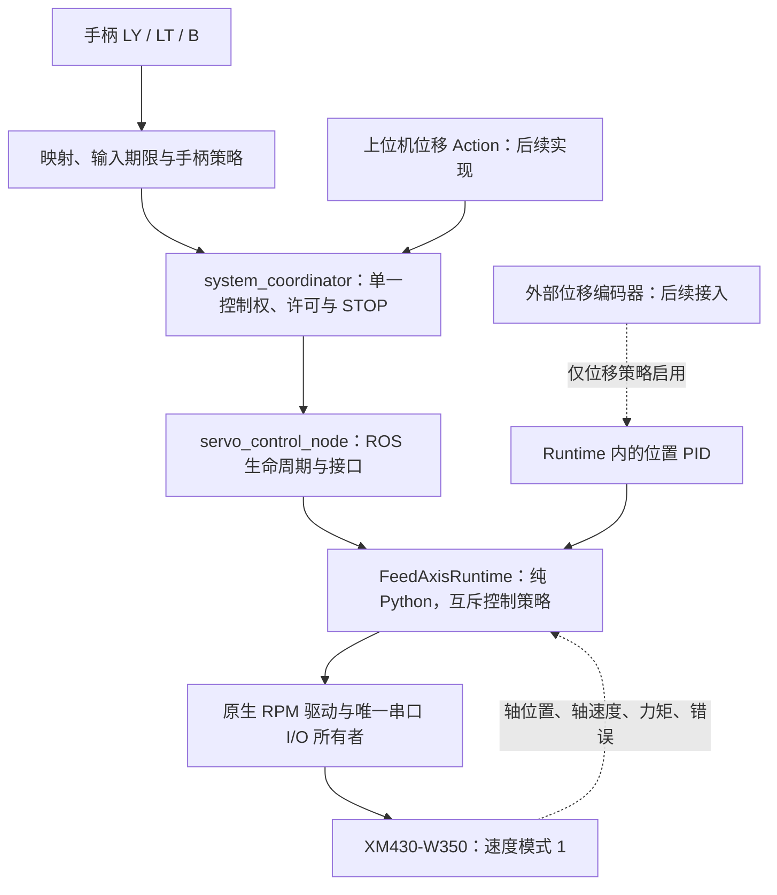

# 舵机接入 ROS 2 与后续位移闭环方案

> **最终范围与结项（2026-11-07）：** 当前配置为 `servo-held-v5`，显式 `joydev_hold` 支持 LT 持续控制；上推反转、下推正转，指令上限 80 rpm（raw 349＝79.921 rpm）、加速度 40 rpm/s，输入观察及输出期限 0.30 秒、停车确认期限 2 秒。软件实现和空载手柄实机联调已完成，最近实测约 ±45.8 rpm；无线资格保持 `NOT_RUN`，两项专项失效测试按用户决定后移，偶发中断记录按未复现保留。外部编码器与位置 PID 仅预留接口。日常使用见[真实舵机快速操作](SERVO_USER_GUIDE.md#真实舵机快速操作)，最终范围见[结项记录](../artifacts/servo_ros2/delivery-v5/scope-revision.json)。下文保留早期方案及修订，不作为当前参数或重复执行测试的依据。

> **早期用户范围修订（2026-11-07）：** 本轮仅舵机空载操作改为显式 `manual_input_mode=joydev_hold`，LT按住时持续操作，不设单次时间上限，LY决定方向和速度；速度上限10 rpm，单一配置源以raw 43=9.847 rpm实现，变化率3 rpm/s。0.15 s只保留reader观察和输出新鲜度约束。无线链路证据仍UNKNOWN、资格仍NOT_RUN，但不再是本轮持续操作的前置条件；默认 `qualified_state` 继续要求资格。下文原先的资格前置条件、有限单次操作和旧测试统计按历史版本理解，当时范围记录见[scope记录](../artifacts/servo_ros2/bounded-jog-tx1awiz0/scope.json)和[实现状态](IMPLEMENTATION_STATUS.md)。

更改前实施状态（2026-11-07）：本文保留设计要求。首期配置、原生驱动、仅舵机运行时及 ROS／手柄软件已实现；六包构建、必要定向回归和最终正式 ROS 模拟通过，源码／安装内容一致，本轮软件测试已经结束。新驱动另完成一次真实只读探测，三个样本有效，未写寄存器，设备仍为位置模式 4；这不表示速度模式或停止验收通过。已实测确认当前接收器为 BFM 模式，无线资格、真实速度模式 1 运动及相关 HIL 仍为 NOT_RUN，真实链路尚未完成；外部编码器与位置闭环仅通过接口契约审查，能力保持关闭。实际证据以[实现状态](IMPLEMENTATION_STATUS.md)为准，操作见[舵机指南](SERVO_USER_GUIDE.md)。文中的拟议命名保留设计语义，实际字段以代码与接口文档为准。

## 1. 需求与单一结论

采用“独立 Python 配置、原生舵机转速驱动、单一执行运行时、ROS 2 管理与输入适配”的结构。手柄控制和上位机位移控制是两种互斥策略，共用同一个舵机串口所有者及停止机制。

| 控制策略 | 输入及输出 | 外部位移编码器的作用 |
|---|---|---|
| `MANUAL_SERVO_VELOCITY` | 左杆 LY 产生舵机转速目标；上推反转、下推正转，幅度越大速度越高 | 不参与采集、调速、参考设置、就绪判断或本模式停车判定；缺失或故障不阻止手柄模式 |
| `POSITION_EXTERNAL_ENCODER` | 上位机下发绝对位置／相对位移，位置 PID 产生舵机速度目标 | 启用真实位移采集，用于闭环修正、边界判断、到位与位置任务停车确认；缺失或失效时拒绝／停止位置任务 |

第一阶段只实现手柄舵机速度控制。第二阶段接入外部编码器后实现上位机位移控制，**不将外部编码器闭环加入手柄路径**。舵机自身的内置编码器和固件速度环与外部位移编码器是两回事；手柄模式继续使用舵机内部反馈和速度控制。

保留既定 LT 按住允许运动、B 软件 STOP。首期 LX 未分配，RT、RB、右摇杆和 RS 继续预留给磁场控制。当前不接入步进旋转轴。

## 2. 现有依据与改动原因

三路 agent 分别审查了设备／配置边界、ROS／手柄路径、控制核心／PID，并交叉核对以下结论。

| 当前实现 | 直接使用时的问题 | 本方案处理 |
|---|---|---|
| [设备工厂](../ros2_ws/src/gca_core/gca/devices/factory.py)要求 `servo/encoder/pulse` 三设备 | 只连接舵机无法启动；未来仅添加编码器仍不满足三设备条件 | 新增只管理推进执行器的运行时，按策略启用真实外部编码器，不构造假设备 |
| [DynamixelConfig](../ros2_ws/src/gca_core/gca/devices/common.py)和[舵机适配器](../ros2_ws/src/gca_core/gca/devices/dynamixel.py)使用 mm/s 与 `mm_per_revolution` | 尚未标定机构比例，不能诚实地表示线速度 | 提取原生 RPM 驱动；毫米换算仅属于后续机械标定适配层 |
| [ControlRuntime](../ros2_ws/src/gca_core/gca/runtime/control.py)固定启动三个 I/O 任务 | 修改一个 `axis_mask` 无法解除结构依赖 | 保留原双轴运行时；新增 `FeedAxisRuntime`，首期只实现舵机速度策略 |
| [手柄会话](../ros2_ws/src/gca_teleop/gca_teleop/session.py)要求双轴参考有效 | 无外部编码器时一直不能 READY | 按明确的控制策略判断能力，手柄舵机模式不要求毫米参考或步进轴参考 |
| [手柄节点](../ros2_ws/src/gca_teleop/gca_teleop/node.py)发送双轴 `JogCommand` | 现有旋转字段指导管绕轴旋转，不是推进舵机的轴转速 | 新增专用 `ServoJogCommand`，保持原双轴消息的单位和含义 |
| [输入门控](../ros2_ws/src/gca_teleop/gca_teleop/state_machine.py)将 LX、LY 都作为有效运动输入和回中条件 | 未分配的 LX 会影响只用 LY 的控制 | 舵机策略只用 LY 与 LT 的有效变化维护输入期限；中立只看 LY，B 始终优先 STOP |
| [输入质量校验](../ros2_ws/src/gca_core/gca/domain/manual.py)禁止未核实 `EVENT_AGE` 用于 hardware | 当前实体手柄映射不等于无线失联资格 | 保留硬件门控，完成现有无线资格后才放行实体手柄运动 |

已实测：XM430-W350 型号编号 1020、固件 46、ID 1、57600、Protocol 2.0、Drive Mode 0；扩展位置模式 4 下完成约 10° 和 720° 空载试转，结束时力矩关闭。报告见[只读识别](../artifacts/servo_readonly/probe-hpl7udd2/report.json)、[720° 试转](../artifacts/servo_motion/rotation720-apbn7of5/report.json)。

这些证据不代表速度模式 1、模式切换、无线失联停车或外部位移闭环已经通过。`-T/-R` 电气后缀、机构每转推进量和外部编码器比例也不能从型号编号或舵机转角推断。

## 3. 结构与输入方向

`servo_control_node` 是拟新增可执行入口；ROS 节点名继续使用现有生命周期客户端依赖的 `gca_control_node`。新 launch 与原双轴执行节点互斥，同一时刻只启动一个 `/gca/*` 执行端。共享权限和管理代码，不复制第二套会话／令牌机制。

当前物理映射中，上推得到 `mapped.ly > 0`，下推得到负值。保留已核实的原始轴索引、中心、范围和符号，不修改标定证据。定义映射后杆量 `u`，舵机原生正方向仍为 Drive Mode 0 对应的正方向：

\[
n_{servo}=-u\,n_{max},\qquad raw=\operatorname{round}(n_{servo}/0.229)
\]

| 操作 | 舵机目标 |
|---|---|
| 左杆上推 | 负 RPM，反向旋转 |
| 左杆下推 | 正 RPM，正向旋转 |
| 左杆回中 | 零速目标，按设定变化率减速，不追赶历史位移 |
| 松开 LT、按 B、输入失效 | 撤销待发命令并走独立 STOP，不等待普通减速队列 |

死区和响应曲线复用现有映射；默认沿用已使用的死区 0.08、指数 1.5，保证死区外幅度增大时速度幅值非递减。0.229 rpm 的寄存器量化会产生速度台阶，不能宣称每个微小杆量变化都对应不同转速。

首期建议最大速度原始值 20，即 4.58 rpm，作为低速联调起点。这来自此前位置试转的速度限制，不是速度模式已验收指标。加速度、采样周期和超时需要按新链路的实际串口事务预算配置，不能直接照搬仿真 10 ms 周期。

方向仅转换一次：手柄输出适配将 `u` 转为有符号舵机目标，手柄方向系数固定为 `-1`；原生驱动只转换单位和寄存器。后续上位机位移路径通过 `MechanicalMapping` 完成线速度到舵机 RPM 的有符号转换，不再经过手柄方向适配。机构正位移对应的舵机方向尚未标定，不能由“上推反转”推断；它与每转推进量一起实测确认，不能再叠加 Drive Mode 反转。

## 4. 独立配置脚本与原生驱动

拟新增工程根目录的 `config/servo_settings.py`，作为舵机数值配置的唯一人工编辑入口。只依赖 Python 标准库；导入、显示或导出配置时均不打开串口，也不导入 ROS。

脚本支持显示与导出 JSON 快照。独立诊断程序和 ROS 节点读取同一个经过严格校验的快照；ROS 只接收配置路径，不另维护一份同值 YAML。修改数值后重新导出、停止并重新 configure 即可，不因调参而重新编译 ROS 消息。生成的 JSON 是部署产物，不作为第二个人工配置来源。

| 配置组 | 内容与来源 |
|---|---|
| 设备身份 | 优先使用已发现的 `/dev/serial/by-id/usb-FTDI_USB__-__Serial_Converter_FT5WJAPT-if00-port0`；57600、ID 1、协议 2.0、model 1020；启动时仍读取真实设备核对 |
| 厂家单位 | 0.229 rpm/raw、4096 count/舵机输出轴转；与机构毫米换算分开 |
| 手柄方向与速度限制 | 映射后 LY 到舵机 RPM 的方向系数 `-1`、速度原始值上限、转速变化率限制；不得让 ROS 参数再次反向，机构方向另行标定 |
| I/O 与停止 | 单次事务期限、反馈最大年龄、输出有效期、停止确认期限、Bus Watchdog；各自校验，不用一个“心跳”代替 |
| 配置版本 | schema 版本、配置修订号、有效配置摘要；日志记录实际加载内容 |
| 后续机构配置 | 独立的每转推进毫米数、方向、外部编码器单位和参考；当前明确未标定，仅位移策略要求有效 |
| 后续 PID | 独立位置控制参数及限幅；不向手柄策略注入外部 PID |

修改方向、控制策略、速度上限或 PID 参数均要求 STOP 确认、DISARM，撤销旧命令和许可后重新应用；不允许运动中修改 Python 全局变量或热切换配置。首次接入应显式列出候选配置与尚待测量的时间预算，不能把未知值填成仿真默认值。

驱动层拟提取 `DynamixelVelocityDrive`，原生接口为 `open_identified()`、`configure_velocity_mode()`、`write_velocity_rpm(rpm, deadline_ns)`、`read_shaft_state()`、`set_torque()`、`stop()`、`close()`。现有线速度适配器未来包装该驱动，而不是复制串口读写实现。

复用 [sdk_support.py](../ros2_ws/src/gca_core/gca/devices/sdk_support.py) 的单调时钟期限和响应长度检查、设备锁，并增加串口独占打开。同一串口不得同时运行独立试转脚本和 ROS 执行节点。

## 5. ROS 接口与运行边界

| 拟新增／调整项 | 约定 |
|---|---|
| `ServoJogCommand.msg` | 复用 `CommandContext`、token、deadman、TTL、`ManualInputQuality`；新增 `servo_angular_velocity_rad_s`，明确是舵机轴的原生正方向 |
| 手柄命令路径 | `/system/servo_manual_target → system_coordinator → /gca/servo_jog`；仅 MANUAL 策略接受，不复用导管绕轴旋转字段 |
| `ServoState.msg` | 舵机轴原始计数、角度／角速度、请求及接受速度、力矩、硬件错误、样本序号、设备代次、原始采样时间及有效性 |
| `GcaState` | 增加嵌套 `servo` 状态，保留会话、生命周期、配置、STOP 通用封套；手柄阶段外部线位移和导管旋转有效标志均为 false |
| `GetCapabilities` | 分开声明舵机速度控制、舵机轴测量、外部位移测量和位移控制能力，不再用一个 verified 同时打开全部能力 |
| `ExecutionLease` | 新增明确的 `control_policy`，由协调器根据已认证源会话生成；执行端校验策略与命令类型，续租不能改变策略 |
| 管理入口 | 复用现有领取控制权、许可、ARM、DISARM、STOP 和 Lifecycle；手柄舵机模式不调用毫米 reference |
| 后续上位机位置接口 | 继续使用已有 `/system/execute_motion` Action，仅接受 LINEAR 轴及绝对／相对位移；返回真实编码器位置、误差和到位结果。首期返回明确的能力不支持错误 |

原生驱动／控制器使用 RPM，ROS 舵机速度使用 rad/s，转换在 ROS 边界完成。后续上位机位移仍使用 ROS 的 m 与核心的 mm，不把 RPM 填进 `linear_velocity_m_s`。舵机内置编码器角度命名为 `servo_shaft_angle`，不填入步进轴的 `rotation_estimated_rad`。

日志并列保存原始 LY、归一化 LY、控制策略、方向转换后的目标 RPM、限幅及量化后的接受 RPM、实测轴速度、轴计数、力矩、输入年龄、停止原因。第一阶段毫米位移明确不可用；第二阶段新增外部位置、目标误差、PID 分量和标定版本。

### 速度模式初始化与停止

1. 读取并核对身份、Drive Mode、当前模式、力矩与错误状态，先确认关闭力矩。
2. 从已实测的扩展位置模式 4 切换到速度模式 1；仅在读回不一致时写模式，避免每次启动重复写 EEPROM。
3. 应用并读回速度限制、加速度及非零 Bus Watchdog，写入并确认零目标，保持 DISARMED。不能把位置模式的旧目标速度 1023 带入 ARM。
4. 显式 ARM 前再次确认零目标、配置版本、新鲜舵机反馈、会话及输入资格；随后才使能力矩。
5. LT/B、超时、反馈失效、串口错误、授权撤销和退出触发独立停止；零速写入失败仍独立尝试关闭力矩。无新鲜停止证据时报告 UNKNOWN，不将“写入成功”当作“已经停止”。

配置成功后正常退出保留速度模式 1，确认零速并关闭力矩；不在每次 STOP 或退出时恢复模式 4、重复写 EEPROM。日志记录模式等持久配置的变化，不恢复历史非零目标。

发现 watchdog 锁存或硬件故障时保留原因并要求显式恢复，不照搬现有 configure 中自动清除 watchdog 的行为。正常退出先停止并确认、DISARM、释放会话，再关闭 ROS 节点，避免此前日志中的 `SHUTTING_DOWN` 停止请求失败。

Bus Watchdog 只证明总线上有通信，持续读取状态也可能维持它。I/O 所有者仍须独立检查原命令、输入和输出期限；控制线程冻结时，即使读线程继续运行，也必须主动写零和撤销力矩。主机进程完全退出时的设备 watchdog 行为需要单独进行一次有界验证。

### 实体手柄输入资格

当前 `event_age` 静态约 0.15 秒过期，且硬件入口明确拒绝未资格确认的输入。本方案不放宽这个限制，也不把手柄输入伪装成 `PROGRAMMED_JOG`。

要满足“持续保持杆量即可持续转动”，先运行现有只读资格流程：核实接收器模式，预声明失联检测界限，验证手柄断电、无线失联、接收器拔出。每种场景按现有向导做 3 次，共 9 次，取得有效证据后使用 `qualified_state`。失败即记录并停止该项，不重复试到偶然通过。若驱动失联后一直保留旧轴值，不能据此放行持续硬件控制；舵机 ROS 模块的实现和模拟验证可以先完成。

## 6. 上位机位移闭环：只在第二阶段启用

后续增加真实外部位移编码器与 `MechanicalMapping`，仍只有舵机和编码器两个设备，不因沿用旧 `ControlRuntime` 而额外要求步进电机。`FeedAxisRuntime` 预留编码器端口和位置控制策略，当前只实现有明确能力的手柄策略，不提供空编码器对象。

手柄路径不运行外部编码器 I/O。准备执行上位机位移任务时，显式切换到位置策略，启用编码器采集，建立实际参考并验证新鲜性，满足条件后才允许 ARM 和执行任务。相对位移以任务正式接纳时的新鲜外部位置为起点；绝对位置命令必须匹配当前 `reference_id`。编码器断开、回绕异常、跳变或过期会阻止／中止位置任务；不能自动降级到 RPM 模式继续运动。返回手柄模式必须经过显式交接，外部编码器不再参与该模式的就绪判断。

位移估计复用 [LinearEstimator](../ros2_ws/src/gca_core/gca/estimation/linear.py)，包括计数回绕、比例、参考、跳变与时间检查。真实推进距离来自外部编码器，不能由舵机轴角乘猜测半径代替。

位置闭环复用 [PositionController](../ros2_ws/src/gca_core/gca/algorithms/control.py)：

\[
e_x=x_{ref}-x_{measured},\qquad
v^*=v_{ff}+K_p e_x+I-K_d\hat v
\]

\[
I_{k+1}=\operatorname{clip}\left[I_k+K_i e_x\Delta t+K_{aw}(v_{limited}-v^*)\Delta t\right]
\]

速度经过速度上限、加速度及有效位置边界制动，再由实测每转推进量 `c` 换算：

\[
n_{servo}=s\frac{60v_{limited}}{c},\qquad s\in\{-1,+1\}
\]

此处 `c` 的单位为 mm/舵机输出轴转，`s` 表示实际正位移对应的舵机方向，两者必须通过独立位移标定获得；当前均未确认。接受的量化 RPM 再换回 mm/s，仅结算一次额外量化残差，避免重复积分补偿。

- 手柄模式不调用 `JogVelocityController` 的外部线速度 PI；未来接编码器后也保持这一约定。
- 上位机位置模式先采用“位置 PID → 速度命令 → 舵机内部速度环”，不默认再叠加一个外部速度积分环。
- 每个有效新编码器样本至多更新一次 PID，使用真实采样间隔；重复样本不刷新年龄或重复积分。
- D 作用于测量速度，起步建议先整定 P，必要时再加入 I，D 默认关闭；具体硬件增益当前不填写。
- STOP、取消、换参考、换配置和控制权交接清除积分、目标和待发输出；不恢复历史位移任务。
- 到位需同时满足轨迹完成、真实位置误差阈值、有效速度阈值及驻留时间；不能只看舵机目标寄存器或原定运行时间。

控制策略接口预留 `reset()`、`update_target()`、`step(feedback, dt)`、`commit_limited_output()`、`observe_accepted_output()`、`stop()`；外部反馈包含 seq、device_epoch、原始采样时间、参考版本及有效性。只在位置策略实际实现后开放对应能力。

### 控制权交接

复用现有会话模式 `MANUAL` 与 `AUTO`：前者绑定 `MANUAL_SERVO_VELOCITY`，后者绑定 `POSITION_EXTERNAL_ENCODER`。策略绑定于已认证执行租约，不能由新到的消息类型或编码器上线自动改变。现有协调器 Action 入口尚未要求 AUTO，实施时需在协调器和执行端同时补充策略校验。

上位机动作到来时，若手柄仍持有 MANUAL 会话，明确拒绝控制权冲突，不自动抢占。交接顺序为 STOP 确认 → DISARM → 结束旧会话／撤销旧许可 → 领取新会话和绑定策略 → 切换采样资源 → 建立所需参考 → 显式 ARM。旧 Action 必须先取消或结束；旧会话的目标、许可、ARM 回执和速度队列不能在新策略中继续生效。

回到手柄模式不要求外部编码器有效，但必须重新观察 LY 回中、LT 松开和新的 LT 按下。首期 B 请求停止当前 MANUAL 会话；上位机位置任务由当前 AUTO owner 的取消／STOP 入口停止。旧手柄令牌不能越过控制权交接继续授权运动或管理新任务，跨会话的操作员停止权限不在首期新增。

## 7. 实施顺序与停止测试条件

| 阶段 | 交付内容 | 有限验证与完成条件 |
|---|---|---|
| 1：纯 Python 边界 | 独立配置、RPM 驱动、仅舵机运行时；保留旧双轴适配层 | 方向与单位转换、限幅、无编码器依赖、过期撤销、失败关闭的定向测试 |
| 2：ROS 接入 | 专用 ServoJog／ServoState、管理接口复用、互斥 launch、策略能力 | 一次模拟链路验证：上负下正、LX 不驱动不续期、LT/B 停止、无旧许可恢复 |
| 3：输入资格与空载硬件 | 有效无线资格；速度模式 1 初始化与零速 ARM | 资格按一次预定流程完成；一次低速正反转、杆量调速、停止及有界失效检查。只验证新路径，不重跑长时全套模型 |
| 4：后续编码器 | 实际标定、上位机位置 Action、位置 PID 与模式交接 | 一次有限正反位移、到位／取消、编码器失效、手柄模式不受外部编码器依赖的定向验证 |

每阶段取得明确证据后停止追加测试；失败只修复对应问题，保留失败记录。通信与 720° 位置试转不替代第 3 阶段；阶段 3 成功也不提前宣称外部位移闭环通过。

第一阶段交付范围不包含导管绕轴步进控制、磁场控制、未知机构比例的毫米运动、自动抢占控制权或外部编码器对手柄速度的修正。

实施任务见[真实舵机接入 goal prompt](SERVO_ROS2_IMPLEMENTATION_GOAL_PROMPT.md)。保存方案和 prompt 不代表已经开始实施或通过验收。
