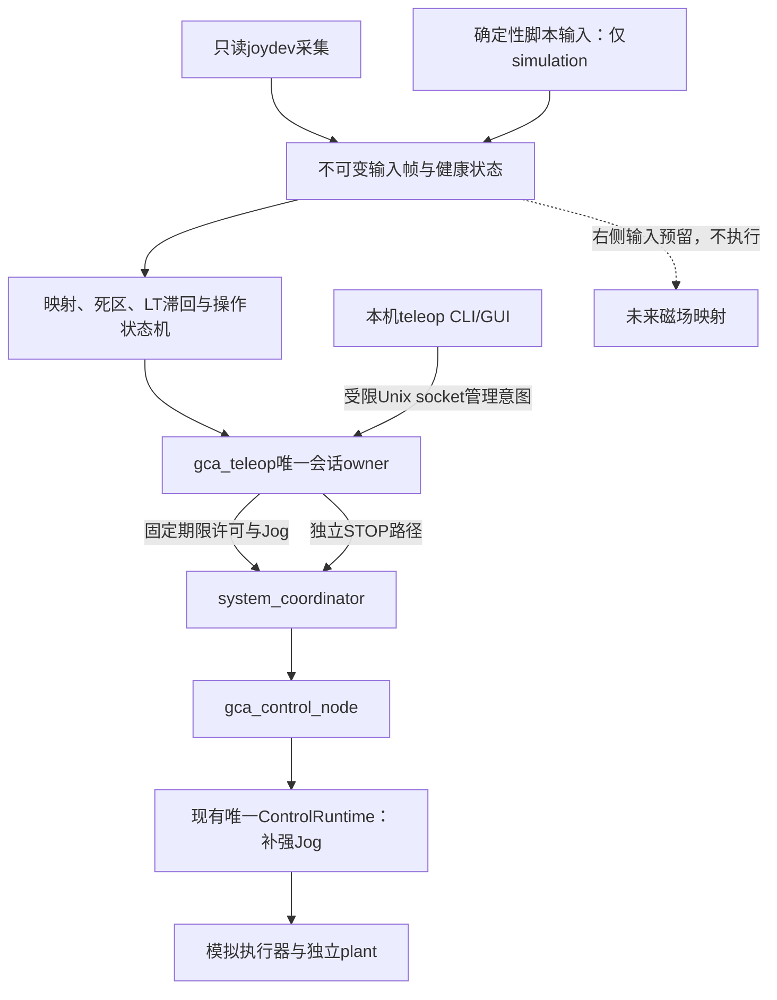

# Xbox式手柄控制GCA：实现与可控性验证方案

> **这是实现前方案与当时的历史状态。** 原始调查和未实施描述保留用于追溯，不代表当前状态。已实现行为、实际软件/实体证据及NOT_RUN边界请读 [IMPLEMENTATION_STATUS](IMPLEMENTATION_STATUS.md)，实际命令与恢复流程请读 [TELEOP_USER_GUIDE](TELEOP_USER_GUIDE.md)。

本方案依据[按键约定](TELEOP_DESIGN.md)、当前源码和2026-11-05的设备只读调查，由输入设备、控制算法、ROS运行时三个agent交叉审查后形成。**本轮交付方案、探索证据和[实现goal prompt](TELEOP_IMPLEMENTATION_GOAL_PROMPT.md)；新增手柄模块及其验收尚未完成。**

## 1. 已确认的环境与本轮证据

| 项目 | 当前事实 | 不能由此推断的事项 |
|---|---|---|
| USB接收器 | `20bc:506d`，名称 `BEITONG AXIULUO3SNS BFM DONGLE`，hid-generic/usbhid | 不是已确认型号的微软Xbox设备；USB在线不证明无线手柄在线 |
| 输入节点 | gamepad为`event5/js0`，`event4`为同接收器的Mouse接口 | 不硬编码event5/js0；重新插入可能改号 |
| 权限 | 当前pi可读js0，不可读event5；没有修改权限 | 不以root运行整个控制系统，不开放全部input设备 |
| 静态能力 | JSIOCG只读查询得到8轴、16键；轴码为X/Y/Z/RZ/GAS/BRAKE/HAT0X/HAT0Y | 实体LX/LY/LT/B的编号、符号、释放值和范围仍需逐项采集 |
| 依赖 | 已装ROS joy 3.3.0、SDL2 2.30；首期后端不新增Python依赖 | 安装joy不代表按键映射、无线失联或GCA控制已验证 |
| 设备选择 | 存在by-id的`...BFM_DONGLE-joystick`路径，uniq为空 | 名称无已证明的唯一序列号；多个匹配设备必须拒绝歧义选择 |

详细事实见[环境记录](../artifacts/teleop_planning/input_environment.json)和[输入只读探测](../artifacts/teleop_planning/input_probe.json)。本轮只做只读查询，没有读用户操作事件、写手柄、震动、修改权限或输出电机/GPIO。

已实际执行现有安装入口：

```bash
bash tools/run_simulation_suite.sh --scenarios jog \
  --output artifacts/teleop_planning/jog_baseline
```

[基线报告](../artifacts/teleop_planning/jog_baseline/report.json)中Jog通过，CLI与launch均退出0，场景墙钟约9.70s；附带的5个既有确定性模型场景也通过。DDS观察到的停止状态转换约0.301s，既不是从实体LT释放起计时，也不是最坏停止上界。此基线没有经过新手柄节点，不能当作新映射验收。

另有[核心模型探索](../artifacts/teleop_planning/core_experimental.json)，明确标记experimental、不是项目验收：当前2 mm/s设定在25%合成滑移下，独立plant稳态约1.5 mm/s；0.1 deg/s持续10秒模型时间没有规划脉冲，而连续积分约需31个边沿。必须先修控制链路，不能只加Joy消息转换。

[探索脚本](../artifacts/teleop_planning/core_experiment.py)调用当前源码的输出整形与脉冲规划逻辑，报告带源码哈希。其复现方式如下；这是源码级定位实验，不能替代后续普通安装和完整ROS路径验收：

```bash
PYTHONPATH=ros2_ws/src/gca_core .venv/bin/python \
  artifacts/teleop_planning/core_experiment.py \
  --output artifacts/teleop_planning/core_experimental.json
```

## 2. 固定用户交互

LY控制推进/后退速度，LX控制正/反旋转速度；LT按住允许运动，释放立即请求STOP；B优先软件STOP。RT、RB、右摇杆及RS只保留输入信息，不产生GCA命令。LB和其它未分配按钮不绑定ARM、参考或模式切换。

左右两轴分别做轴向死区和幅度映射，斜向输入允许两轴同时运动，不做跨mm/s与rad/s的向量归一化。默认固定`axis_mask=3`。旋转参考失效时，整个手柄双轴模式锁定；不得根据当时LX恰好为零而静默降为推进单轴。

LT不等于ARM。连接/重连、B停止、输入过期、会话或参考变化后，必须经过“LT释放且左杆回中 → 新一次LT按下”。B按住期间禁止运动；B松开不会直接恢复。普通摇杆回中可受控减速，丢弃未执行的整脉冲积压；**LT/B仍使用现有立即撤销输出和abort语义**，本轮不默认增加等待波形排空的释放模式。

abort无法确定已输出数时角度估计/参考失效，按既有流程等待停止、DISARM、必要时RESET、由操作者确认并重新设参考、显式ARM。手柄不得自动设零、清故障或恢复旧速度。B当前只作用于GCA，磁场联合停机另行定义。

## 3. 模块与正式路径



| 拟新增/修改位置 | 必要职责 |
|---|---|
| `gca_teleop/model.py`、`config.py` | 不可变InputFrame/InputHealth/Intent，严格配置、单位、epoch、时钟与资格类型；不得无约束字典贯穿控制 |
| `gca_teleop/input/joydev.py` | 唯一只读fd所有者，发现/身份匹配、非阻塞有界读取、初始化、重同步、断连与重新打开 |
| `gca_teleop/input/scripted.py` | 与实体输入相同端口的定时脚本/录制回放，仅允许模拟执行后端 |
| `gca_teleop/mapping.py`、`state_machine.py` | 标定归一化、独立死区、响应曲线、LT滞回、B优先、回中重触发、输入质量门控 |
| `gca_teleop/session.py`、`dispatch.py` | 唯一MANUAL会话、全局context序号、续租、异步许可、容量1最新输入槽、停止屏障 |
| `gca_teleop/node.py`、`management.py`、`cli.py` | ROS宿主、同owner管理入口、状态发布及有期限关闭；不直接持电机/编码器/GPIO句柄 |
| `gca_teleop/probe.py` | 纯输入发现、逐按键采集/标定、资格记录工具；不启动GCA或领取控制权 |
| `gca_core/gca/algorithms/jog_velocity.py` | 外部编码器速度PI及最终输出抗饱和 |
| `gca_core/gca/algorithms/jog_rotation.py` | 连续相位、小数余量、有限段时序、预约、换向与边界 |
| 既有runtime、ROS节点、协调器 | Jog初始化、原输入截止、全链路STOP屏障及停止优先回调组 |
| `system_bringup`、`tools`、测试 | 安装配置/launch、脚本仿真、真实手柄驱动模拟设备、报告、回归和普通安装验证 |

这是一个新增ament_python包，模块可按实现规模适度合并；不把每个模块做成ROS节点。新增输入代码不导入legacy。原CLI的有限时长Jog继续兼容，并使用同一正式协调器路径。

## 4. 首期输入后端与无线连接边界

首期选择**native Linux joydev**：`O_RDONLY|O_NONBLOCK|O_CLOEXEC`，配合`poll/select`及`JSIOCG*`，使用Python标准库。当前可直接以pi读js0，且不触发SDL haptic初始化。Linux推荐新程序使用evdev，但本工程在现有权限下把joydev封装为独立后端；evdev后续替换，不在首期维护两套完整采集栈。[Linux接口说明](https://docs.kernel.org/input/joydev/joystick-api.html)

按VID/PID、设备名称、内核轴/键映射和显式设备路径交叉确认身份；多个候选时失败。每次重新打开产生新input_epoch。每次读取有事件数、字节数和时间上限；处理短读、错误、队列积压和32位事件时间回绕，依据实际内核时钟语义建立关联，不能把读取时刻直接冒充旧队列事件发生时刻。

`JS_EVENT_INIT`是内核合成缓存基线，不是操作者新按下LT。初始化完成后再次出现INIT意味着需要重同步，必须先停止并重新门控。USB拔出可由fd错误/HUP/设备实例消失判断，不能通过不断盲试其它输入设备恢复。[Linux v6.8 joydev源码](https://raw.githubusercontent.com/torvalds/linux/v6.8/drivers/input/joydev.c)

**reader健康、状态变化、无线链路证据分开记录。** joydev只报告变化；静态握住摇杆可能没有新事件。ROS joy的autorepeat会重发缓存，不能作为无线心跳；本方案不把通用`/joy` topic作为受信运动入口。[joy 3.3.0说明](https://raw.githubusercontent.com/ros-drivers/joystick_drivers/3.3.0/joy/README.md)

两种真实输入模式共用一个采集栈：

- `event_age`默认模式：只有LX/LY/LT相关的真实有效状态变化可延长GCA独立事件有效期；右侧预留输入、死区内噪声、重复值、B释放、GUI操作及reader轮询不能续GCA旧速度。全局事件序号可以变化，但不能据此刷新左侧运动年龄。无新事件超时后停止并锁存。**静态长时间握住LT和摇杆会停止，这是保守模式的明确限制。**
- `qualified_state`默认锁定：只有独立只读资格测试确认“持LT和非零左杆时关手柄/无线断链/拔接收器，会在预先约定的D内产生中立或断连”，且记录绑定当前身份、模式、驱动、映射及可核实版本，才允许维持经确认的驱动状态。原event时间不更新；另记observation时间和`QUALIFIED_STATE_CONTRACT`。它依赖已验证的失联行为，不声称每次轮询收到了新无线报文。身份变化、资格缺失、无法满足D或无法解释的异常立即禁用该模式。

本轮实际接收器的无线资格为UNKNOWN。未来实现必须交付资格向导与失败门控，不能只翻转一个verified布尔值。无资格时可在保守模式下将真实输入送入simulation；hardware还必须同时满足手柄资格及既有设备HIL门控。没有用户配合完成输入资格，自动软件验证仍可完成，但实体映射/无线资格必须记NOT_RUN。资格测试只证明其覆盖条件，不能推广为任意无线故障均被检测。

两种模式仅能在停止确认且DISARM后切换，作废旧许可和待发工作，产生新epoch并重新执行LT释放/回中门控。每次重新打开、连接epoch、身份或profile变化都重新核验资格；资格失败进入未资格锁定状态，不能悄悄切换模式继续运动。qualified_state的观察只能来自实际reader推进，不能由发布定时器、许可回执或缓存访问刷新。断连、解析错误、reader超时优先撤销输入；不能自动切换脚本输入掩盖故障。D只是输入端失联响应界限，停止预算还须加入后续调度、命令期限及执行器响应，不能把D称为机械停止时间。

## 5. 输入契约、唯一会话与管理操作

新增`ManualInputQuality.msg`并加入`JogCommand`，至少包含source_kind、source_id、input_epoch、event_seq/time及时间来源、observation_seq/time、固定valid_until、clock_domain_id、link_evidence/qualification_id，以及程序Jog的固定episode_end。新增只读`TeleopState.msg`，发布门控原因、输入质量、期望/实际速度、停止和参考状态，不发布token。输入原始状态可用Joy作观测，不能反向订阅为控制源。

首期同一Pi运行，clock_domain_id使用Linux boot ID；跨机monotonic值拒绝比较，ROS仿真时钟不能改变实际期限。event_age截止从有效事件产生，qualified_state从满足资格契约的独立reader观察产生；两者来源明确。SCRIPT_SAMPLE每帧是真正合成样本。PROGRAMMED_JOG保持现有CLI语义：一次jog(duration)确定episode_end，后续帧不能延长这个整体期限。

协调器、设备端、core及实际I/O均取最早期限：输入valid_until、一次性nonce截止、执行租约、局部输出TTL。接收时不得重新给旧样本完整TTL，有限波形包括DIR时序的整段必须容纳在有效窗口内；控制线程冻结时I/O仍遵守原输入截止。`deadman=true`缺质量字段明确拒绝，旧CLI helper和测试一并迁移；受限`deadman=false`停止仍可用。

同一`gca_teleop` owner负责会话和全局sequence。它已领取MANUAL后，另开原CLI领取会得到CONTROL_BUSY；因此新增本机`gca_teleop_cli`管理代理：0700运行目录、0600 Unix socket、SO_PEERCRED同UID校验、有界消息/连接/超时，明确操作白名单与请求ID去重。管理请求携带预期owner实例、输入epoch、会话代次和相关版本，过期窗口不操作新实例；token只留owner内存，不通过文件或响应共享。

该代理支持显式configure/activate、claim、reference、ARM、DISARM、RESET、STOP、release和status，转入现有正式服务；不增加远程无认证ARM接口。普通launch不领取会话、不设零、不ARM。后续GUI可以使用同一代理；未来磁场输入共用同一操作者会话，不另起竞争控制权的客户端。

许可派发为“一个在途请求＋容量1最新输入槽”。event序号、reader观察序号和命令sequence分别维护。仍有效的普通在途回执可完成一次有界派发，再处理最新槽；不能因25Hz新观察或续租序号变化而永久饥饿。B、LT释放、断连、epoch变化及到期则无条件丢弃旧回执。管理/记录/发布不能阻塞采集与独立停止通道。

## 6. STOP必须贯穿整条链路

审查确认当前`/system/request_stop`未统一处理所有在途Jog，且协调器/设备的STOP与慢管理RPC共组。实现时必须补齐：

1. 以已认证STOP的`CommandContext.sequence=S`建立(session_id, authorization_generation)停车屏障，单调推进且有界保存。协调器和设备先更新屏障、清最新槽并撤销seq≤S的未用nonce，再等待停止结果。
2. 许可签发、慢许可回执、DDS接收和core dequeue都检查屏障。core.stop扩展携带context；停止闩锁在普通队列之外即时撤销输出，I/O需求附停止serial。旧Jog即使在STOP回READY后才出队也不能重开许可。
3. 客户端、协调器、设备各有独立停车通道/回调组，STOP不等待普通permit、ARM或renew RPC。不能只在teleop端清队列。
4. ARM事务捕获stop_epoch，每次await后以及最终设备enable前复核。B与慢ARM竞争时，丢弃晚响应还不够，必须保证不能发生迟到使能。
5. 新运动必须来自完成释放/回中/新LT按下的操作周期，分配seq>S；续租、旧包重发、迟到ARM和故障RESET均不能隐式恢复运动。

当前ARM重新授权会先rotate_generation，再等待设备租约和ARM响应；owner尚持前代次时STOP可能因STALE_GENERATION被拒绝，因此仅检查stop_epoch不够。须在同一当前session/source capability内建立有界的前代次STOP别名，停车同时覆盖本次交接涉及的执行代次，并取消该ARM事务。别名只允许STOP，不允许ARM、renew或reference；新owner接管立即失效。交接包括响应在途窗口：别名保留至owner明确确认新代次；交接超时则撤销ARM并停车，不能只删别名留下已使能设备。

设备端新旧执行许可交接也必须保留受认证的独立停车能力，不能因executor_token暂空或新租约回执未到而等待ARM完成。实现需明确旧凭证限权、在途新租约撤销及最终enable前检查，并测试代次提升后、租约回执前、设备enable入队及ARM响应在途四个窗口。

会话/身份校验仍在屏障更新之前；同一owner的限权代次交接不等于允许旧控制者停新控制者。普通STOP、deadman释放、DISARM、会话撤销和节点退出均要审查同一不变量，不能只修B的单一入口。

## 7. Jog核心修复与可控性定义

| 编号 | 已发现问题 | 后续实现要求 |
|---|---|---|
| JF01 | 线速度Jog仅设定舵机速度，未由外部编码器纠正滑移 | 在唯一runtime内新增速度PI：速度前馈＋外部测量速度误差，独立量纲/参数；有效新seq和真实dt只积分一次，最终限幅及量化残差一次抗饱和 |
| JF02 | 每段从confirmed角度重新舍入，细小速度永远不足一脉冲 | 连续受限相位＋小数余量；区分planned/reserved/confirmed，不把预约当执行；回中不能补追整脉冲积压 |
| JF03 | 首次/再入Jog未重建时间与速度初态，长空闲放大加速预算 | 首入/确认停止/再入显式初始化，过长dt停止而非密集补跑；包括首次线速度输出 |
| JF04 | 段内平均率忽略规划/提交空档，现有段总数＋时长不足以证明段内加速 | 用有界有限边沿/分段时序表达Jog脉冲，模拟与pigpio共同实现；验证离散边沿速度、换向和DIR时序；不宣称机械连续加速度已经实测 |
| JF05 | STOP后旧许可/队列可能重新准入 | 实现第6节端到端屏障及独立STOP调度 |
| JF06 | 输入原期限尚未贯穿最终输出 | 实现第5节质量契约，速度需求和波形均不得越过原期限 |
| JF07 | LT中止可能使旋转参考失效，双轴无法直接续操作 | 明确锁定和同owner恢复流程；不自动参考、不静默单轴降级 |

推进采用速度PI，不把摇杆意图积分成需要随后追赶的虚拟位置。回中受控减速并清理/跟踪积分，稳定零速后无爬行、无隐式HOLD。单独新增Jog速度增益和调度参数，不能套用定位PID增益，也不能使既有硬件模板继承仿真增益。

旋转相位按真实时间积分，规划相对于已接受预约端点；一次只允许有界在途段，不能靠无限预排队提高占空比。PulseSegment末尾增加可选不可变`edge_offsets_us`，默认None兼容旧位置动作调用；有限边沿时序同步落实到Jog规划、SimPulseEngine和真实pigpio构造/校验，不得收到profile后静默回退为均匀脉冲。每条波形的边沿数、最小高低时间、方向建立/保持、配置/参考/代次、整段期限都须验证；中途abort仍不能凭规划时序猜真实已发数。

低速以长期平均率和累计量化误差评价，高速还需统计段间空档；无法在能力约束内跟踪时明确限速/报告不足，不用越限追赶。只检查相邻段平均速率，不足以宣称段内加速约束；新增时序仍仅证明软件计划满足约束，实机波形由H02确认。

## 8. 可控性模拟测试与判据

分三层：纯映射/状态机与模型时钟；真实ROS进程和DDS；实际只读手柄输入驱动模拟执行器。第三层不能替代前两层的确定性竞态测试，也不属于真实电机HIL。

拟定合成profile：seed=7，左右轴独立deadzone=0.08，响应曲线指数1.5，LT按下/释放阈值0.6/0.4，最大推进2 mm/s、旋转30 deg/s，input age上限0.15s，reader心跳预算0.10s，派发25Hz，core沿用10ms模型周期。**这些是测试起点，不是实际手柄标定或安全速度。** 实体profile的索引、中心、范围、方向、资格项保持未确认，只有逐项采集后才填入。

| 测试 | 内容与必须断言 |
|---|---|
| JT01 | 设备匹配、权限不足、多个候选、8字节事件解析、短读、错误、时间回绕、INIT/溢出重同步；全部失败关闭，绝不盲选Mouse |
| JT02 | LX/LY正负、独立死区、连续/单调/奇对称幅度映射；从静止起未选分量无输出 |
| JT03 | 斜向双轴各自限速；RT/RB/右杆/RS及未分配键任意变化不改变GCA意图、不刷新GCA事件期限 |
| JT04 | LT滞回、抖动、无效值、B同时按下；B优先且释放不自启 |
| JT05 | 启动/重连/会话与参考变化后，LT已按住或摇杆不回中不得运动 |
| JT06 | event_age静态保持到期；reader仍活跃、右侧变化、缓存重复发布均不能续旧意图 |
| JT07 | qualified_state无记录/记录错配拒绝；有合成合格契约时允许静态保持，注入断链与reader冻结分别停止；合成通过不修改实体资格 |
| JT08 | 程序Jog有限episode不可延长；错误boot ID、旧epoch、旧seq、未来/过期时间拒绝；原CLI兼容 |
| JT09 | 25Hz输入及慢许可，容量1不积压、无永久饥饿；回执有效期不重置 |
| JT10 | B分别与permit申请、ACK、DDS入队、core入队及波形submit交错；停止后旧Jog不复活 |
| JT11 | 慢ARM/renew/配置RPC与STOP竞争；ARM提升代次后、租约回执前、enable入队及响应在途时STOP仍有效，不迟到使能；交接超时停车，旧owner不能影响新owner |
| JT12 | 控制线程冻结而reader/遥测活跃，最终速度需求和有限段仍按原输入期限停；不把心跳当控制授权 |
| JT13 | 推进±2mm/s阶跃，滑移0/10%/25%，噪声/延迟/死区分别变化；评估独立plant速度，不用设定值冒充反馈 |
| JT14 | 首次及长空闲后再入、加减速/换向、边界制动、饱和/解除饱和、重复反馈不积分 |
| JT15 | 0.1deg/s长时间细动、微小往返、连续换向、量化余量；完整结算计数与独立积分预期一致 |
| JT16 | 有限波形的离散时序、最小高低时间、DIR建立/保持、段间空档/占空比、预约路径限位、整段截止；注入实际pigpio适配器离线验证 |
| JT17 | 回中后无历史位移追赶/脉冲补发；LT/B立即abort及未知计数使参考失效；同owner显式恢复 |
| JT18 | 读线程/节点/客户端退出、SIGINT/SIGTERM、源续租失败、停止UNKNOWN、慢盘/慢订阅、有界日志和只清理本次进程 |
| JT19 | 相同种子和脚本可重复；至少30分钟模型时间检查漂移、相位偏差、计数去重与队列/记录容量 |
| JT20 | 新包普通安装、源码树外probe/CLI/launch/配置可用；既有全部必测软件回归无跳过 |

数值验收在实现前固定在版本化合成profile：

- 推进±2 mm/s、未饱和、噪声为0的稳态段，最迟2s后以W=0.5s窗口测独立plant平均速度；绝对误差≤`max(5%*abs(v_set), 2*encoder_mm_per_count/W)`。噪声场景另预先给出噪声余量与窗口，不能事后扩阈值。
- 普通Jog的受限目标/输出增量满足配置加速度与实际dt；执行器量化容差从实际量化单位推导。LT/B紧急撤销单独验停止行为，不套正常减速斜坡。回中并确认稳定后，额外1s的独立位移漂移≤两个编码器计数；不得补追旧位移。
- 低速旋转在完整结算、未丢弃预算的窗口内，与受限角速度独立积分结果相差≤1脉冲；0.1deg/s持续10s必须出现正确数量级的边沿，不能“始终零输出也算通过”。无失步模型和注入失步模型分别报告，后者不能要求软件凭开环自动发现失步。
- 常速旋转以跨段完整窗口W评价累计确认角/时间，目标误差门槛为`max(5%*|目标角速度|, 2*单脉冲角度/W)`；同时记录段内率、空档和占空比。有限边沿时序按整型时间量化的预算验证速度及离散加速计划，不能仅比较段均值。
- 确定性停止测试核对撤销闩锁不晚于下一规定控制/I/O调度点，旧seq≤STOP屏障无新输出。真实ROS记录输入事件→派发→设备接受→停止闩锁→停止证据各时间，不把DDS快照间隔当物理反应；等待预算由输入期限、现有stop_timeout和观测周期事先确定，超时失败并保留现场。

报告应包含原始输入/归一化值、LT/B、质量/epoch、原截止、请求/受限/接受/测量速度、外部编码器与plant真值、规划/预约/确认脉冲与机械真值、停机时间线、错误和版本。Jog没有位置到位目标，不能沿用旧通用`target_error_mm`作为手动速度误差。导出JSON、JUnit、CSV/JSONL、PNG/SVG；模型时间和ROS墙钟分开。

## 9. 实施顺序、交付与完成边界

1. 固定类型/期限/STOP屏障契约，先把JF01–JF07转成可复现回归，再修核心与接口，保存旧CLI兼容。
2. 交付probe、profile schema、joydev和scripted端口、映射/状态机及资格门控，不启动真实执行器。
3. 接通唯一session owner、独立停止、本机管理代理、安装后launch与操作流程。
4. 完成JT01–JT20及受影响旧测试，运行真实DDS脚本套件；若用户配合，再做只读实体映射和输入→simulation实验。
5. 更新文档/追踪和全部报告，执行串行普通安装验收。实体输入未做的项目保持NOT_RUN；电机/波形H01–H03保持实际状态。

统一入口仍为bootstrap/verify；新增`tools/run_teleop_suite.sh --output artifacts/teleop/latest`，由verify纳入。新增安装后`gca_teleop_probe`、`gca_teleop_node`、`gca_teleop_cli`和`teleop_simulation.launch.py`。这些是待实现产物，当前不能按它们已经存在来操作。

多agent分工：输入agent负责model/input/probe/profile；控制agent负责gca算法/runtime/设备有限时序及核心测试；ROS agent负责IDL、会话/派发/IPC/节点及相关集成测试；主agent先协调接口，统一构建、工具、文档和交叉审查。一个人运行colcon，不能同时写build/install。

分歧取舍已明确：选择joydev解决当前权限下的可交付性；选择速度PI避免回中追赶虚拟位置；选择立即STOP保护既有语义；选择一个owner避免多客户端竞争；为正常静态握持实现但锁定qualified_state，保守event_age作为默认，资格缺失不以缓存心跳补齐。未实现磁场控制、远程网关和跨机身份策略，不占用用户预留的右侧输入。
