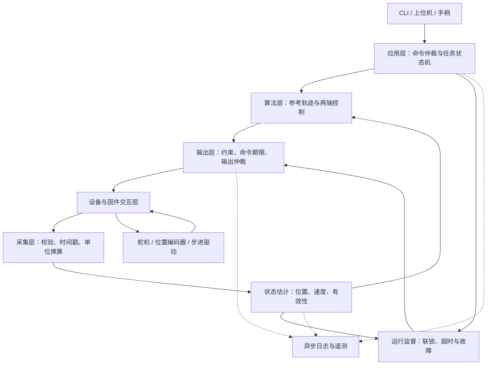

GCA 软件重构设计方案（讨论稿 v1）
================================

日期：2026-11-04。本文为项目设计，不表示接口已经实现或硬件已经验证。由架构、控制算法、运行与设备交互三个 agent 分别分析并交叉评审后汇总。

范围补充：本文描述GCA设备核心；整个系统的主设计入口是 [磁控导管系统详细设计 v0.2](ROS_SYSTEM_ARCHITECTURE.md)，包含Windows磁驱动器、上位机、ROS接口、任务编排、通信协议和验收矩阵。整体系统采用ROS 2适配与协调，核心算法和设备接口保持独立于ROS。涉及跨端接口、命令单位与系统状态的定义以主设计文档为准。

2026-11-05实施补充：[基于ROS 2的双轴实现方案](GCA_ROS2_IMPLEMENTATION_PLAN.md)确定正式运行宿主为Jazzy上的`gca_control_node`，CLI与手柄作为ROS客户端；本文后续关于独立`gca-control`服务、CLI先行、TCP入口及目录布局的建议，以该实现方案的具体部署选择为准。本文的纯算法边界、mm/deg核心单位、推进闭环与旋转开环原则继续保留。

建议采用 Python 模块化单体控制服务，运行于树莓派 4B。保留“推进闭环、旋转开环”的系统思想；推进外环输出速度，旋转使用有界、可取消的定时脉冲段。各层通过明确的数据类型与接口连接，硬件依赖集中在适配器中。

**1．设计依据与边界**

用户确认的机械功能如下：

| 自由度 | 执行机构 | 反馈 | 控制目标 |
|---|---|---|---|
| 轴向插入／退回 | 舵机 | 外部位置编码器测得的实际推进位移 | 跟踪推进位置、限制推进速度与加速度 |
| 绕轴旋转 | 步进电机 | 无实际角度反馈 | 根据脉冲数执行旋转角度与角速度指令 |

软件控制两自由度，不引入第三个夹持执行器，也不包含磁场发生器控制。编码器安装点代表的是装置测量位置，不能据此推断导管远端的真实空间位置。

从 legacy 中可追溯的硬件线索：

| 项目 | 旧代码值 | 新版处理 |
|---|---|---|
| 舵机 | DYNAMIXEL 协议，ID=1，57600 baud；目录出现 XM430-W350 | 联调前确认实际型号、固件、TTL/RS-485 接口；启动读回身份和能力 |
| 推进传动 | 舵机每圈4096计数，驱动轮半径6 mm | 作为待标定候选，不能直接当实测参数 |
| 外部编码器 | `/dev/ttySC1`，38400 baud，01/03/06 风格的串口帧 | 核实型号、寄存器、帧格式、计数回绕、更新率和多圈范围 |
| 编码器测量轮 | 有效半径约10.978 mm | 用实测位移标定 `mm_per_count`，记录版本 |
| 旋转驱动 | 目录含DM542；BOARD引脚29/31作为PUL/DIR | 核实具体驱动器、接线、有效沿、使能与电平接口 |
| 旋转换算 | 6400脉冲/电机圈，导管角/电机角=17/30 | 核实细分拨码与传动比；统一引脚编号和方向约定 |

“固件交互层”在第一版指与现有舵机、编码器、步进脉冲后端交互的软件适配层；目前没有证据表明已有自研 MCU 固件。MCU 是可替换后端，不能成为重写软件的默认硬件前提。

**2．核心架构决策**

| 决策 | 推荐方案 | 原因与边界 |
|---|---|---|
| 程序组织 | 一个 `gca-control` 控制服务，多个职责明确的任务 | 两个运动轴适合共享统一状态机；避免多服务之间状态分裂 |
| 编程语言 | Python 3，版本随树莓派系统确认并锁定 | 复用生态、方便算法和测试；脉冲时序交给专用后端 |
| 推进策略 | 位移外环 P/PI/PID → 线速度 → 舵机速度模式 | 每轮计算非阻塞；不等待舵机完成一次位置动作 |
| PID引入 | 先P验证，再按稳态误差引入I，必要时再启用D | 不预设必须使用所有三项；旧增益不可直接复用 |
| 旋转策略 | 角度轨迹 → 脉冲段 → 定时波形后端 | 保持开环，同时支持加减速、停止和执行计数 |
| 并发 | 一个控制状态写入者；每物理串口/总线一个I/O所有者 | 避免竞争访问和读写串帧 |
| 设备实现 | 真实设备、仿真设备实现同一接口 | 普通电脑即可验证大部分逻辑 |
| 用户入口 | CLI先行，上位机API与手柄作为同级命令适配器 | 所有入口统一经过权限、状态和限幅检查 |
| 第一版范围 | 单轴与双轴并发目标、停止、状态、日志、仿真 | 精确同步到达、复杂轨迹和GUI作为后续扩展 |

不将 ROS 2、Web 服务或数据库设为核心控制依赖。若后续确有集成需求，通过上位机接口适配，不把它们嵌入 PID 或设备驱动。

**3．模块分层与数据流**



| 层级 | 负责什么 | 明确不负责什么 |
|---|---|---|
| 领域模型 `domain` | 单位、命令、采样、轴状态、故障、设备接口 | 串口、GPIO、SDK、线程、文件 |
| 传输 `transport` | 有期限的字节读写、连接生命周期 | 运动目标和PID |
| 协议 `protocols` | 帧编码/解码、CRC、寄存器、异常响应 | 行程约束和控制策略 |
| 设备适配 `devices` | 设备身份、能力、原始采样、执行命令、设备状态 | 用户命令队列与轨迹规划 |
| 数据采集 `acquisition` | 采集调度、帧有效性、原始计数、时间与来源 | 计算电机控制量 |
| 状态估计 `estimation` | 标定换算、零点、回绕、滤波、速度与可信度 | 向硬件输出 |
| 算法 `algorithms` | 轨迹、PID、开环步数规划、到位判断 | 阻塞等待、读传感器、写串口 |
| 控制输出 `output` | 限速/限加速度、单位映射、命令期限、最终输出门控 | 接收任意外部原始寄存器写入 |
| 应用 `application` | 命令校验、任务生命周期、控制权、双轴策略 | 直接操作设备句柄 |
| 运行时 `runtime` | 调度、I/O所有者、邮箱、停止协调、依赖装配 | 定义PID数学规则 |
| 观测 `telemetry` | 结构化事件、控制记录、状态推送、回放数据 | 阻塞控制循环 |

依赖规则：`domain` 不依赖其他项目层；算法依赖领域数据；应用依赖抽象接口；设备适配器实现这些接口；只有 `bootstrap` 选择真实或仿真实现。DYNAMIXEL SDK 可在设备适配器内部同时承担传输和协议职责，不为了分层强行重复实现 SDK。

算法层与输出层分开：前者回答“期望怎样运动”，后者回答“这个控制量此刻是否允许发出，以及怎样转换为设备命令”。监督模块向输出门控提供许可/故障状态，不跨层抢写同一串口。

**4．领域数据与接口契约**

GCA核心接口统一采用 `mm`、`mm/s`、`mm/s²`、`deg`、`deg/s`；系统级ROS接口采用m、rad、A及相应时间导出单位，仅在ROS适配边界转换一次。计数、RPM、寄存器整数只出现在设备边界与诊断中。内部时间期限使用单调时钟；UTC时间仅用于可读日志。

建议的数据类型：

```python
EncoderSample(
    source_id, device_epoch, seq,
    request_started_ns, received_ns,
    device_sample_ns, timestamp_source,
    raw_count, valid, error_code,
)

LinearState(
    sample_seq, sample_received_ns, position_mm, velocity_mm_s,
    valid, referenced, calibration_id, reference_id,
)

RotationState(
    emitted_pulses, estimated_angle_deg,
    reference_valid, estimate_valid, engine_idle,
)

MotionCommand(
    command_id, session_id, sequence, kind,
    linear_target_mm, rotation_target_deg,
    reference_id, expiry_ms, on_complete,
)

LinearVelocityDemand(
    command_id, output_seq, generation, created_ns, valid_until_ns,
    feedback_seq, feedback_received_ns, reference_id,
    velocity_mm_s,
)

PulseSegment(
    segment_id, generation, signed_pulses,
    timing_profile, submit_before_ns, max_duration_ns,
)

OutputReceipt(
    command_id, output_seq, generation, status,
    applied_setpoint, applied_ns, error_code,
)
```

这些是接口草图，后续用有类型的不可变 `dataclass`、枚举和 `Protocol` 实现，不以无约束字典贯穿控制链路。

| 接口 | 调用者 | 契约 |
|---|---|---|
| `EncoderPort.read(deadline_ns)` | 编码器I/O任务 | 有界阻塞，返回新采样或明确失败，绝不用缓存冒充新响应 |
| `ServoPort.identify/configure/read_status/write_velocity` | 舵机I/O所有者 | 所有操作有期限，写入应答与实际运动状态分开 |
| `LinearController.update(reference, state, dt)` | 控制任务 | 无I/O；返回请求速度与P/I/D等诊断 |
| `LinearController.track_applied_output(receipt)` | 控制任务 | 接收与当前generation/输出序号匹配的最终控制量，更新抗饱和跟踪；旧回执仅记录 |
| `TrajectoryPlanner.advance(now, dt)` | 控制任务 | 返回位置/速度参考与阶段；支持连续重规划和取消 |
| `PulseEngine.submit(segment)` | 脉冲I/O任务 | 返回已接受；不代表脉冲已输出 |
| `PulseEngine.poll_completion()` | 脉冲I/O任务 | 返回已完成段及已确认输出脉冲数 |
| `PulseEngine.abort()` | 脉冲I/O任务 | 返回停止确认和可选实际已输出脉冲数 |
| `OutputGate.validate(demand, snapshot, now)` | 输出所有者 | 检查状态、generation、期限、反馈有效期、设备能力 |

采集时若设备没有采样时间戳，记录请求开始与响应结束时间，并注明是主机接收时间；不能把响应时间当成精确的物理采样时刻。时间估计和滤波延迟进入调参依据。

串口错误返回 `INVALID`，不得伪造 `0 mm`。只有收到完整有效的新响应才更新采样序号；静止时连续相同读数可以是合法新采样。通信新鲜度不能证明传感器内部一定没有冻结，还需结合运动残差和设备诊断。

**5．推进闭环设计**

```text
目标位置
  → 有速度/加速度约束的参考轨迹 x_ref、v_ref
  → 与外部编码器位置 x_meas 比较
  → 位置控制器输出 v_requested（mm/s）
  → 最终速度与加速度约束
  → 线速度换算为舵机RPM及设备原始值
  → 舵机内部速度环
  → 导管推进
```

推荐公式：

```text
e[k]       = x_ref[k] - x_meas[k]
v_raw[k]   = v_ref[k] + Kp*e[k] + I[k] - Kd*v_meas_filtered[k]
v_limited  = limit_velocity_and_acceleration(v_raw, previous_output, dt)
I[k+1]     = clip(I[k] + Ki*e[k]*dt
                      + Kaw*(v_limited - v_raw[k])*dt, I_min, I_max)
```

微分作用于测量量，以减小目标变化造成的微分冲击；D默认关闭。积分项保存的是速度贡献，增益量纲随这一输出定义确定。回算抗积分饱和使用最终限制后的控制量，不能只考虑PID内部的单个限幅器。调用顺序明确为“计算请求→施加输出约束→提交该轮积分状态”；若设备量化或再次限幅，通过 `track_applied_output(receipt)` 使用已接受的等效线速度修正跟踪。回执还需关联独立的输出序号、generation和command_id，旧任务回执不能改变新控制器。已接受的设定值不等于电机实测速率；发送失败时冻结控制器并转入停止处理，不继续累积积分。

上述公式描述同一轮更新；实际输出可能异步执行，因此PID的采样 `dt` 与限加速度采用的输出更新时间差应分别记录。输出层不得在连续输出时始终套用某个旧采样的 `dt`，停止减速流程也使用自身实际更新时间。

其他必要规则：

- `dt` 取有效采样更新的单调时钟间隔；重复快照不重复积分或求导。运行监督可更快调度，但不能借此声称外环有更高采样带宽。
- `dt` 超出允许范围、采样过期、跳变不合理、编码器重新上线均产生显式事件。长间隔后不追赶补算多轮PID。
- P/I/D状态由控制器实例持有；新任务、取消、参考系变化、故障恢复时按定义重置或跟踪，实现无突变切换。
- 单次CRC错误在仍有新鲜有效采样的短窗口内允许保留上一控制量；不得延长原采样的有效期。超过预算立即停止。
- 目标位置先经过轨迹规划；第一版用梯形速度/加速度限制，后续需要时再引入S曲线。
- 机械软限位同时约束目标和运动过程。接近边界时考虑制动距离、测量与通信延迟及余量，不等越界后才停止。
- 到位判据首先要求参考轨迹已经完成，然后最终目标与实测位置的误差、实际速度同时小于阈值并持续一段驻留时间；不能在缓慢启动时因暂时跟踪误差小而提前完成，也不能单次误差过零即算完成。
- 位置控制不等于力控制。电流、舵机理论位移与编码器位移残差可辅助诊断卡滞/滑移，不能直接作为已标定的接触力。

线速度换算使用标定的 `mm_per_servo_revolution`：

```text
servo_rpm = motor_direction_sign * 60 * velocity_mm_s / mm_per_servo_revolution
```

方向符号只在一个映射位置应用。实际半径和传动比体现在标定量中，不能在PID、输出层和协议层分别取负。

ROBOTIS官方说明 XM430-W350 的速度模式包含内部PI，支持将其作为外环的速度执行器；实际设备仍需确认型号与固件。具体硬件能力与配置行为以[官方控制表](https://emanual.robotis.com/docs/en/dxl/x/xm430-w350/#velocity-pi-gain76-78)为依据。

保留未来“位置设定值执行器”的扩展边界，但首期只实现一个推荐控制后端。若实物不适合速度模式，应重新设计非阻塞位置设定值控制器并独立调参，不能悄悄切换后端继续使用同一套增益。

**6．旋转开环设计**

输入目标角度与速度/加速度约束，生成角度轨迹，再离散成脉冲时序。相对于已建立的旋转参考，目标脉冲采用绝对换算与舍入；连续小位移保留小数余量，避免每段截断造成累积偏差。

```text
ratio = 导管角度 / 电机角度
target_pulses = round(target_angle_deg * pulses_per_motor_rev / (360 * ratio))
estimated_angle_deg = emitted_pulses * 360 * ratio / pulses_per_motor_rev
```

脉冲引擎必须满足：

- 定时生成有限段，包含明确的有效沿数、方向和时间约束；普通 Python `sleep` 不承担逐脉冲时序。
- 核实脉冲最小高/低电平时间、方向建立与保持时间；换向先减速到零再改变方向。
- 限制每段和全部排队段的总时间/脉冲数。不能靠连续堆积有限段造成实际无限执行。
- `accepted` 只表示后端接收任务；仅完成确认用于累计已输出脉冲。旧generation的完成事件可用于结算物理历史，但绝不允许由此触发后续旧任务。
- 取消时清空未执行段并停止活动段。若后端无法准确报告中途已输出多少脉冲，设置 `estimate_valid=false`，重新建立参考后才能接受绝对角度目标。
- 不按请求脉冲数、经过时间或计划轨迹伪造实际执行计数。即使脉冲计数准确，机械角度仍是开环估计，不能确认没有失步。
- 输出脉冲中断、失能后外力转动、设备重启或疑似失步均可能使参考失效；重启不直接恢复磁盘里保存的角度作为可信状态。

Pi 4B 第一版候选后端为 pigpio 定时波形，封装成 `PigpioPulseEngine`；其公开功能包括硬件定时波形，见[项目说明](https://github.com/joan2937/pigpio)。选定系统镜像后仍需验证兼容性、连续分段、取消延迟、计数可观测性和负载下的波形。若这些指标不满足要求，换成外置 MCU/脉冲控制器后端，上层保持不变。

若后续引入MCU，第一阶段仅承担脉冲定时、计数、停止和租约超时；协议包含版本、session/generation、序号、段ID、CRC、接受/完成事件及累计输出计数。MCU使用自己的时钟管理本地TTL，不能直接比较Pi的单调时钟数值。MCU重启产生新的设备epoch，使主机旧命令和角度参考失效。是否将推进外环进一步下沉，应由端到端时序测量决定。

**7．采集、调度与线程模型**

```text
gca-control 进程
  ├─ 控制/监督任务：唯一系统状态写入者，读取快照，推进状态机，计算控制量
  ├─ 编码器I/O任务：一个串口所有者，读取外部位置并发布采样
  ├─ 舵机I/O任务：一个总线所有者，优先输出，穿插状态读取
  ├─ 脉冲后端任务：提交/取消/结算有限波形段
  ├─ API任务：校验、命令仲裁、状态订阅
  └─ 日志任务：有界队列消费与文件写入
```

任务不等于必须一个线程一个类。首期可采用控制线程、设备I/O线程、API事件循环和日志线程；短时锁只用于交换不可变快照，不在锁内读串口、等待输入或等待电机到位。硬件定时服务可能是独立进程，但控制权限仍由单个应用统一管理。

采集层和输出层是逻辑模块，它们访问同一舵机串口时必须交给同一个I/O所有者执行。不能“采集线程直接read、输出线程直接write”共享协议状态。若编码器与舵机实际共用物理总线，应合并所有者和总线调度。

队列分三类：状态用“最新快照”；连续速度设定值用容量1邮箱；状态转移和执行完成用有界可靠事件队列。完成事件若丢失，不能继续宣称计数准确，必须故障处理。普通遥测可丢样并记录计数，控制停止事件不得被普通命令挤掉。

采样率和控制率不预先承诺：

| 路径 | 初期设计目标 | 确定条件 |
|---|---|---|
| 编码器有效采样 | 可配置；以稳定20–50 Hz作为初步测量目标 | 编码器实际更新率、响应延迟与丢帧率允许 |
| 推进PID | 每个有效新样本至多更新一次 | 不高于有效反馈更新率；使用实测dt |
| 监督调度 | 可先以100 Hz作为调度目标 | 仅用于期限检查；不代表硬实时保证 |
| 舵机状态采集 | 运动状态优先，温度等低频 | 与写指令共享总线，满足输出延迟预算 |
| UI遥测 | 5–10 Hz的初始显示配置 | 可降采样，完全独立于控制 |
| 脉冲定时 | 由所需转速与脉冲/圈计算 | 专用波形后端能力及实测 |

上述数字是测试起点，不是装置能力或验收指标。旧版编码器单次查询固定等待0.2秒，每控制轮查两次，另等0.05秒，仅这些等待就已约0.45秒；新版必须先测通信链路，再确定合理外环带宽。

使用单调时钟的绝对调度期限，记录实际周期、控制执行时间、样本年龄、输出延迟和超期次数。超期不通过密集补跑历史tick追赶。串口事务设置单次最大阻塞时间，停止指令至多等待当前事务的有界结束，不能假定软件优先级可以打断已发出的串口帧。

**8．状态机、停止与故障恢复**

```text
BOOT → SELF_CHECK → DISARMED → READY → EXECUTING → HOLDING
                         ↑       ↑        │          │
                         │       └─ STOPPING ←───────┘
                         └─ 显式DISARM

任意运行态 → FAULT 或 ESTOP
FAULT/ESTOP → 排除原因 + 显式RESET → SELF_CHECK/DISARMED
```

`DISARMED` 表示输出许可关闭，可采集状态和执行无运动参考设置；`ARM` 仅在配置、设备能力、所需参考和反馈满足条件时进入 `READY`。若支持运动回零，另设受限的 `REFERENCING` 子流程；无原点传感器时只支持用户确认的当前位置参考设置，不称为自动机械回零。

必须区分以下行为：

| 行为 | 推进轴 | 旋转轴 |
|---|---|---|
| HOLD | 编码器有效时继续保持目标位置外环，允许修正 | 停止发脉冲，保持使能策略按硬件定义；没有角度纠偏 |
| STOP | 取消当前目标并受控减速至零，不自动进入位置保持 | 取消后续段并执行规定的减速/停止流程 |
| FAULT_STOP | 根据反馈/通信是否可用执行零速或硬件禁止，锁存故障 | 停止/取消脉冲，无法结算时作废角度估计 |
| DISARM | 禁止新运动，并按已验证策略处理扭矩/使能 | 禁止新运动并处理使能 |
| ESTOP | 若有独立硬件通路则由其禁止驱动；软件同步锁存 | 同左；软件API不能冒充独立硬件急停 |

零速度不等于位置保持；关闭扭矩也不保证机构不会被外力推动。是否保留使能由实际机构决定。STOP完成后回到READY（设备状态已确认）或FAULT（状态未知），不自动恢复被取消的目标。

停止的执行顺序：

1. 锁存停止、关闭旧运动许可、提升 `generation`，清空旧目标/速度邮箱和未执行脉冲段。
2. 若是正常停止，发布由停止流程产生的新generation制动命令；故障停止按能力走零速/禁止路径。
3. 每个I/O所有者发送普通运动命令前复核generation、有效期、样本年龄和门控状态，拒绝过期命令。停止流程使用独立受限的 `StopDemand/DisableDemand`，允许在普通门控关闭、反馈过期或参考失效时发零速/禁止命令；它只能执行指定停止策略，不能借此提交新运动。减速可用时受控减速，反馈不可用时按预定故障策略停止，不能等待反馈恢复才发停止。
4. 处理在途命令和活动波形；接收执行状态确认，停止超时升级为故障。不能把“串口写成功”当作“电机已停止”。
5. 需要时作废位置参考。解除故障只恢复进入自检的资格，不自动ARM或重发旧任务。

这些软件规则无法撤回已经进入硬件的命令，因此总线事务期限、脉冲排队时长、设备watchdog和独立禁止路径共同决定最坏停止时间。对于开环旋转，只能确认脉冲引擎空闲和停止命令执行，机械残余运动需实验评估。

输出命令同时携带控制期限和反馈来源。I/O所有者独立检查 `valid_until` 与 `feedback_received_ns`，防止控制任务反复用冻结样本生成“新命令”掩盖采集失效。控制任务失联后，I/O所有者进入有界停止流程，停止普通运动输出。

特别注意：DYNAMIXEL Bus Watchdog 观察所有指令包，遥测读取也可能保持总线活跃；它不能替代控制命令期限。若控制停止写入未能确认，I/O所有者不能继续靠普通轮询维持原速度，应执行预定硬件禁止/停止通信以允许watchdog到期等故障策略，并报告状态未知。该语义见[官方Bus Watchdog说明](https://emanual.robotis.com/docs/en/dxl/x/xm430-w350/#bus-watchdog98)。具体支持情况在设备探测阶段确认。

第一版默认两轴组成一个运动会话：任一关键轴故障时停止整个会话，不自动以另一个轴继续完成组合动作。后续单轴维护模式可单独定义。

**9．任务与上位机接口**

对外暴露运动语义，不暴露任意寄存器写接口：

```text
GetStatus / GetCapabilities
Arm / Disarm / ResetFault
SetReference
MoveAbsolute / MoveRelative
JogStart / JogRenew / JogStop
Stop / Hold
SubscribeTelemetry
```

建议第一版 TCP 使用“一行一个JSON对象”的消息边界，限制消息长度和读超时，缓存半包并逐条解析粘包。CLI调用同一应用接口；网络层只是适配器。远程访问需控制会话身份与写权限，默认仅本机监听，配置后才开放指定网络接口。

命令示例（数值仅说明格式）：

```json
{"version":1,"command_id":"move-0042","session_id":"session-a","sequence":42,"type":"move_absolute","reference_id":"ref-7","linear_mm":20.0,"rotation_deg":90.0,"expiry_ms":500,"on_complete":"hold"}
```

`expiry_ms` 限制命令被服务器接收后的准入/排队时间，不是允许设备持续运行的时间，也不能检测命令在网络中已经延迟多久。服务器按自己的单调时钟计算期限；运动任务另有明确的执行超时。远程运动请求还须携带服务器在当前会话签发的短期 `freshness_token`，服务器记录其固定截止时间，网络迟到且token已过期的请求拒绝；到达后计算的期限不能越过token截止时间。上面的JSON省略了这一会话协商字段。持续Jog需要短期租约不断续期，断连或控制权租约过期触发停止。第一版远程运动会话默认需心跳保持，包括定位任务；不把断连后继续运动作为隐式行为。

关键语义：

- 同一时刻一个运动控制权拥有者；手柄与上位机不能互相覆盖。STOP可由已授权入口请求，恢复需当前有效会话。
- `accepted / started / completed / canceled / faulted` 分开反馈；TCP发送成功不等于完成运动。
- `command_id`与会话序号用于去重；相对运动在命令被接受时只转换一次绝对目标，重试不重复累加。
- `reference_id`不匹配拒绝；重新设零点会改变参考ID并作废旧目标。
- 正在运行时默认拒绝新定位任务；显式 `replace` 才执行有约束重规划。连续Jog采用最新有效目标；不把所有历史目标堆进FIFO。
- 双轴组合目标一次校验、一次接受，避免“推进接受而旋转拒绝”后只动一轴。任一轴启动失败取消另一轴；逻辑原子接受不等于硬件原子同时启动。
- 第一版支持共同开始意图、各轴独立运动、联合完成判定，不保证精确同步到达；需要同步轨迹时扩展共享时间参数，不能把两个线程同时start当成同步控制。

**10．配置、标定与设备生命周期**

配置分为设备接线、运动约束、算法参数、标定四类，均有schema版本。启动加载时检查类型、有限数、范围、相互约束与设备能力，硬件模式缺少关键项时拒绝ARM。仿真可提供独立示例值，不把演示值默认为实机参数。

| 配置类别 | 典型字段 |
|---|---|
| 设备 | 串口稳定路径、ID、型号白名单、协议、波特率、GPIO编号体系、使能极性 |
| 标定 | 编码器mm/count、推进mm/servo_rev、方向、脉冲/圈、传动比、参考建立方式 |
| 约束 | 行程、角度范围、最大速度/加速度、停止余量、命令与采样期限、总脉冲排队上限 |
| 算法 | Kp/Ki/Kd、积分限值、抗饱和参数、滤波时间常数、到位阈值与驻留时间 |
| 运行 | 采集率、调度率、事务超时、日志策略、API绑定地址、后端类型 |

设备优先使用 `/dev/serial/by-id` 或 udev稳定别名；不能在打开失败后盲目把另一个USB串口当作同一设备。重连先验证身份，增加device epoch并进入重新自检，不自动继续运动。

启动流程为：读取配置 → 关闭普通输出许可并创建新session/generation → 对受配置约束的端口做有界身份检查 → 立即请求设备停止、取消脉冲后端遗留波形并核验状态 → 采样与参考有效性检查 → 显式ARM。重连同样执行这一流程。设备可能保留上次运动命令，身份读取本身也可能影响总线watchdog，因此不能先长时间普通遥测再处理停止。无法确认停止则保持FAULT，不进入READY。脉冲后端的旧session完成事件只用于历史结算，不得解锁新会话。初始化不得自动运动到舵机位置0，也不得每次启动自动改变编码器硬件零位。

参考设置与几何标定分离。第一版优先软件零点，保存标定版本和参考ID；软件零点只有在设备计数连续且参考仍有效时成立。硬件置零、改波特率、固件升级属于显式维护操作，不能隐藏在普通连接函数中。

标定记录至少包含原始计数与实测位移、多点往返结果、方向、负载条件、时间和版本。切换算法参数或标定在DISARMED状态进行；以后若增加在线调参，需独立定义参数切换与记录机制。

**11．建议项目目录**

以下为目标结构，本文不创建空模块来冒充已经实现的功能：

```text
gca_code/
├── legacy/                         # 原始实验参考
├── pyproject.toml                  # 包、依赖与工具配置
├── src/gca/
│   ├── __main__.py
│   ├── bootstrap.py                # 依赖装配与生命周期
│   ├── domain/
│   │   ├── commands.py
│   │   ├── samples.py
│   │   ├── states.py
│   │   ├── faults.py
│   │   └── ports.py
│   ├── transport/serial_port.py
│   ├── protocols/encoder_protocol.py
│   ├── devices/
│   │   ├── dynamixel_servo.py       # 官方SDK适配
│   │   ├── serial_encoder.py
│   │   ├── pigpio_pulse_engine.py
│   │   └── simulated_devices.py
│   ├── acquisition/sampler.py
│   ├── estimation/
│   │   ├── linear_position.py
│   │   ├── velocity_filter.py
│   │   └── rotation_estimate.py
│   ├── algorithms/
│   │   ├── pid.py
│   │   ├── linear_controller.py
│   │   ├── trajectory.py
│   │   └── step_planner.py
│   ├── output/
│   │   ├── limits.py
│   │   ├── mappings.py
│   │   └── gate.py
│   ├── application/
│   │   ├── command_service.py
│   │   ├── motion_session.py
│   │   └── state_machine.py
│   ├── runtime/
│   │   ├── control_loop.py
│   │   ├── io_workers.py
│   │   ├── supervisor.py
│   │   └── mailboxes.py
│   ├── interfaces/
│   │   ├── cli.py
│   │   ├── tcp_api.py
│   │   └── joystick.py
│   ├── telemetry/
│   │   ├── recorder.py
│   │   └── events.py
│   └── config/schema.py
├── configs/
│   ├── simulation.yaml
│   └── hardware.example.yaml
├── calibration/
├── tests/
│   ├── unit/
│   ├── protocol/
│   ├── integration/
│   └── hil/                        # 仅显式选择时运行的实机测试
├── tools/                          # 标定、时序测量、离线日志分析
├── deploy/gca-control.service
└── docs/GCA_ARCHITECTURE.md
```

设备模块采用延迟导入：普通电脑导入算法和跑仿真时不要求安装树莓派GPIO库。驱动对象构造不触发运动；硬件连接由显式生命周期方法执行。第三方依赖通过包管理与锁定版本安装，不复制多份SDK到项目里。舵机优先封装[ROBOTIS官方SDK](https://emanual.robotis.com/docs/en/software/dynamixel/dynamixel_sdk/overview/)，自研部分集中于装置语义与运行约束。

**12．观测、回放与测试**

每次运行生成session ID，记录软件版本/构建标识、配置摘要、标定版本、设备身份和能力。控制记录包括目标、参考轨迹、原始与处理后反馈、样本序号/年龄、实际dt、P/I/D、限幅前后输出、设备写入结果、脉冲完成计数、状态迁移与故障原因。

日志由有界队列异步写出，磁盘慢或满不能阻塞控制。明确记录丢样计数和日志降级事件；需要完整记录的实验任务可以配置在丢日志后受控结束，但不能在控制线程等待磁盘恢复。绘图和统计在离线工具执行。

| 测试类型 | 必须验证的行为 |
|---|---|
| 纯算法 | 变dt、反向、到位驻留、抗饱和、速度/加速度约束、量化累计误差 |
| 协议 | 已知报文、CRC错误、短帧、粘包、超时、负计数/回绕、异常响应、设备身份不符 |
| 状态机 | 未ARM拒绝运动、参考失效、去重、控制权冲突、停止后旧generation拒绝、复位不恢复旧任务 |
| 并发集成 | 控制任务停止但采集继续、样本冻结但命令续期、STOP与输出竞争、队列满、重连 |
| 仿真 | 执行器滞后、饱和、摩擦、测量噪声/延迟、滑移、通信丢包、负载突变 |
| 实机HIL | 输出方向、单位标定、脉冲频率与计数、取消延迟、满负载抖动、断连停止、重启不自启 |

仿真可验证软件控制逻辑与失效处理，不证明真实机械性能。控制参数需在实机低速、明确行程范围的标定环境中重新整定。

验收指标参数化，实施前与装置需求一起确定：推进稳态误差、超调、最大速度、到位时间；旋转脉冲误差和外部仪器测得角度误差；采样间隔/输出延迟分布；最坏停止延迟与停止距离。0.1 mm旧阈值不直接继承为新版精度承诺。

停止预算至少覆盖：故障检测时间＋当前I/O事务剩余时间＋已排队硬件动作时间＋执行器减速/机械响应时间。通过逻辑分析仪与位移记录验证，不只依靠软件日志时间戳。

**13．部署与实施顺序**

Pi部署使用独立虚拟环境、锁定依赖、固定配置路径和systemd服务。服务重启始终进入DISARMED；不自动恢复上次运动。使用设备权限组和最小必要硬件权限；所有串口有超时，关闭流程有总期限。避免在控制进程里杀占用端口的任意进程。

| 阶段 | 交付物 | 通过条件 |
|---|---|---|
| P0 设备确认与契约 | 硬件清单、协议样例、坐标方向、标定计划、接口/schema | 型号和能力明确，未知值不冒充默认实机配置 |
| P1 无硬件骨架 | 领域模型、状态机、仿真、输出门控、命令生命周期 | 在普通电脑完成运动/停止/故障场景，旧指令不复活 |
| P2 设备适配与采集 | 舵机/编码器后端、数据质量、时序测量工具 | 单总线所有者、有效采样、明确超时与身份校验 |
| P3 推进闭环 | 轨迹、P→PI/PID、限幅、停止和日志 | 先完成方向/比例验证，再按约定误差和停止指标验收 |
| P4 旋转开环 | 定时脉冲、加减速、取消与计数结算 | 波形和脉冲数通过仪器核对；中断后参考语义正确 |
| P5 双轴与上位机 | 组合命令、租约、手柄适配、状态与部署 | 两轴故障联动、重连/重复命令/断连行为可重复验证 |

P2的只读采集先于实机运动；P1应先实现停止、故障和输出期限，再进入P3/P4。无需同时建设所有未来模块，按上述依赖顺序交付可运行的纵向功能。

首期完成的定义：实机能在已标定范围内完成推进目标与开环旋转；停止有已测量的执行行为；反馈/控制/通信失效不会继续无限使用旧指令；状态和日志能说明为何动作、为何停止；仿真与自动化测试覆盖关键失败路径。

**14．实施前需要补齐的信息**

以下不阻止架构设计，但决定实机配置与性能目标：

1. 舵机准确型号、固件版本、接口、电源及可用watchdog能力。
2. 外部编码器型号、协议手册、内部分辨率/更新率、实际安装方式和掉电行为。
3. 步进驱动器型号、细分、传动比、使能接线、是否存在原点/限位/独立停止通路。
4. 推进行程、目标速度/加速度、期望精度；旋转范围、转速及允许累计旋转限制。
5. 到位后需要持续位置保持还是停止输出；断连策略与最大允许停止距离。
6. 树莓派系统镜像及位数、现有串口扩展板；是否允许新增MCU（首期方案不要求）。

这些值确认后写入设备配置、标定与验收标准；不改变模块边界。多agent讨论的最终取舍是：先建立统一领域模型、状态机和可观测的输出链路，再接入与调试控制算法，避免再次让硬件操作、PID和线程编排混在同一个脚本中。
