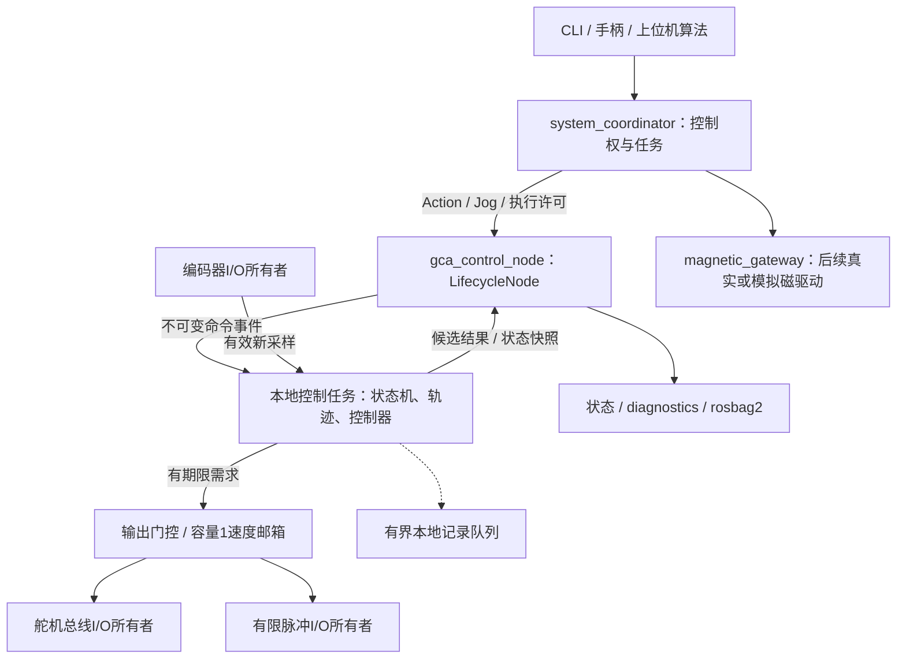

基于 ROS 2 的导管／导丝双轴控制实现方案
=====================================

| 属性 | 内容 |
|---|---|
| 版本／日期 | v1.0，2026-11-05 |
| 对象 | 树莓派上的轴向推进与绕轴旋转；保留系统联合编排接口 |
| 运行基线 | 当前 Pi 4B，ARM64，Ubuntu 24.04，Python 3.12，ROS 2 Jazzy |
| 状态 | 实现方案与旧代码审查；本文不代表新代码已实现或缺陷已修复 |
| 形成方式 | 旧代码审查、ROS 2 运行架构、运动控制三个 agent 独立分析并交叉讨论后整合 |
| 系统契约 | [系统详细设计 v0.2](ROS_SYSTEM_ARCHITECTURE.md) |
| 控制原理 | [GCA 设备核心设计](GCA_ARCHITECTURE.md) |

本版将 ROS 2 确定为正式运行框架：启动、生命周期、运动 Action、手动目标、控制权、参数、诊断和记录均通过 ROS 2 组织。算法与设备接口保留无 ROS 依赖的边界，以便直接测试和替换硬件；正式运行不再并行启用旧 TCP 运动服务器。本文细化旧文档中的部署建议，不改变系统单位、推进闭环、旋转开环及 Windows 磁驱动的职责边界。

**1．范围、现状与取舍**

首期交付轴向定位、绕轴定位、双轴组合定位、短租约 Jog、停止、位置保持、显式参考设置、故障恢复、仿真及实验记录。双轴一次准入、联合完成；首期不保证精确同时起动或同步到达。Windows 电流控制沿用系统文档，通过协调器对接，不能阻塞本地双轴软件开发。

当前 Pi 已验证 `rclpy`、Action 和诊断消息可导入，具备 `colcon`、ROS launch、rosbag2、串口库、pytest 和 YAML 库。当前 Python 环境未发现 DYNAMIXEL SDK、pigpio、RPi.GPIO。安装缺失依赖不等于硬件验证完成；未打开串口、未设置 GPIO、未运行旧运动程序。

| 已确定的实现选择 | 边界 |
|---|---|
| Python 3.12 + rclpy/Jazzy，使用现有系统 | 不因重构先换系统或新增 MCU |
| 一个 GCA 设备进程统一管理两轴 | 不将采集、PID、限幅各拆成 ROS 节点 |
| 位置外环输出线速度，舵机采用已核实的速度模式 | 型号或模式不支持时拒绝启用，另行评审执行后端 |
| 有限硬件定时波形驱动旋转 | Python sleep 和 ROS timer 均不承担逐脉冲定时 |
| ROS 是唯一正式命令入口 | CLI、手柄和非 ROS 网关都作为客户端，不持有设备句柄 |
| 无硬件环境先完成可运行流程 | 仿真通过不作为实机精度、停止距离或电气兼容证据 |

**2．旧代码问题与必须落实的修复**

审查以功能相对完整的 `use_PIDController` 为主，并核对 `PID_thread`、`use_JoyStick`、`SteeringGearControl` 的分支。下表的行号以本次审查时文件为准。P0 表示进入实机运动前必须解决，P1 表示首版发布前必须解决；均不是已修复声明。

为缩短表格，源码缩写对应以下文件：

| 缩写 | 源码 |
|---|---|
| M | [use_PIDController/main.py](<../../legacy/Magnetically controlled guide wire thruster/use_PIDController/main.py>) |
| S | [use_PIDController/motor.py](<../../legacy/Magnetically controlled guide wire thruster/use_PIDController/motor.py>) |
| E | [use_PIDController/encoder_func.py](<../../legacy/Magnetically controlled guide wire thruster/use_PIDController/encoder_func.py>) |
| P | [use_PIDController/PID.py](<../../legacy/Magnetically controlled guide wire thruster/use_PIDController/PID.py>) |
| R | [use_PIDController/stepper_func.py](<../../legacy/Magnetically controlled guide wire thruster/use_PIDController/stepper_func.py>) |
| I | [use_PIDController/steering_func.py](<../../legacy/Magnetically controlled guide wire thruster/use_PIDController/steering_func.py>) |
| U | [use_PIDController/toolfunc.py](<../../legacy/Magnetically controlled guide wire thruster/use_PIDController/toolfunc.py>) |
| T | [PID_thread/main.py](<../../legacy/Magnetically controlled guide wire thruster/PID_thread/main.py>) |

| 编号／优先级 | 已确认问题与证据 | 新版修复契约 | 回归用例 |
|---|---|---|---|
| B01／P0 | S:324–336，`move_pos` 无期限等待；M:63 在外环中调用 | 取消阻塞位置动作；每个新样本计算一次速度需求，I/O 有事务期限 | T01、T08 |
| B02／P0 | P:9–13，积分和微分未使用 dt，无抗饱和 | 真实采样 dt、积分限值、最终输出回算、显式复位 | T01 |
| B03／P0 | M:52、54，同轮查询两次编码器；E:85 每次固定等待 0.2 s | 一个有效原始采样产生一个不可变状态快照，控制与日志引用相同 seq；采样率实测 | T02 |
| B04／P0 | E:20、39、63、83、144，CRC 按数值位长转字节，可能不足两字节 | CRC16 固定两字节、小端；长度不足不参与解码 | T03 |
| B05／P0 | E:87–105，只检查 CRC 后按内容解码，缺精确帧长度、地址、功能码、异常帧及寄存器语义校验；负计数规则写死 | 有界流式解析；响应必须匹配请求；回绕及有符号规则依据实际手册 | T03 |
| B06／P0 | S:108–156、179–201，短帧索引及响应参数长度检查不足，可能把 CRC 当位置数据 | 使用官方 SDK 封装舵机协议；仍检查通信结果、设备错误、响应长度和设备身份 | T04 |
| B07／P0 | M:99–113，步进内层循环不检查退出事件，等待首目标时也不能退出 | 有界状态推进，无无限内层运动循环；独立停止标志优先处理 | T05 |
| B08／P0 | R:12–16、26–30，用 sleep 定脉冲；R:40 的 stop 只改 DIR | 定时有限波形；停止明确取消待执行段、停止活动段并核验 idle；按能力处理使能 | T06、H02 |
| B09／P0 | M:118–122，软件循环后直接累计脉冲；R:51 向零截断角度换算，无中止后的可信度 | 分离已规划、已接受、已确认输出计数；目标舍入及余量累计；未知中止作废角度估计 | T06 |
| B10／P0 | I:8–25 无限重连、盲试端口、启动自动移至舵机 0；M:176–180 自动改编码器配置和零位 | 稳定设备标识、有界探测、先处理遗留输出、显式 ARM；参考与维护操作分离 | T07 |
| B11／P0 | M:136–144，单次 recv 当完整报文；空包可能使用未定义变量、单字段包越界，两轴独立入队可只执行一轴 | 正式入口改为有类型 ROS Action；全目标校验与一次准入；可选网关定义帧边界与上限 | T09 |
| B12／P0 | M:161、183–184、209，监听全部网卡，无控制权／期限／去重，目标队列和连接线程无界 | 单会话、序号、token、租约；队列有界、Jog 容量 1、限制网关连接；权限见第 10 节 | T10、T11 |
| B13／P0 | M:215–239，退出只置事件并无限 join，未确认设备停止；use_JoyStick/main.py:174–187、292–300 仅输入状态改变时写速度，退出未确认零速 | 有期限停止先于关闭；手柄仅在新鲜有效输入且使能键按下时续Jog；拔出／异常／退出不再续旧速度 | T05、T08 |
| B14／P1 | M:33、44，以 -1 表示无目标，与合法负位置冲突；M:74–76 单次误差判断到位 | Optional／显式任务状态；轨迹完成、误差、速度、驻留联合判断 | T01、T09 |
| B15／P1 | M:67–72 仅裁剪两条数组，setpoint 无界增长且绘图长度不一致；控制链同步 print | 同一条有界控制记录包含目标、采样与输出；异步写盘、丢样计数、离线绘图 | T12 |
| B16／P1 | U:47–103 自动查杀端口占用者，另有 lsoft 拼写、pid 未初始化、管道参数及句柄泄漏问题 | 删除自动查杀功能；启动冲突明确报错退出，由部署工具管理进程 | T13 |
| B17／P0 | T:26–46 在锁内执行输入和设备 I/O；T 顶层连接与运动；DM542/DMdriver.py 顶层 GPIO 输出 | import／构造无硬件副作用；短锁仅交换快照；硬件生命周期显式执行 | T14 |
| B18／P0 | S:286–297，模式／扭矩切换未逐步核对；S:300–313，速度读取失败仍换算 None，电流校验后再次读取返回 | 模式配置事务逐步验证，ARM前核对安全零速；类型化采集结果，一次读取保留质量 | T02、T04、T07、H01 |
| B19／P0 | M:25–30、87–88、116，轮径、增益、引脚、细分与传动比散落硬编码，缺限位／制动距离 | 版本化配置和标定、能力探测、目标与过程限位、独立停止预算 | T15、H01、H03 |
| B20／P1 | 各目录含多套 motor／PID／SDK；Dynamixel_Control/vel_control.py:5–44 是 MX-12A／协议 1.0 示例，主 S 是协议 2.0 风格 | 单一包导入路径、依赖锁定、型号白名单与控制表；不混用旧示例 | T14、H01 |

审查精度说明：主 M 中的 `lock` 只保护数组，不能据此声称该主路径已发生舵机多线程读写；单总线所有者是新版必须维持的约束。S 的 `read_int` 已使用 signed=True，不将负数问题误报为一律无符号解码。旧字符串校验拒绝字面量 NaN，但超长十进制字符串可转换为 Infinity；新版统一检查有限数、长度和范围。R:61 的 `is not ''` 也不再保留。

两个可重复的纯软件证据：

```text
编码器 CRC：01 03 00 24 00 02 → CRC=0x0084
旧实现编码为 84，正确两字节编码为 84 00。

舵机状态帧：ff ff fd 00 01 04 00 55 00 a1 0c
这是没有位置参数的状态帧。旧检查可接受该帧，随后读取四字节位置时
可能把 CRC a1 0c 解成 3233；新版必须返回响应长度错误。
```

上述只用于协议回归，不表示这些寄存器请求适合未知型号实机。不得为审查直接 import 会自动运动的旧模块。

**3．ROS 2 节点与本地运行结构**



`gca_control_node` 是正式设备宿主；本地控制与 I/O 线程受该节点生命周期管理。控制循环使用本地单调时钟和可中断等待，ROS 回调仅负责校验、消息转换、投递事件与结果桥接。不得在回调中直接读串口、等待运动完成或生成脉冲。

| 执行单元 | 独占内容 | 通信方式 |
|---|---|---|
| 本地控制任务 | 双轴运动状态、参考轨迹、PID、任务执行上下文 | 不可变快照、有界命令／回执队列 |
| 编码器 I/O 所有者 | 编码器连接、请求解析、采样序号 | 最新采样快照；独立异常事件 |
| 舵机 I/O 所有者 | 同一物理总线的读写、模式配置、停止与 watchdog 处理 | 容量 1 速度邮箱、优先停止标志、可靠回执 |
| 脉冲 I/O 所有者 | 波形资源、方向、段生命周期、完成与中止结算 | 有界段队列、优先停止、完成事件 |
| ROS executor | Action／Service／Topic、生命周期、结果桥接 | 不操作硬件句柄 |
| 日志任务 | 文件与日志轮转 | 有界队列，控制侧不等待磁盘 |

实际共用物理总线的设备必须合并 I/O 所有者。普通运动、停止、遥测读回均由同一所有者串行访问该设备。I/O 所有者在控制任务冻结时仍检查本地期限并发起受限停止，但不能宣称能抵御整个 Python 进程或操作系统冻结；后者依赖设备 watchdog、有限波形和已验证的禁止通路。

建议包布局如下；这是对旧文档“建议目录”的具体化，当前尚未创建这些软件包。`gca_core` 的 Python 模块名使用 `gca`，通过 ament_python 安装，不另保留一份重复核心。

```text
ros2_ws/src/
  gca_system_interfaces/       # ament_cmake：msg、srv、action；沿用系统级接口包名
  gca_core/                   # ament_python；Python gca 包不依赖 rclpy
    gca/domain/               # 不可变类型、枚举、端口协议、状态
    gca/algorithms/           # 轨迹、PID、量化及到位判据
    gca/protocols/            # 编码器帧；不重复手写 DYNAMIXEL SDK
    gca/devices/              # 真实、仿真与故障注入后端
    gca/runtime/              # I/O所有者、输出门控、时钟、停止流程
  gca_ros/                    # LifecycleNode、Action桥接、消息／单位转换
  system_coordinator/        # 会话、控制权、GCA-only及后续联合任务
  system_bringup/             # launch、配置、启动自检、记录配置
  operator_gateway/           # 可选；非ROS客户端入口
  magnetic_gateway/           # 系统联合阶段加入
tests/                       # 协议样例、跨包集成与显式HIL
tools/                       # 标定、波形测量、离线日志分析
docs/
legacy/                      # 只读实验参考，不进入运行时 import 路径
```

**4．数据契约与单位**

ROS 接口使用 m、rad、s；GCA 内核沿用 mm、deg，在 `gca_ros` 边界转换一次。轴向正方向为插入；旋转采用有明确观察方向的累计角，不按 2π 自动取模。原始计数、RPM、寄存器单位只在设备边界与诊断中出现。

| 类型 | 必须保留的信息 |
|---|---|
| CommandContext | session_id、task_id、command_id、generation、sequence |
| DeviceSample | source_id、device_epoch、seq、请求起始与接收时间、时间来源、原始值、valid、错误 |
| LinearState | position、velocity、位置／速度有效位、referenced、sample_seq、sample_received_ns、reference_id、calibration_id |
| RotationState | confirmed_pulses、reserved_pulses、estimated_angle、estimate_valid、reference_valid、engine_idle |
| OutputDemand | command_id、output_seq、授权generation、本地output_generation、设备epoch、created_ns、valid_until_ns、反馈seq及时间、配置／参考版本 |
| OutputReceipt | 对应输出序号与代次、接受的等效设定值、应用时间、错误；不冒充实测速度 |
| StopStatus | requested／in_progress／confirmed／unknown、每轴证据、停止原因和截止时间 |

`device_epoch` 在设备重连／重启时变化；本地进程另有 boot_id。授权generation由协调器管理，本地output_generation用于设备内部停止／保持交接；输出同时检查两者，本地增代不能替代新的上游授权或延长其租约。序号仅在对应上下文内比较。无有效数据时保留显式无效状态，不填 0 或目标值；重复值可以是合法新采样，重复快照不能冒充新采样。数值、字符串、序号与数组均设置范围和长度上限。

**5．ROS 接口、Action 与生命周期**

继续使用系统文档的命名空间和 `gca_system_interfaces`，不再建设另一套与系统契约平行的双轴接口。

| 接口 | 类型 | 首期行为 |
|---|---|---|
| `/system/claim_control`、`renew_control`、`release_control` | Service | 唯一控制会话及租约 |
| `/system/arm`、`disarm`、`reset_fault`、`request_stop` | Service | 短请求，返回受理与操作ID；状态报告实际结果 |
| `/gca/execute_motion` | ExecuteMotion Action | 轴掩码、绝对／相对目标、限制、终态策略与超时 |
| `/gca/jog` | JogCommand Topic | 协调器授权的短期速度需求，最新合法序号覆盖 |
| `/gca/set_reference` | Service | 仅 DISARMED 且确认静止时设置所选轴参考 |
| `/gca/get_capabilities`、`get_command_status` | Service | 查询设备能力、按 command_id 查询接受／执行／拒绝／终态 |
| `/gca/state`、`/system/state` | Topic | 实测推进、估算旋转、参考与质量、运行状态、停止进度 |
| `/diagnostics` | DiagnosticArray | 采样年龄、事务错误、队列、租约与执行端健康 |

`/system/manual_target` 保持为上位机手动入口；协调器转换为 `/gca/jog`。GCA-only 模式不依赖 Windows 可用，但必须是显式选择的运行配置；联合任务不能静默降级为 GCA-only。

ExecuteMotion 的字段草案如下，后续据此生成正式 IDL：

```text
Goal:
  CommandContext context
  MotionTarget target             # axis_mask、ABSOLUTE/RELATIVE、m/rad、reference_id
  MotionLimits limits             # m/s、m/s²、rad/s、rad/s²
  uint8 end_policy                # UNSPECIFIED=0 / STOP=1 / HOLD=2；拒绝0
  string freshness_token
  float64 admission_timeout_s
  float64 execution_timeout_s
Feedback:
  uint8 phase
  GcaState state
  float64 elapsed_s
  StopStatus stop
Result:
  uint8 outcome                   # SUCCEEDED / CANCELED / FAILED
  string error_code
  string message
  GcaState final_state
  bool outputs_held
  bool stop_confirmed
```

目标拒绝 NaN、Infinity、未知枚举、非法掩码、超范围限制和过期许可。相对目标只在准入时基于同一有效快照转换一次；同 command_id 重试不能重复累加。只校验所选轴的目标及参考能力，未选轴必须保持已确认停止，不能继承前任务的 HOLD。执行中首期拒绝新定位，不实现隐式抢占或无缝重规划。

原生 Action 的目标响应仅有接受／拒绝，不能假设它自带自定义拒绝原因。客户端用 command_id 查询有界状态记录；活动命令不得被缓存淘汰。相同 command_id、不同载荷返回冲突；以新 Action UUID 重发已存在命令时拒绝重复执行，并提供原命令状态查询。结果淘汰后仍保留会话sequence高水位，拒绝旧序号；重试及查询也要核对当前身份与epoch，缓存回执不能授予新运动许可。协议重试与 Action 目标生命周期分开建模。

**5.1．Action 的具体并发实现**

本机 Jazzy 的 ActionServer 默认接受所有目标、默认拒绝取消；必须显式实现 goal_callback、cancel_callback 和 handle_accepted_callback。其 execute 由 executor task 调度，不能假设 callback group 自动串行化执行体。[依据：Jazzy ActionServer 源码](https://raw.githubusercontent.com/ros2/rclpy/jazzy/rclpy/rclpy/action/server.py)。

实现使用 `MultiThreadedExecutor`，线程数作为部署配置测量确定。显式保留 callback group 对象：

| 回调组 | 成员与约束 |
|---|---|
| action_group：MutuallyExclusive | goal、cancel、handle_accepted 和结果桥接 guard condition；统一提交 Action 终态 |
| management_group：MutuallyExclusive | 生命周期与管理请求；仅短操作，过渡期可有明确上界的本地停止等待 |
| telemetry_group：MutuallyExclusive | 发布快照与诊断；不访问设备，不推进控制器 |

回调组约束仅覆盖所属回调，不能代替核心状态的单写入者或线程间同步。禁止回调内同步 Service 调用、嵌套 spin、`spin_until_future_complete` 和长时间 `sleep`。异步上游调用采用 `call_async`／Action future 与事件推进。[依据：ROS 2 回调组与死锁说明](https://raw.githubusercontent.com/ros2/ros2_documentation/jazzy/source/How-To-Guides/Using-callback-groups.rst)。

Action 桥接按以下顺序实现：

1. goal_callback 对快照做准入检查，在短锁下预留唯一目标槽及事件队列容量；返回 ACCEPT 只表示预留成功。预留有截止时间，接入异常不得永久占用。
2. handle_accepted_callback 先通过 executor 创建 rclpy Future，登记 Action UUID／command_id与future的映射，再投递 StartRequested，最后调用 `goal_handle.execute()`。控制任务执行前重新检查状态、会话、epoch、参考和期限；过渡期间失效则终结失败，不输出运动。
3. `async execute_callback` 只等待已登记的terminal_future并返回 Result，不轮询、不操作硬件、不自行调用终态转换。不使用未建立 asyncio 事件循环的 `asyncio.sleep`。即使目标立即完成或在执行协程开始前取消，也必须已有可结算的映射。
4. 核心产生 MotionReached 等候选结果，写有界桥接队列并触发 guard condition；结果桥接回调负责 goal_handle 的 succeed／canceled／abort，以及 future 完成。跨线程通知显式唤醒 executor。
5. cancel_callback 在 action_group 内锁存取消、设置优先停止标志，返回 ACCEPT；不当场调用 canceled。rclpy 完成 CANCELING 状态转换后，同组结果桥接才能提交取消终态。
6. 取消先锁存时抑制迟到的成功候选，等待停止证据；停止确认后 canceled，停止超时／未知则 abort，Result 为 FAILED 并保留取消原因。成功已提交时拒绝之后的取消。两种顺序各只有一个终态。
7. 桥接提交结果后向核心回送终态提交事件。核心在提交前不对外宣称最终 SUCCEEDED；结果队列溢出或映射丢失触发故障，不丢弃完成事件后继续运行。

停止 Service 引起的任务中断可返回应用层 CANCELED，但若没有经过 ROS Action 的 CANCELING 转换，ROS goal 使用 abort；不得从 EXECUTING 非法调用 canceled。原生 CancelGoal 则遵循上述 CANCELING 路径。[状态依据：ROS 2 Action 设计](https://design.ros2.org/articles/actions.html)。

**5.2．生命周期与运动状态分别管理**

| Lifecycle 操作 | 本地行为 |
|---|---|
| configure | 校验配置、创建资源，I/O所有者有界连接／识别，处理遗留输出并检查停止；不自动移动或设零 |
| activate | 接通应用事件处理和必要遥测，运动状态仍为 DISARMED；等待显式 ARM |
| deactivate | 先撤销普通输出许可，发起有期限停止；完成后停普通业务。超时保留 FAULT／UNKNOWN，不能报告停止成功 |
| cleanup／shutdown／error | 仍先处理停止并结算结果，再按总期限释放线程、串口和波形资源；不自动重发历史动作 |

LifecycleNode 不会自动禁止普通 Action、Service 或订阅中的运动逻辑；本方案显式在准入和输出两处检查 lifecycle_active、ARM、许可和状态。诊断与停止入口在过渡和故障时仍需可用，必要的健康状态使用明确管理的普通 publisher，不误依赖 inactive 的 LifecyclePublisher。[实现依据：Jazzy LifecycleNode 源码](https://raw.githubusercontent.com/ros2/rclpy/jazzy/rclpy/rclpy/lifecycle/node.py)。

若生命周期回调需要等待停止，它只等待本地控制／I/O任务设置的完成事件，期限明确，不等待同一 executor 的回调、Service 或 guard condition。停止完成与 Action 结果提交分开，避免 deactivate 占住线程后自我等待。正常停机可先发异步停止、确认后再请求生命周期转换。

**6．轴向推进实现**

控制链为：外部编码器 → 有效位置／速度估计 → 受约束参考轨迹 → 位置外环 → 线速度约束 → 型号适配 → 舵机内部速度环。舵机位置只作诊断与滑移残差，不替代外部反馈。

速度模式启用采用显式配置事务：核实型号与能力 → 撤销普通输出并按设备规则确认扭矩／输出禁止 → 配置并核对运行模式、限制及watchdog → 写入并读回安全零速目标 → 仅在显式ARM条件通过后允许使能。每一步都核对通信结果、设备错误和必要读回；任一步失败不得继续使能。重连、模式切换后同样执行，不能恢复残留的非零GoalVelocity。

**6.1．采集与状态估计**

- 串口设置读、写与整笔事务期限；按预期帧长度增量接收，校验站号、功能码、字节数、异常响应、CRC和请求关联。不能用固定 sleep 加 in_waiting 认定一帧完成。
- 首版每条设备连接最多一个在途请求；设备协议没有事务ID时，超时后的迟到帧必须通过静默窗口／排空及重新同步等已验证策略隔离，不能误配给下一次查询。
- 仅完整有效的新响应更新采样 seq；若设备无采样时间戳，记录请求起始与接收时间，标明主机时间，不能称为精确物理采样时间。
- 按实际计数协议处理负数、回绕和重连；以标定的 mm_per_count 换算，再应用软件参考。设置软件参考不会改写编码器硬件零位。
- 速度由有效新采样及真实 dt 估计并适度滤波；首次采样或长间隔后速度暂时无效，不能默认为 0 来满足到位条件。通信正常不能证明编码器内部未冻结，结合可用的设备诊断和运动残差检测。

**6.2．轨迹与控制器**

首版采用速度／加速度受限轨迹；根据当前位置、速度和制动距离处理起步、反向、限位与停止，不将突变目标直接喂入 PID。外环每个有效新样本至多更新一次，dt 超限进入停止／重建状态，不补算多轮。

```text
e = x_ref - x_measured
v_raw = v_ref + Kp * e + I - Kd * filtered_v_measured
v_limited = apply_velocity_acceleration_and_boundary_limits(v_raw)
I_next = clip(I + Ki * e * dt + Kaw * (v_limited - v_raw) * dt)

servo_rpm = direction_sign * 60 * v_limited / mm_per_servo_revolution
```

先 P，再按稳态误差引入 I，D 默认关闭。积分状态保存速度贡献；新任务、参考变化、故障与停止按契约清零或跟踪。控制采样 dt 和输出更新间隔分别记录，限加速度使用实际输出间隔。方向只在设备映射中应用一次。

异步设备回执的抗饱和不得重复回算：每个 output_seq 保存本轮 dt、v_raw 和已使用的 v_limited；若需要按设备最终量化设定值追加校正，只对 `v_applied_setpoint - v_limited` 的残差结算一次。重复、旧代次和不再关联当前控制器的回执只记录。写入失败冻结正常控制并停止，不继续积分。

到位需同时满足：参考轨迹完成、有效新反馈、最终位置误差在阈值内、有效测量速度足够小，并连续驻留。任一条件失效重置驻留。STOP 终态还要确认停止；HOLD 终态转入显式保持上下文，不把“轨迹完成”视为输出已关闭。

软限位同时限制目标和过程；边界余量至少考虑制动距离、检测／I/O延迟和标定不确定度。基本估算可使用 `v²/(2*a_brake) + abs(v)*T_delay + margin`，但 a_brake、T_delay 和 margin 必须实测，不能用公式替代最坏工况停止距离验收。

**7．绕轴旋转实现**

累计角度目标先转换为绝对目标脉冲，保持小数余量，禁止每段 `int()` 截断。定义 r 为“导管角／电机角”，P 为每电机圈脉冲数：

```text
target_pulses = round(target_angle_deg * P / (360 * r))
estimated_angle_deg = confirmed_pulses * 360 * r / P
```

P、r、方向、电平、有效沿、DIR建立／保持时间和使能策略均来源于接线及标定。旧 BOARD 29/31 对应 BCM 5/6；若采用 pigpio，应明确用 BCM 编号，不能把旧数值直接传入。换向先减速到零并满足方向时序。

后端统一提供 `identify/capabilities/submit/poll/abort/close`。submit 返回接受与段ID；完成事件包含段ID、generation、后端epoch和已确认输出数；abort 可以返回“精确计数不可用”。

| 计数 | 含义 | 可否作为已执行角度 |
|---|---|---|
| planned | 轨迹期望的脉冲端点 | 不可 |
| reserved | 已接受但尚未结算的活动／排队脉冲 | 不可；规划下一段时必须计入，防止重复规划 |
| confirmed | 完整完成证据对应的已输出脉冲 | 可用于开环估算，不能证明机械没有失步 |

首版真实后端优先验证单个有限波形，活动段及总预约时长均有上限，不使用 repeat／forever。每段执行许可在设备端检查；整段必须落在可允许的输出窗口内。控制任务冻结后不再自动续段。若需要双缓冲或波形拼接，再单独验证连续性、停止界限和计数可追溯性。

pigpio 是候选后端，不是已验证依赖。其 `wave_send_once` 返回值不是脉冲计数；busy／idle 和停止调用状态不能给出中途精确执行数。可在无中止、无重连且完整完成证据可靠时结算一个有限段；中途中止、完成证据丢失或后端重启均使估计无效。兼容性及波形必须在当前 Pi 镜像实测。[依据：pigpio 官方实现](https://github.com/joan2937/pigpio/blob/master/pigpio.py)。

估计无效后拒绝所有依赖累计角参考的绝对和相对定位；首版也不自动降级为无参考 Jog。用户在确认静止后显式重新建立参考。没有原点传感器时，该操作只是参考设置，不声称机械自动回零。

旋转完成条件是量化目标脉冲数等于已确认数、后端 idle、无未结算段。零脉冲目标可逻辑完成但须报告量化后的目标；角度容差应包含半脉冲量化误差。状态与结果始终标记“开环估算”，机械残余转动和失步通过外部仪器验证。

若候选后端不满足波形、停止或计数契约，先限制／禁用实机旋转能力，再评估定时控制器或 MCU；上层 Action 和状态接口不变。不以普通 GPIO 库的安装成功作为定时后端通过证据。

**8．状态、许可与停止**

沿用系统状态：INITIALIZING、DISARMED、READY、EXECUTING、HOLDING、STOPPING、FAULT、ESTOP。控制模式与任务阶段独立保存。配置和所选轴能力／参考通过后才允许 ARM；关键轴故障停止整个双轴会话。

输出所有者在每次正常写入前检查：设备epoch、会话和generation、输出序号、valid_until、反馈seq及年龄、参考／配置版本、设备能力及本地许可。检查与提交按同一所有者顺序执行；已经进入硬件的指令不能撤回，必须计入停止预算。停止标志拥有独立容量，不会因普通队列满而丢失。

| 操作 | 推进 | 旋转 |
|---|---|---|
| STOP | 取消目标，按已验证策略减速／零速；不自动保持位置 | 取消预约段、终止／减速活动段，结算计数；未知则作废估计 |
| HOLD | 有效新采样继续位置外环，保持租约和输出期限 | 不再发脉冲，使能策略依设备定义；不具备角度纠偏 |
| DISARM | 撤销运动许可，完成停止并按验证策略处理扭矩 | 禁止新段并按验证策略处理使能 |
| FAULT_STOP | 反馈不可用也能通过受限通道发零速／禁止 | 有界中止，停止失败或未知锁存 |
| ESTOP | 记录已接入硬件急停，软件同步锁存 | 同左；软件请求不等同独立硬件急停 |

停止顺序固定为：撤销普通许可并提升代次 → 清空旧邮箱／预约 → 独立 StopDemand／DisableDemand → 处理在途动作 → 核验每轴停止证据 → 报告 CONFIRMED 或 UNKNOWN。停止通道只能执行预定义退出策略，不能用于绕过门控提交新运动。

推进停止确认须使用停止请求后的有效实测速度满足阈值并驻留，或经实机验证足以满足该退出策略的输出禁止状态读回，不用旧缓存；GoalVelocity=0、设定值读回或SDK写成功本身均不足以证明停止。旋转只能确认脉冲引擎空闲和停止执行，不能冒充实测机械静止；结果保留 evidence_kind。状态未知或停止超时返回失败并锁存故障，不能只因线程退出报告停止成功。

HOLD 的生命周期独立于已结束 Action：成功且保持时，原子交接到 HoldContext，保留目标、参考与会话，并以新本地output_generation隔离旧回执。只有交接成功才提交 outputs_held=true；交接期间取消优先执行停止。协调器仍须为保持阶段提供匹配的有效授权；若其授权generation改变，则重新授权，设备不得自行迁移旧许可。反馈、上游控制权或执行租约过期均退出保持，不能用缓存状态反复续命。

控制权租约、执行许可、命令准入TTL、输出TTL、反馈最大年龄、执行超时和停止超时分别配置。freshness_token 由接收端签发，包含其本地固定截止时间；收到迟到包不能重新启动完整 TTL。撤销的代次不能续租，重连必须重新握手并建立许可。

DYNAMIXEL Bus Watchdog 观察所有指令包，持续遥测读取也可能维持它。正常控制失效后先停止；若停止不能确认，不得继续用普通轮询无限保活旧速度，应走预定禁止／停止通信以允许 watchdog 到期等策略，并报告 UNKNOWN。实际支持以型号与固件探测为准。[依据：XM430-W350 官方 watchdog 说明](https://emanual.robotis.com/docs/en/dxl/x/xm430-w350/#bus-watchdog98)。

最坏停止预算包含检测／本地期限、调度、在途事务、已提交波形及执行器响应；按故障路径逐项测量。单个线程的周期、ROS QoS 或心跳不能证明整个停止上界。参考变化、重连和 RESET 后均不恢复历史目标；故障解除只允许重新自检和显式 ARM。

**9．QoS、队列与观测**

| 路径 | ROS／本地策略 | 失效处理 |
|---|---|---|
| Jog | KEEP_LAST(1)、VOLATILE、RELIABLE，有限 lifespan；本地容量1 | 序号／token／期限拒绝迟到目标；过期停止 |
| 采样遥测 | 浅队列、VOLATILE、BEST_EFFORT | 允许降采样；本地闭环不经 DDS 回送 |
| 聚合状态 | KEEP_LAST(1)、RELIABLE、TRANSIENT_LOCAL | 快照包含 boot_id 和年龄，历史状态不能授予运动许可 |
| Action／Service | 相容可靠 QoS；应用等待有界 | 查询command_id消除不确定性，不盲目重做运动 |
| 本地完成／故障事件 | 容量可配置的可靠队列 | 队列满触发受控故障，不静默丢计数／终态 |
| 日志 | 有界异步队列与轮转 | 慢盘／满盘不阻塞控制，记录丢样和降级 |

DDS deadline／liveliness 用于诊断，本地期限负责输出监督；禁止运动命令使用 TRANSIENT_LOCAL。可靠发布可能阻塞，发布工作由 ROS 侧读取快照，不能在本地控制任务直接 publish。[依据：ROS 2 QoS 说明](https://raw.githubusercontent.com/ros2/ros2_documentation/jazzy/source/Concepts/Intermediate/About-Quality-of-Service-Settings.rst)。

控制记录以一条结构化记录关联目标、参考、反馈seq、实际dt、PID分量、限幅、output_seq、回执、脉冲结算、状态与错误。rosbag2保存系统级交互，本地记录保留控制细节。回放默认进入仿真命名空间，不把历史命令重放到实机入口。

**10．配置、权限与部署**

配置分 simulation 与 hardware，分别版本化；真实模式缺少必需项时禁止 ARM，不回退演示值。至少包含设备身份与稳定路径、协议、校准、方向、限位、速度／加速度、参考、事务／采样／输出期限、脉冲排队上限、停止／保持策略及日志策略。

ROS 参数的on_set回调只做类型、有限数、范围、交叉约束和状态校验；post_set仅排队不可变配置事件。初始declare也走完整schema校验，不依赖仅覆盖后续set的回调。设备配置／增益／标定／限制变更仅 DISARMED且无活动任务或pending reservation时进行；配置事务与目标预留互斥。本版采用完整配置事务，不接受运动中逐个 set_parameters 修改。

校验后的候选快照经本地控制任务与 I/O所有者确认应用，再提升applied_config_revision并报告结果。ARM还必须检查requested_config_revision等于applied_config_revision。中途失败保持旧配置或进入待重新配置状态，不能报告已应用但硬件只更新一半。ROS 参数显示值与实际生效配置版本分别可查询。

`gca_ros` 管理业务状态与设备生命周期，`system_bringup` 管理配置／激活顺序。服务自动重启只恢复至 DISARMED，不自动 ARM。首版不同时启用独立 gca-control TCP 服务，移除自动杀端口程序和通配端口扫描。依赖通过包管理安装并锁定，仿真导入不要求 GPIO／SDK；与系统 Python 3.12 匹配的环境保留 ROS Python 可见性。

会话ID、command_id 和 ROS_DOMAIN_ID 都不是认证机制。非 ROS 入口默认关闭，启用时限制监听地址、身份、连接数、帧大小和读写期限。硬件运行图中的发布者／客户端权限需在部署中落实：受控主机与账户，跨机 ROS 场景使用配置过权限的 DDS Security／SROS2，限制直接 GCA 命令和 CancelGoal 服务的调用方。不能用字符串 owner 或不可见的 UI 按钮宣称完成认证。

标准 Action 取消请求没有自定义 session 字段；检查目标关联只能解决业务一致性，调用方访问权限须由传输／部署权限保证。授权停止接口在运动 token 过期时仍能执行受限停止，不能因普通运动许可失效而拒绝停车。硬件模式的权限配置、设备独占及停止能力均纳入验收。

**11．验证矩阵与交付门槛**

本表是后续实现必须交付的测试，不表示本次已运行。纯算法用注入时钟，协议用已知正确报文与独立预期值，集成测试使用模拟设备；HIL 显式启用且不混入默认测试。不能靠复制真实驱动实现生成预期结果。

| 用例 | 覆盖 | 通过证据 |
|---|---|---|
| T01 控制与到位 | B01、B02、B14 | 变dt、饱和、反向、新目标、重复快照、迟到／重复回执；无重复积分／回算，轨迹未完不提前成功 |
| T02 数据一致性 | B03、B18 | 一次采样对应一个seq，控制与日志一致；失败不转0，首次／长间隔速度无效不能到位 |
| T03 编码器协议 | B04、B05 | 84 00 CRC、短帧、分片／粘连、异常码、错误地址、迟到帧、负计数／回绕均有确定结果 |
| T04 舵机协议与错误 | B06、B18 | 无参数合法CRC帧不得产生位置；None、SDK超时、设备错误与身份不符不输出正常速度 |
| T05 取消与退出 | B07、B13 | 无目标及运动时均有界退出；手柄释放／拔出、读取异常、线程死亡、SIGINT／SIGTERM不续旧Jog；写零速成功但实测仍运动不得确认停止 |
| T06 脉冲生命周期 | B08、B09 | 接受不累计；重复完成不重复累计；预约不重复规划；中止计数未知拒绝绝对和相对定位 |
| T07 启动与参考 | B10、B18 | 导入／启动不运动不设零；连接错误有界；模式配置任一步失败、错读回或残留非零速度均禁止使能；重连拒绝旧参考／命令 |
| T08 输出监督 | B01、B13 | 控制线程冻结但遥测活跃、样本冻结但命令刷新、总线超时等场景，I/O端独立撤销输出 |
| T09 命令准入 | B11、B14 | 非有限数、负合法目标、未知掩码、越界限制、单轴无关能力、双轴一轴失败均不会部分准入 |
| T10 会话与幂等 | B12 | 控制权冲突、重复command_id、同ID不同内容、缓存淘汰后旧序号、旧代次续租均不会重复动作 |
| T11 队列和访问 | B12 | 消息洪泛、满队列、未授权命令和取消请求；停止入口不被普通请求挤掉 |
| T12 观测负载 | B15 | 慢盘、满盘、慢可靠订阅、日志洪泛，控制不等磁盘／DDS，丢样与降级可见 |
| T13 部署冲突 | B16 | 端口／设备被占用明确失败，不杀其他进程，不盲接另一个串口 |
| T14 包与副作用 | B17、B20 | 无GPIO／SDK环境导入核心、跑仿真；不存在运行时legacy导入或顶层运动 |
| T15 配置与限位 | B19 | mm↔m、deg↔rad、方向、参考版本、运行中调参、部分配置失败、制动边界确定 |
| T16 ROS Action竞态 | 第5节 | 两目标并发准入、cancel与成功交错、先取消后execute、guard唤醒、停止失败；只有一个终态且无旧动作复活 |
| T17 Lifecycle | 第5节 | inactive／active但未ARM均拒绝运动；deactivate期间本地停止不依赖executor回调；过渡失败仍可诊断 |
| T18 HOLD与故障联动 | 第8节 | Action成功后保持上下文有效；取消交接、反馈过期、租约过期、关键轴故障均退出保持 |
| H01 身份与低速标定 | B19、B20 | 型号／固件／控制表、接口电平、每轴方向、往返位移比例和真实参考方式有记录 |
| H02 波形与角度 | B08、B09 | 逻辑分析仪验证高低时间、DIR时序、实际边沿数、负载下连续性及中止；外部角度测量与估计分开 |
| H03 停止与性能 | B19 | 正常／断线／进程故障路径的停止时间、距离、误差、超调和抖动满足事先填写的指标 |

H01–H03 的合格值在硬件确认阶段填写，旧阈值 0.1 mm、轮径、6400 脉冲／圈和 17/30 传动比均不直接继承为验收承诺。所有 B01–B20 都有实现与回归证据后，才可宣称已修复相应旧问题。

**12．开发顺序与完成定义**

| 阶段 | 交付物 | 完成门槛 |
|---|---|---|
| D0 契约与设备清单 | IDL、配置schema、能力／未知项清单、原始协议样例、测试指标表 | 单位、状态、停止证据、实际设备身份有定义；未确认能力显式禁用 |
| D1 ROS仿真纵向流程 | interfaces、gca_core、gca_ros、协调器GCA-only、bringup、CLI客户端 | 本Pi无硬件完成ARM、双轴动作、反馈、完成、取消、失联；T05／T07／T10／T16／T17先通过 |
| D2 协议与只读采集 | 编码器解析、官方SDK舵机适配、单总线调度、状态质量 | T02–T04／T13／T14通过；先只读实机确认身份与时序，再允许运动 |
| D3 推进实机 | 轨迹、P→PI、输出限制、停止与标定工具 | T01／T08／T15通过，H01与推进相关H03有实测证据 |
| D4 旋转实机 | 有限脉冲后端、计数结算、中止与参考处理 | T06及H02通过；后端不满足时不得启用旋转硬件模式 |
| D5 双轴发布 | 双轴联动、Jog、HOLD、配置事务、服务部署、回归报告 | T01–T18与对应HIL通过，B01–B20逐项闭环，重启不自动运动 |
| D6 系统联合扩展 | 模拟／真实Windows代理、magnetic_gateway、固定联合模板 | 按系统文档验证电流就绪→运动→退出、跨端断线与故障联动 |

D1 不等待 Windows 或全部硬件资料就绪；D2–D4 的真实运动必须依据确认后的能力和标定。停止、许可、期限和故障路径先于 PID 调参。首版不引入复杂流程语言、严格分布式同步或 ros2_control 迁移。

需要补齐的实机信息是：舵机型号／固件／物理接口与watchdog，编码器手册／更新率／计数范围，步进驱动与电平／细分／使能接线，实际传动标定、行程／角范围／速度／精度／最大停止距离，以及到位后的保持或退出要求。它们进入配置与验收，不用猜测默认值填补。

**13．多 agent 讨论后的最终决策**

| 讨论点 | 采用的方案 | 理由／验证责任 |
|---|---|---|
| ROS作为基础与纯算法可测试性 | ROS为正式宿主；核心类型与数学不依赖ROS | 同时满足运行统一与无硬件回归，不保留第二套运动入口 |
| ROS timer还是专用控制任务 | 本地单控制写入者，ROS只桥接事件 | 不让串口或DDS反压控制；独立I/O期限仍必须测量 |
| Lifecycle能否代表可运动 | 不能；active、ARM、会话与参考分别检查 | Action及最终输出都门控，T17验证 |
| Action取消如何结束 | 单组串行提交终态，取消后等停止；失败abort | 避免CANCELING转换窗口和成功／取消双终态，T16验证 |
| 异步抗饱和 | 对限制回算一次，设备量化只结算残差 | 避免重复积分／回算，T01验证 |
| 旋转中止后计数 | 后端不能证明则作废估计，显式重建参考 | 不把接受数或运行时间当执行数，T06／H02验证 |
| 是否首期必须新增MCU | 不要求；候选Pi后端实测不通过再评估 | 硬件未知不阻碍D1，真实能力不满足则限制运行 |
| 旧问题如何认定修复 | 每项有实现变更、回归和必要HIL证据 | 本文完成设计闭环，不冒充代码修复或性能验收 |
