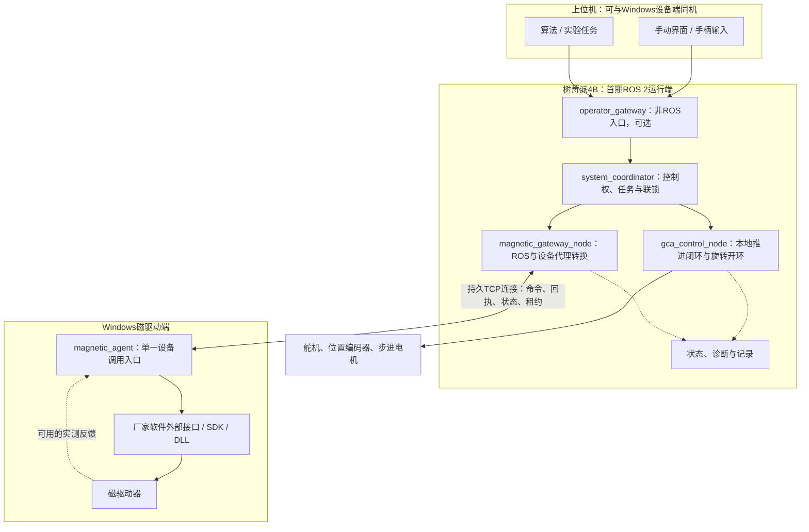
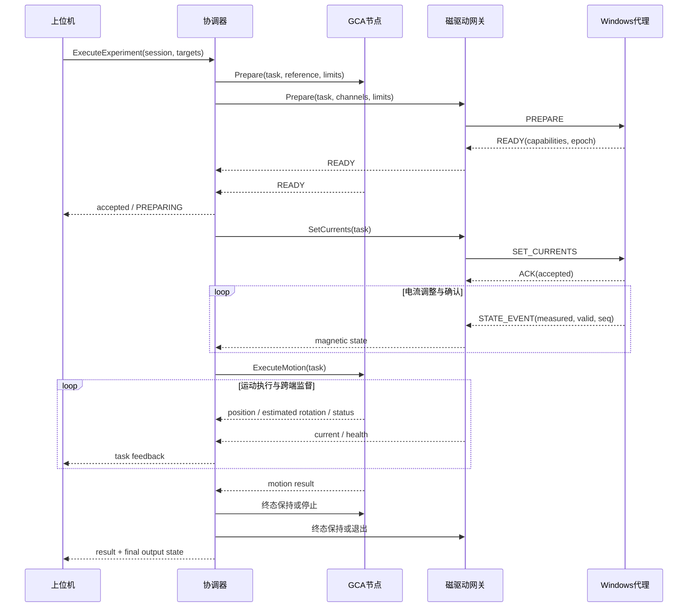

磁控导管系统详细设计：上位机、GCA 与 Windows 磁驱动器
==================================================

| 文档属性 | 内容 |
|---|---|
| 版本 | v0.2，详细设计草案 |
| 更新日期 | 2026-11-04 |
| 主控 | 树莓派 4B |
| 覆盖范围 | 目标生成、ROS 2协调、GCA执行、Windows磁驱动桥接、观测与部署 |
| 实现状态 | 尚未实现本设计的软件包，尚未完成实机验证 |
| 配套文档 | [GCA设备核心详细设计](GCA_ARCHITECTURE.md) |
| 双轴实施细化 | [基于ROS 2的双轴实现方案](GCA_ROS2_IMPLEMENTATION_PLAN.md)，含旧代码审查、ROS运行契约与回归矩阵 |

本文是整个系统设计的主入口，可用于拆分开发任务、编写接口和制定联调测试。文中“必须”表示拟实施的软件契约，“建议”表示可调整的技术选型，“待确认”表示尚无设备证据的参数或能力。设计决策不等于已获得硬件验证。

阅读路径：[范围与要求](#requirements) → [部署](#deployment) → [设备核心](#device-core) → [控制权与状态机](#state-machines) → [ROS契约](#ros-contracts) → [Windows协议](#wire-protocol) → [时间预算](#timing) → [配置](#configuration) → [验收](#acceptance)。其余章节解释Windows接入、联合任务、故障和工程组织。

已确认：磁驱动器依赖 Windows 控制软件，且提供外部调用接口；推进和旋转由树莓派控制；手动或算法目标来自上位机。尚需确认 Windows 接口的具体类型、写入/读回能力、线程约束和超时行为。

建议把整套系统组织成“目标生成端 → 唯一系统协调器 → 两个设备执行端”。上位机与磁驱动 Windows 软件可以在同一台物理电脑，也可以分开；这三个逻辑角色不要求三台电脑。

<a id="requirements"></a>

**设计范围、已知条件与需求**

| 类型 | 内容 |
|---|---|
| 用户已确认 | 舵机驱动轴向推进，外部编码器测实际推进位移；步进电机开环控制绕轴旋转 |
| 用户已确认 | 磁驱动依赖Windows软件，软件有外部接口；手动/算法目标由上位机下发 |
| 本版设计选择 | ROS 2作为协调层；Pi本地执行GCA控制；Windows代理封装厂家接口 |
| 本版设计选择 | 推进外环输出线速度，旋转使用有限定时脉冲段；实际设备能力核实后启用 |
| 待确认 | Windows接口具体类型、实测电流读取能力、通道映射、设备watchdog |
| 待确认 | 舵机/编码器型号、步进驱动参数、系统镜像、控制频率、运动/电流限值 |

| 需求编号 | 系统要求 |
|---|---|
| FR-01 | 手动与算法通过统一入口提交目标，只有一个有效控制权拥有者 |
| FR-02 | 推进以外部编码器为闭环反馈；旋转位置始终标记为脉冲估计 |
| FR-03 | 支持各通道电流目标，分别报告请求、接受、读回设定和实测值 |
| FR-04 | 支持电流条件成立后启动GCA的联合任务，并具有明确完成/退出策略 |
| FR-05 | 支持取消、停止、故障锁存和显式恢复；不自动续跑历史任务 |
| FR-06 | 各执行端独立检查输出期限、反馈新鲜度和控制会话 |
| FR-07 | 在无设备环境下运行仿真、协议测试和协调器测试 |
| FR-08 | 根据任务ID关联命令、采样、输出、状态转换和错误 |
| NFR-01 | 控制路径中不进行无界等待、绘图、同步写盘或无界重试 |
| NFR-02 | 每物理总线一个I/O所有者；每个设备只有一个合法运动写入入口 |
| NFR-03 | 所有队列、报文、重试、任务和关闭流程有界 |
| NFR-04 | 时间、单位、坐标参考、设备能力和数据质量在接口中显式表达 |
| NFR-05 | 性能由端到端实测确定，不从软件调度率推导物理控制精度 |

首期实现：单轴/双轴定位、短租约手动Jog、设定电流、顺序联合任务、状态记录、故障注入和部署。后续扩展：动态联合轨迹、磁场B到电流I的模型、视觉/力反馈、严格同步、外置MCU、ros2_control适配。首期不实现全功能实验流程语言或任意执行图。

<a id="deployment"></a>

**部署与职责**

首期选择树莓派 4B 承载 ROS 2 协调器、GCA 节点和 Windows 网关；Windows 上运行轻量本地设备代理，调用现有厂家接口。目标生成程序通过 ROS 2 或非 ROS 网络入口接入同一个协调器。后续若有 Linux 上位机，可迁移协调器和记录服务，设备接口保持不变。



图中的非ROS入口为可选适配器；原生ROS上位机可直接调用协调器接口。若上位机与Pi跨机运行ROS节点，使用相同接口包、兼容QoS与网络配置。ROS节点通过共同domain发现彼此，但domain并非认证或设备控制权机制，见[官方Discovery说明](https://raw.githubusercontent.com/ros2/ros2_documentation/jazzy/source/Concepts/Basic/About-Discovery.rst)。

| 组件 | 负责 | 不承担 |
|---|---|---|
| 上位机UI/算法 | 生成目标、选择手动/自动、展示反馈 | 绕过协调器直接写设备 |
| `system_coordinator` | 单一控制权、联合任务状态、顺序/并行阶段、取消与故障联动 | 逐周期推进PID、步进脉冲、电源快速电流环 |
| `gca_control_node` | 调用独立GCA核心，执行本地闭环/轨迹、输出监督、状态上报 | 直接调用Windows厂家软件 |
| `magnetic_gateway_node` | ROS接口与Windows协议转换、命令关联、网络状态 | 伪造电流反馈、独立决定实验步骤 |
| Windows `magnetic_agent` | 独占厂家接口，限幅/变化率、租约、读回、执行确认 | 依赖Pi才能发现本地通信失效 |
| 厂家软件/驱动器 | 电流执行及其支持的内部控制/保护 | 自动理解整个实验的任务语义 |

协调器和GCA控制节点为独立职责，必要时采用独立进程。GCA内部采集、PID与输出仍通过本地快照连接；不为了ROS化将每个算法文件拆成节点。上位机算法可以使用Python/C++等实现，ROS只是接入方式之一。

**Windows端的接入方式**

推荐“Windows原生代理＋Pi上的ROS网关”，避免将厂家的运行时依赖与ROS安装绑定。代理语言按接口选择：.NET接口可用C#；C/C++ SDK可用C++；DLL且调用约束允许时可用Python封装；命令行接口使用有超时的子进程。确定接口后只实现对应适配器，不同时开发全部类型。

若Windows已经有合适的ROS 2环境，可将网关和代理合并为Windows ROS节点；这是另一种部署后端，不改变上层Action、状态或租约语义。首期不要求为了运行ROS而迁移厂家程序，也不要求经WSL访问设备。

厂家软件外部API与直接设备SDK要区别对待：若SDK直接占用设备，厂家GUI和代理不能同时作为写入者。联合控制会话中关闭GUI直接修改通道或进入远程控制模式；若无法限制外部写入，需检测设定值被改变并退出联合任务，无法检测时不得宣称具有独占控制保证。

阻塞或不稳定的厂家接口应隔离到工作线程/进程，并保留有界停止路径。杀死一个SDK工作进程不等于电流输出已停止；代理也崩溃时只能依赖设备自身watchdog或独立禁止能力。能力缺失必须在状态中可见。

**控制权与命令来源**

手动和自动是两个目标来源，共用同一个执行入口。系统只有一个有效运动会话，包含 `session_id、owner、mode、generation、lease`。在手动/自动切换时，先停止或按明确策略交接旧任务，确认后再授予新控制权；不能让两个publisher靠最后到达的消息争夺设备。

运行状态、控制模式与任务阶段分别建模，具体取值与转换见[状态机契约](#state-machines)。连接可用、自检完成、输出ARM和任务执行是不同状态；ROS Lifecycle即使被采用，也不替代设备运动状态机。

协调器同时校验推进/旋转/电流目标和当前能力。一次联合任务只有一个 `task_id`，下发到设备的子任务保留 `task_id、stage_id、command_id、generation`，完成结果可以从两端关联。命令接受是逻辑事务，物理执行不是原子事务。

手动Jog使用短期有效目标；自动定位使用Action。单设备调试可以采用显式维护模式，该模式不允许并行执行系统联合任务。所有运行模式下均保留授权停止入口。

**ROS接口与消息约定**

接口名为建议值，实施时统一定义在 `gca_system_interfaces` 包中。标准ROS物理量对外采用 m、rad、A、s；既有GCA核心使用mm/deg的部分在ROS适配边界转换一次，字段名带单位，禁止隐式混用。

| 名称 | 类型 | 语义 |
|---|---|---|
| `/system/execute` | `ExecuteExperiment` Action | 接受包含GCA与电流阶段的完整任务，反馈阶段与子系统进度 |
| `/system/claim_control` | Service | 请求控制会话；返回授权结果和租约信息 |
| `/system/renew_control` | `RenewControl` Service | 续期当前控制权，不创建新运动任务；包含当前会话、代次和续租序号 |
| `/system/request_stop` | Service | 接受停止请求；实际停止结果由任务结果/状态报告 |
| `/system/manual_target` | Topic | 当前授权会话的连续目标，包含序号与短期有效信息 |
| `/system/state` | Topic | 聚合状态、活动任务、模式、故障、控制权 |
| `/gca/execute_motion` | Action | 推进/旋转目标、约束、完成与取消 |
| `/gca/state` | Topic | 实测推进位置、估算旋转角、参考有效性、运动状态 |
| `/magnetic/set_currents` | Action | 电流目标、变化率限制、到达条件和超时 |
| `/magnetic/state` | Topic | 请求/已接受设定值/实测电流分别记录及其有效性 |
| `/diagnostics` | Topic | 设备、链路与运行健康情况 |

ROS Action提供目标、反馈、结果和取消交互，但动作服务器必须自行实现抢占与设备停止。不能收到取消应答就认为设备已经停止，见[官方Action设计](https://design.ros2.org/articles/actions.html)。

第一版联合目标以位移、角度和各通道电流为基础，不假定已有磁场反演模型。电流数组必须配合固定 `channel_ids、mapping_revision`，避免通道顺序错位。目标磁场B到电流I的映射以后由单独模型模块加入；实测电流不冒充实测磁场。

关键状态字段建议包括：

```text
task_id, stage_id, command_id, session_id, generation
device_epoch, reference_id, calibration_id
state_seq, sampled_at, received_at, timestamp_source, valid
requested_currents_a, accepted_currents_a, measured_currents_a
current_feedback_available, current_feedback_age, current_tracking_valid
linear_position_m, rotation_estimated_rad, rotation_reference_valid
accepted / executing / reached / canceled / faulted
```

实际反馈缺失时，`measured_currents_a`为空并标记不可用，不能填写目标电流。SDK返回成功只提升到 `accepted`；读回设定寄存器也不等于测到实际电流。

**一条联合任务如何执行**

例如：先建立一组目标电流，再推进20 mm并旋转30°，结束后按任务策略保持或退出。

```text
目标来源提交任务
  → VALIDATING：能力、范围、参考、控制权与链路检查
  → PREPARING：两端接受准备，暂不发运动输出；设置准备超时
  → FIELD_RAMP：Windows端受限改变电流
  → FIELD_READY：实测电流满足误差、驻留与新鲜度要求
  → MOTION_EXECUTING：Pi执行推进闭环与旋转开环
  → SETTLING：检查到位、运动结束以及电流状态持续有效
  → EXITING：执行明确的终态策略并取得所需确认
  → TERMINAL：返回SUCCEEDED、CANCELED或FAILED及最终输出状态
```

这是应用自定义的编排状态机，不是ROS自动提供的事务流程。`PREPARING`失败时释放另一个端的准备；开始物理执行后失败，执行补偿停止而非声称回滚到原来位置。

`FIELD_READY`在这里只表示电流条件成立，不证明实际磁场已经测得或满足要求。若设备没有实际电流反馈，可支持显式的“设定已接受＋等待时间”实验模式，状态中标记未验证；不能让这一模式满足要求电流闭环确认的任务。

运动期间协调器持续监督电流状态。Windows端测量失效或输出异常时停止GCA；GCA故障时磁驱动端执行预先配置的退出策略。退出策略可以是受限降流、禁止输出或其他经设备能力验证的方式，不能无条件假定立即归零总是正确。

任务完成与输出持有分开：Action可以报告轨迹完成，但持续电流或推进位置HOLD仍需有效会话租约和监督。任务结果必须说明终态是“继续保持”还是“输出退出”。断连后保持无限电流不能成为默认隐含行为。

**顺序、并行和精确同步**

首期优先支持事件触发的顺序编排，例如“电流确认到达后开始推进”。随后支持同时进行的缓慢电流变化与机械运动，由同一任务生成两端子轨迹并监督进度。

若需要精确同步，引入 `prepare → ready → commit(start_at)`、共同时间基准、执行迟到拒绝、实际开始时间回执和同步误差测量。但分布式commit不是物理原子启动：一个端成功另一个端断连仍需故障处理。

Windows SDK/设备若不支持预缓冲轨迹或定时触发，就无法仅靠ROS网络消息获得严格同步。更严格的时序需要共享硬件触发或支持定时执行的控制器，精度以实测为准。相同消息时间戳、同步发Topic、两个Action都accepted均不证明同步动作。

跨机器单调时钟不可直接比较。日志关联使用已同步的墙上时钟并记录误差估计；本地超时使用各端单调时钟。硬件实时控制不依赖可能跳变或暂停的ROS仿真时钟。

**ROS网关到Windows代理的协议**

本版固定为持久TCP、4字节长度前缀与UTF-8 JSON帧，详细字段见[Windows协议契约](#wire-protocol)；不要每个电流更新启动一次进程或创建一次连接。协议至少定义：

```text
HELLO / CAPABILITIES
CLAIM_SESSION / RENEW / RELEASE
PREPARE / SET_CURRENTS / CANCEL / STOP
GET_STATE / STATE_EVENT
ACK / RESULT / ERROR
```

握手校验协议版本、设备身份、通道映射、实测反馈、停止与watchdog能力。会话nonce、单调递增序号、command_id及generation用于拒绝重复与旧命令，重试相同command_id不能重复执行相对增量或重启斜坡。

Windows代理为自己的控制会话签发有本地截止时间的短期token。网关提交命令时引用该token；代理在本地验证它仍有效。`ttl_ms`限制接收后的排队时间，不能覆盖token既定截止时间，不能因网络延迟收到旧包就重新启动完整TTL。只允许当前合法会话续租，重连必须重新协商device_epoch与参考状态。

链路心跳不等于任务租约。网关不能因TCP仍连接或ROS节点仍在发遥测就无限续期电流输出；续期必须受当前协调器/控制源授权约束，旧generation不能延长新会话或复活已取消动作。慢客户端状态推送有界，不得阻塞停止请求。

**失联、停止与QoS**

| 故障 | Pi执行端 | Windows执行端 |
|---|---|---|
| 上位机控制会话过期 | 协调器取消任务，GCA停止 | 协调器要求退出；代理租约独立兜底 |
| Windows链路中断/电流反馈过期 | 停止关联GCA任务 | 代理本地执行租约超时策略 |
| 协调器崩溃 | GCA本地租约过期停止 | 网关不得盲目续租；代理到期退出 |
| Pi断电 | 依赖已配置的舵机watchdog和有限脉冲后端行为 | 代理到期退出 |
| Windows代理/厂家程序崩溃 | 停止GCA并报告磁驱动状态未知 | 若软件无法执行停止，依赖驱动器watchdog/独立禁止；能力须核实 |
| 任一端恢复连接 | 自检、确认停止、重新建立会话 | 同左；禁止自动继续旧任务 |

停止动作分开维护“请求接受、停止进行、停止确认、状态未知”，实际停止确认须达到对应设备的可观测条件。软件无法证明已停止时不得报告整体安全停止成功。

遥测采用浅队列，可按数据用途选择best effort；状态转换/任务结果采用可靠交互。连续运动目标采用 `KEEP_LAST(1)`、`VOLATILE` 和明确期限，避免重连接收到历史运动目标。可靠传输可能重试，应用仍需检查序号和新鲜度。DDS的deadline/liveliness可用于诊断，不能替代设备本地租约。QoS语义依据[ROS 2官方说明](https://raw.githubusercontent.com/ros2/ros2_documentation/jazzy/source/Concepts/Intermediate/About-Quality-of-Service-Settings.rst)。

ROS topic/action名称和domain本身不限制谁能发命令。运行端验证会话与许可；网络访问使用受控局域网和必要的认证/访问限制，选择原生ROS跨机部署时再配置相应DDS安全方案。

**包与工程组织**

```text
src/gca/                         # GCA核心包：领域、算法、驱动等；不依赖ROS
ros2_ws/src/
  gca_system_interfaces/         # msg / srv / action
  gca_ros/                       # GCA核心的ROS适配
  magnetic_gateway/              # ROS与Windows代理协议转换
  system_coordinator/            # 控制权、联合任务状态机
  operator_gateway/              # 非ROS上位机入口，可选
  system_bringup/                # launch、参数、节点配置
windows_agent/
  protocol/                      # 与Pi共用的协议schema
  vendor_adapter/                # 只封装已确认的厂家接口
  runtime/                       # 会话、租约、限幅、执行和状态
tests/
  simulated_windows_agent/
  orchestration/
  disconnect_and_recovery/
```

目录为建议布局，不表示当前已创建软件包。共享协议schema独立于ROS消息，转换集中在网关，Windows代理无需安装ROS消息生成环境。实机模式中只启用一种GCA命令入口的控制权，避免独立TCP与ROS同时驱动同一核心。

`system_bringup`启动Pi节点及状态检查；Windows代理由Windows自己的进程管理方式启动。ROS launch不能被当成跨Windows远程进程管理器。自动重启服务只恢复至未ARM状态。

首期采用有线局域网、固定设备地址/稳定主机名。所有原生ROS端锁定同一发行版和接口包版本，优先统一RMW实现以减少联调变量，并验证防火墙、发现和QoS兼容性。Windows代理采用点对点TCP时无须参加DDS发现。

ROS 2具体发行版与系统镜像在设备兼容测试后固定；不为磁场SDK强行改变Windows环境。上位机承担复杂算法和绘图，Pi保留本地执行与监督；日志写入和网络回调不得阻塞控制循环。

**实施与验收顺序**

1. 核实厂家接口：先单独完成身份、能力、读回、受限电流设定、停止、超时实验，明确API成功与物理输出之间的差异。
2. 实现Windows模拟代理和真实代理，验证会话、去重、断线、崩溃/重启、租约，不先依赖ROS。
3. 为GCA核心加ROS封装，完成单独推进/旋转Action与状态发布。
4. 实现磁驱动ROS网关，将Windows状态与结果准确映射为ROS接口。
5. 实现系统协调器的“电流就绪→GCA运动→终态策略”，然后增加手动/自动控制权切换。
6. 加入联合实验记录、故障注入与端到端延迟测量；最后依据需求扩展连续联合轨迹和精确同步。

验收重点：重复命令不重复执行；上位机/网关/协调器任一失联后本地端按约定退出；半边启动失败不继续另一半；电流无反馈时不会误报实测到达；取消应答与物理停止结果清晰区分；系统重启不恢复历史动作；测得的联合动作延迟与停止时间满足事先约定的目标。

接下来需要的设备资料集中为：厂家接口具体类型和调用样例、能否读取实际电流、设备通道数/映射、单次调用最大耗时、是否支持连续目标/轨迹预缓冲、远程控制独占模式，以及停止/watchdog能力。它们决定磁驱动适配器和同步性能，不改变上述系统编排边界。

<a id="device-core"></a>

**设备核心的模块契约**

GCA和磁驱动核心使用同一种分层原则，但不强制共享设备协议或算法代码。对ROS依赖的代码仅存在于适配包与协调器；Windows设备代理也可独立测试。

| 模块 | 输入 | 输出 | 可持有的资源/状态 |
|---|---|---|---|
| 传输/协议 | 有期限的读写请求 | 原始响应、协议错误 | 一个受所有者管理的连接、帧解析缓存 |
| 设备适配 | 设备语义请求 | 采样、能力、写入回执 | 型号/固件信息、连接epoch |
| 采集 | 采集计划 | 带序号、时间、有效性的原始采样 | 采集调度、连续失败计数 |
| 状态估计 | 原始采样、标定、参考 | 位移、速度、参考有效性 | 滤波器、回绕状态、零点 |
| 算法 | 参考轨迹、有效状态、dt | 期望速度或旋转轨迹 | 积分等控制器状态 |
| 输出 | 期望控制量、许可、约束 | 限制后设备指令及其回执 | 最近输出、代次、输出期限 |
| 本地监督 | 样本年龄、控制租约、设备状态 | 许可撤销、停止流程、故障 | 本地状态机和停止期限 |
| ROS适配 | ROS命令、核心状态 | 核心请求、ROS反馈 | 序列化、单位转换、Action关联 |

GCA推进链路固定为：`外部位移测量 → 位置误差 → 控制器 → 受限线速度 → 舵机速度执行`。建议先P、再PI，D按噪声和响应验证后启用。每个有效新样本至多更新一次控制器；实际dt由采样时间确定。抗积分饱和跟踪最终受限输出，迟到回执按输出序号和generation隔离。轨迹完成后，位置误差及实际速度同时满足驻留条件才到位。

旋转链路固定为：`累计角度目标 → 加减速轨迹 → 有限脉冲段 → 执行计数`。以已确认发出的脉冲计算角度；不按提交数计算。中止后计数未知则估计无效，不能继续接受依赖该估计的相对或绝对角度任务。重新建立参考是显式操作；没有原点传感器就不声称实现自动机械回零。

磁驱动链路固定为：`通道目标电流 → 有限变化率 → 厂家调用 → 可用的读回/测量`。快速电流环是否由驱动器执行以能力核查为准。若需要软件斜坡，由代理本地按实际时间更新，不能靠网络消息间隔精确生成电流波形。厂家接口阻塞时不允许无限排队下一批电流目标。

共同规则：无效值不替换为0；缓存不得重新标为新采样；新连接不能继承旧epoch；构造对象/import不触发输出。普通运动许可失效时，受限停止通道仍可运行，不要求有效位置参考或新鲜测量才能发送零速/禁止请求。

Pi的控制tick执行顺序为：读取不可变状态快照 → 处理停止/故障事件 → 校验许可与反馈 → 推进参考轨迹 → 计算控制量 → 施加约束 → 提交有期限需求 → 发布非阻塞诊断。串口和磁驱动TCP读写均在各自I/O任务中执行；ROS回调不得等待电机到位。

**设备能力表与厂家适配器**

代理握手返回以下能力，协调器根据能力接受或拒绝任务：

| 能力字段 | 意义 | 不满足时 |
|---|---|---|
| `can_set_currents` | 可设置指定通道电流 | 拒绝磁驱动任务 |
| `can_read_setpoints` | 可读取设备保存的设定值 | 只报告API接受，不能报告设定值已核对 |
| `can_measure_currents` | 可读取实际电流 | 拒绝要求实测电流到位的任务 |
| `can_stop_output` | 有明确停止/退出接口 | 根据已验证能力限制可运行模式 |
| `watchdog_supported` | 执行端失联后设备可自主退出 | 标明代理崩溃场景的保护缺口 |
| `exclusive_control_supported` | 可防止外部GUI改写 | 需要检测冲突或限制为维护运行 |
| `can_buffer_trajectory` | 支持预先下发轨迹 | 不启用依赖缓冲轨迹的同步方式 |
| `can_start_at_time` | 支持约定时间启动 | 不启用定时commit |

厂家适配器接口草案：`identify()`、`get_capabilities()`、`read_state(deadline)`、`apply_currents(target, deadline)`、`request_exit(policy, deadline)`、`close()`。返回结果区分 `API_ACCEPTED / SETPOINT_VERIFIED / CURRENT_MEASURED / FAILED / UNKNOWN`；多个条件可分别成立，不压缩成一个成功布尔值。

配置适配器时记录SDK版本、位数、线程亲和要求、许可要求与设备独占要求。若需厂家GUI会话才能调用，代理启动条件包含该会话就绪；Windows服务账户是否可访问该会话必须联调确认。未经验证不直接将原本依赖桌面的程序改成后台服务。

<a id="state-machines"></a>

**状态机与控制权交接契约**

分开保存三类状态，避免一个枚举同时表达设备就绪、手动模式和任务阶段：

| 维度 | 取值 |
|---|---|
| 系统运行状态 | `INITIALIZING / DISARMED / READY / EXECUTING / HOLDING / STOPPING / FAULT / ESTOP` |
| 控制模式 | `NONE / MANUAL / AUTO / MAINTENANCE` |
| 任务阶段 | `VALIDATING / PREPARING / FIELD_RAMP / FIELD_READY / MOTION_EXECUTING / SETTLING / EXITING / TERMINAL` |

| 当前状态 | 事件 | 转换前提与动作 | 目标状态 |
|---|---|---|---|
| INITIALIZING | 两端自检完成 | 禁止普通输出；核实没有遗留动作 | DISARMED |
| DISARMED | ARM | 控制权有效，配置/能力/所需参考通过，建立执行端租约 | READY |
| READY | 接受任务 | 完整目标校验，生成任务ID，锁定配置与参考版本 | EXECUTING |
| EXECUTING | 完成且要求保持 | 所有到位条件成立，保持模式可用且租约有效 | HOLDING |
| EXECUTING | 完成且要求退出 | 按终态策略退出并取得所需确认 | READY |
| EXECUTING/HOLDING | STOP或控制权到期 | generation递增，取消未执行输出，启动两端停止 | STOPPING |
| STOPPING | 停止确认 | 普通STOP可保留有效参考；退出原因需报告 | READY或DISARMED |
| 任意运行态 | 关键故障 | 撤销普通许可、锁存故障并尝试本地停止 | FAULT |
| 任意运行态 | 已配置的硬件急停触发 | 记录外部输入并锁存；不声称软件代替硬件通路 | ESTOP |
| FAULT/ESTOP | RESET | 原因已解除，自检与停止状态满足；不恢复目标 | DISARMED |

故障状态与停止执行情况是两个字段：`FAULT`下可能仍有 `stop_progress=REQUESTED/IN_PROGRESS/CONFIRMED/UNKNOWN`。收到故障并不自动意味着物理输出停止。

手动转自动、自动转手动首期统一采用“请求交接→受控停止→确认停止→释放旧会话→授予新会话”，不实现运动中的无缝接管。模式切换不自动设零，不改变标定。控制权请求冲突返回明确的 `CONTROL_BUSY`，不抢占已有会话。

设置参考、更新标定、改变设备映射只在DISARMED且无活动任务时允许。设置参考产生新 `reference_id`，所有基于旧参考的任务失效。设备重启或失步嫌疑导致参考无效时，即使解除故障也不能直接运行位置任务。

**联合任务的执行时序**



图中的 `Prepare` 是能力/状态检查与短期资源预约，不允许产生运动。准备到实际执行间，端点仍要重新检查epoch、参考、许可和期限；READY不能当成永不过期的执行许可。任一准备超时则释放双方预约；无法确认远端释放时等待预约到期，不盲目重开相同任务。

任务完成条件必须检查与本任务/阶段关联的数据，不能拿上一个任务的到位消息满足新任务。电流就绪须为目标下发后的有效测量，GCA运动开始前再次检查新鲜度。任务一旦进入退出流程，不再因为迟到的成功消息重新开始运动。

<a id="ros-contracts"></a>

**ROS消息与Action详细契约**

下表为实现时IDL的字段依据；不是已生成或编译过的ROS接口。所有数值拒绝NaN/Infinity，数组长度有上限，缺失测量由有效位表示，不用目标值填充。

| 数据结构 | 字段与类型 | 规则 |
|---|---|---|
| `CommandContext` | session_id:string；task_id:string；command_id:string；generation:uint64；sequence:uint64 | ID采用UUID字符串；序号按会话递增，重传保持同一ID/序号 |
| `MotionTarget` | mode:uint8；linear_m:float64；rotation_rad:float64；axis_mask:uint8；reference_id:string | mode为ABSOLUTE或RELATIVE；未选择轴不执行；相对量只在准入时转换一次 |
| `MotionLimits` | max_linear_m_s、max_linear_m_s2、max_rotation_rad_s、max_rotation_rad_s2:float64 | 不高于本地配置限值，不能由上位机放宽设备约束 |
| `CurrentTarget` | channel_ids:string[]；currents_a:float64[]；slew_a_s:float64[]；mapping_revision:string | 数组长度一致且通道不重复；首期必须覆盖已配置的全部受控通道 |
| `CurrentGate` | require_measured:bool；tolerance_a:float64[]；settle_s:float64；feedback_max_age_s:float64 | 驻留期内持续有效；坏样本/过期使驻留重新计时或触发故障 |
| `EndPolicy` | gca:uint8；magnetic:uint8；exit_profile_id:string | 显式选择保持或退出；缺省拒绝；退出profile由本地配置定义 |
| `SampleQuality` | valid:bool；seq:uint64；device_epoch:string；timestamp_source:uint8；age_s:float64 | 单调序号不跨设备epoch比较；age必须说明计算所在端 |

`ExecuteExperiment.action`建议包含：

| 部分 | 字段 |
|---|---|
| Goal | CommandContext、MotionTarget、MotionLimits、CurrentTarget、CurrentGate、EndPolicy、prepare_timeout_s、execution_timeout_s、freshness_token |
| Feedback | phase、gca_state、magnetic_state、elapsed_s、waiting_condition、stop_progress |
| Result | outcome、error_code、message、final_gca_state、final_magnetic_state、outputs_held、stop_confirmed |

首期只支持固定模板 `SET_CURRENTS_THEN_MOVE`；不接受任意表达式或脚本作为任务。后续新模板增加明确版本及字段，不依靠字符串拼接解释流程。

`outcome`取 `SUCCEEDED / CANCELED / FAILED`。取消仅在取消流程终结且达到所要求的停止/退出条件时返回CANCELED；停止超时或物理状态未知返回FAILED，包含原始取消原因。持续HOLD场景的SUCCEEDED仅表示运动目标达成，`outputs_held=true`，系统仍处于HOLDING并保持续租。

手动目标使用两种互斥输入：短租约Jog的速度目标，或明确的定位Action。速度消息字段为 `linear_velocity_m_s、rotation_velocity_rad_s、CurrentTarget、context、freshness_token`；轴使能掩码明确哪些目标生效。释放手柄或消息过期产生零速度/停止流程。电流是否随Jog停止按终态profile执行，不暗示所有通道立即归零。

接口补充：`/system/arm`、`/system/disarm`、`/system/reset_fault`、`/system/release_control`为短时请求Service，返回是否接受及操作ID；可能耗时的实际状态变化通过 `/system/state` 和事件报告。直接 `/gca/*`、`/magnetic/*`入口也必须验证协调器授权；不能仅依靠界面不显示这些接口来限制访问。

**QoS与消息处理策略表**

| 数据 | 本版建议策略 | 应用约束 |
|---|---|---|
| 手动连续目标 | KEEP_LAST(1)、VOLATILE、RELIABLE，配置有限lifespan | 最后有效序号覆盖；过期/失去控制权拒绝；不以重传保证时效 |
| 高频传感遥测 | 浅队列、VOLATILE、BEST_EFFORT | 允许丢样；记录采样序号；闭环使用本地采样，不依赖ROS遥测回送 |
| 聚合系统状态 | KEEP_LAST(1)、RELIABLE、TRANSIENT_LOCAL | 仅用于观察；重连看到历史状态仍须核验boot_id和状态年龄 |
| 命令应答/事件 | 有界可靠传输；可查询任务当前结果 | 不把一次事件丢失变成永久等待 |
| Action/Service | 明确配置相容的可靠交互 | 接受/物理完成分开；对阻塞调用设上层期限 |

TRANSIENT_LOCAL仅用于可识别年代的状态快照，禁止用于运动/电流命令。发布可靠状态的I/O阻塞也不能反压控制tick：控制侧先写有界本地邮箱，再由遥测任务发布。

<a id="wire-protocol"></a>

**Windows桥接协议 v1**

连接由Pi网关发起，Windows代理监听配置的受控网卡地址和端口。具体端口由部署配置确定，启动失败不得杀死其他占用端口的程序。

帧格式固定为 `uint32_be payload_length + payload_length字节UTF-8 JSON`。本版报文上限为65536字节（协议选择，不是硬件参数）；长度0、超限、非UTF-8、非JSON对象均拒绝并记录。解析器处理半包/粘包；接收超时覆盖整个帧，不能让对方无限缓慢发送占用连接。畸形报文关闭连接，活动会话按失联策略处理。

| 通用字段 | 约束 |
|---|---|
| `protocol_version` | 整数，v1为1；不支持则握手拒绝 |
| `message_id` | 每条逻辑消息的唯一ID；重发同一逻辑消息保持不变 |
| `type` | 已定义的枚举；未知命令不得忽略后继续执行 |
| `session_id` | 有输出请求时必须为当前会话 |
| `generation`、`sequence` | JSON使用无符号十进制字符串，避免跨语言整数精度损失；ROS边界转uint64 |
| `task_id`、`command_id` | 输出命令必须包含；响应保留关联 |
| `agent_epoch` | 代理/设备控制上下文标识，重启或设备重连后改变 |
| `freshness_token` | 代理签发并在本地维护截止时间的短期不透明token |
| `ttl_ms` | 准入/排队期限；只能收紧token和租约期限 |
| `payload` | 由type决定，严格校验字段与类型 |

响应包含 `reply_to` 关联请求的message_id。异步状态包含独立的 `state_seq` 和当前任务关联，不借用请求ACK表示持续健康。对外错误码稳定，SDK原始错误另放诊断字段。

以下报文仅用于解释格式，电流和时间数值是协议示例，不能直接作为实机测试参数：

```json
{
  "protocol_version": 1,
  "message_id": "example-message-001",
  "type": "SET_CURRENTS",
  "session_id": "example-session",
  "generation": "3",
  "sequence": "42",
  "task_id": "example-task",
  "command_id": "example-command",
  "agent_epoch": "example-epoch",
  "freshness_token": "issued-by-agent",
  "ttl_ms": 200,
  "payload": {
    "channel_ids": ["coil_a", "coil_b"],
    "currents_a": [0.1, -0.1],
    "slew_a_s": [0.05, 0.05],
    "mapping_revision": "example-map"
  }
}
```

上述example ID为占位；正式实现要求规定的UUID格式，token仅能由当前代理签发，示例文本不构成可执行命令。

请求处理顺序：校验连接授权和协议 → 校验epoch/会话 → 查询去重记录 → 校验generation和序号 → 校验token及期限 → 校验任务状态/通道/数值 → 接受并记录 → 交给唯一厂家I/O所有者。相同command_id与相同内容返回已知状态，不重新调用设备；相同ID但不同内容返回 `ID_CONFLICT`。去重记录容量有界，保留活动命令与会话内高水位；淘汰旧结果后，旧序号仍须拒绝，不能因缓存淘汰变为新命令。

ACK表示接受，不表示实测到位。网关等待ACK超时后查询command_id结果或按相同ID重试；不得换一个新ID盲目重复执行。连接断开后的不确定结果标记UNKNOWN，不自动推测失败并重发物理动作。

STOP/CANCEL采用高优先级通道，仍验证连接身份、目标会话和任务关联；允许当前停止请求在运动token已失效时执行，不能因为过期而禁止停车。停止通道只允许预定义退出动作。队列优先级无法打断已进入厂家的阻塞调用，因此单次SDK调用必须有已知上界或独立停止能力。

<a id="timing"></a>

**时间、租约与停止预算**

区分以下期限，不使用一个笼统的“心跳超时”代替：

| 参数 | 负责端 | 目的 |
|---|---|---|
| `source_lease` | 协调器 | 上位机是否仍持有控制权 |
| `executor_lease` | GCA/Windows代理 | 协调器是否仍授权输出 |
| `command_ttl` | 命令接收端 | 命令是否允许准入与排队 |
| `feedback_max_age` | 控制器/本地输出监督 | 反馈能否用于继续执行 |
| `prepare_timeout` | 协调器和准备端 | 准备资源不能永久占用 |
| `execution_timeout` | 协调器及各执行端 | 任务未完成时必须退出 |
| `io_transaction_timeout` | 总线/SDK所有者 | 停止不能无限等待普通事务 |
| `stop_timeout` | 本地端和协调器 | 超时则报告停止未知/失败 |

所有具体数值在通信基准测量、允许速度与停止距离确认后设置；不存在未经验证的通用100Hz或固定毫秒级保证。

健康续租必须受上游当前授权约束。Windows网关不因“自身还在运行”持续替失联协调器续租；GCA不因“遥测还在读取”维持失效控制命令。每次任务终结/停止提升代次，旧续租请求不能延长被撤销任务。

本地采样/算法/输出各自记录实际单调时钟间隔。跨机不能直接比较单调时钟，freshness token由接收端按自己的时钟判定。多级租约存在传播与本地到期延迟，整体停止上界按链路累积预算验收，不能声称两端租约在同一物理时刻失效。

预算示意：`T_stop_total ≤ T_detection + T_dispatch_or_local_expiry + T_inflight_io + T_buffered_output + T_actuator_response`。每项必须有可测上界；任一项未知时，系统只能报告尚无确定的最坏停止时间。协调器故障和网络断开分别测试，不只测正常STOP调用。

控制循环不以ROS仿真时间作为硬件输出期限。记录时同时保留源端时间、接收时间、端点epoch、同步质量；离线对齐不能把不确定的时钟偏差解释为控制延迟。

<a id="configuration"></a>

**配置、坐标与部署生命周期**

配置分为系统、设备、控制、标定和实验五部分，由schema验证后生成不可变运行快照。运行中修改设备模式、标定、通道映射或运动约束须先DISARM，不能热更新一半配置。

| 配置文件 | 内容 |
|---|---|
| `system.yaml` | 部署角色、ROS命名空间、Windows地址、控制权/租约、记录策略 |
| `gca_hardware.yaml` | 设备身份、串口、GPIO编号体系、方向、驱动能力 |
| `magnetic_hardware.yaml` | 厂家适配器、通道映射、能力要求、退出profile |
| `control.yaml` | 轨迹约束、PID、滤波、采样/输出期限、到位判据 |
| `calibration.yaml` | 位移比例、轮径/传动比、脉冲换算、版本与标定记录 |
| `experiment.yaml` | 联合任务模板、目标、阶段超时、实测确认要求、终态策略 |

示例为参数清单，`null`均表示必须确认后填写，硬件模式禁止据此ARM；不提供虚构的实机PID与电流默认值：

```yaml
schema_version: 1
runtime:
  backend: hardware
  auto_arm: false
  source_lease_ms: null
  executor_lease_ms: null
  stop_timeout_ms: null
gca:
  linear_limits_m: null
  max_linear_speed_m_s: null
  rotation_limits_rad: null
  encoder_feedback_max_age_ms: null
magnetic:
  adapter_kind: null
  channel_ids: []
  current_limits_a: null
  require_measured_feedback: true
  exit_profile_id: null
```

坐标规定：推进正方向为插入；旋转正方向必须结合机械观察方向在接线/标定文档中画出。旋转使用累计角，不自动按2π取模。电流正方向由通道接线与映射版本定义。ROS接口用m/rad/A，GCA核心mm/deg只在适配边界转换一次；内部值不混入ROS消息而漏掉单位转换。

启动顺序：Windows代理加载配置并进入禁止普通输出状态 → 有界识别设备并处理遗留输出 → Pi启动GCA与网关 → 握手核对身份/能力/映射 → 两端确认可用状态 → 协调器进入DISARMED → 上位机申请控制权 → 显式ARM → 接受任务。代理或SDK依赖桌面会话时，先满足该依赖再宣布ready。

停机顺序：停止接受新任务 → 撤销活动代次并请求两端退出 → 等待有期限的停止确认 → 记录未知状态或故障 → 关闭设备/网络资源 → 结束服务。进程退出成功不作为设备停止证据。

重连首先改变连接epoch并查询真实状态；旧prepare、Action结果、缓存目标和token全部隔离。不能以恢复TCP连接作为自动恢复运动条件。配置摘要、标定版本和软件构建标识随每个运行session记录。

**错误模型、日志与实验回放**

| 错误码族 | 示例 | 处理责任 |
|---|---|---|
| 准入错误 | INVALID_ARGUMENT、CONTROL_BUSY、REFERENCE_MISMATCH | 拒绝该任务，保持既定系统状态 |
| 会话/时效 | SESSION_EXPIRED、STALE_GENERATION、COMMAND_EXPIRED | 拒绝旧输出；活动许可过期时本地停止 |
| 能力错误 | CURRENT_FEEDBACK_UNAVAILABLE、STOP_CAPABILITY_UNKNOWN | 拒绝要求相应能力的运行模式 |
| 通信错误 | DEVICE_TIMEOUT、BAD_FRAME、SDK_ERROR | 按反馈有效期/故障策略退出 |
| 执行错误 | TRACKING_TIMEOUT、CURRENT_NOT_SETTLED、ROTATION_ESTIMATE_INVALID | 终结关联任务并联动退出 |
| 停止错误 | STOP_TIMEOUT、OUTPUT_STATE_UNKNOWN | 锁存故障，不报告已确认停止 |

错误事件包含发生端、device_epoch、task_id、原始错误、最近有效状态、是否可重试和所执行的退出动作。自动重试仅用于已定义的幂等事务，不自动重新执行整段运动。

rosbag2用于系统级消息记录；各设备本地控制日志保留更高频采样、PID分量、实际dt、限幅与输出回执。两者用session/task/command与时间关联。日志写入异步且队列有界；记录丢样与磁盘错误，不能阻塞控制。

日志回放默认接入仿真或分析命名空间，不将历史命令直接发布到实机控制入口。回放用于解释原始执行，不能声称复现相同物理轨迹；仿真仍需独立动力学/延迟模型。

<a id="acceptance"></a>

**验证矩阵与交付门槛**

| 用例 | 对应要求 | 场景与预期证据 |
|---|---|---|
| AT-01 | FR-01 | 手动/自动同时申请：只有一个获得控制；切换须完成停止交接 |
| AT-02 | FR-02 | 外部编码器断开：本地输出到期退出；不得改用舵机位置冒充真实反馈 |
| AT-03 | FR-02 | 脉冲中途取消且计数未知：角度估计无效，定位命令被拒绝 |
| AT-04 | FR-03 | SDK仅返回成功：状态停留在accepted，不报告实测电流达标 |
| AT-05 | FR-04 | 一端prepare失败：另一端不开始动作，预约释放或到期 |
| AT-06 | FR-04 | 电流达标后执行GCA；运行中电流反馈过期，关联运动停止 |
| AT-07 | FR-05 | 取消与成功回执竞争：终态唯一，旧成功不能重新开始动作 |
| AT-08 | FR-05、FR-06 | 上位机、协调器、网关分别失联：本地租约按预算退出，旧代次不能续期 |
| AT-09 | FR-06 | 控制线程冻结但遥测活跃：输出期限仍失效，不能靠读包保持旧速度 |
| AT-10 | NFR-02 | 厂家GUI与代理竞争写入：远程模式阻止或检测冲突并终结任务 |
| AT-11 | NFR-03 | 半包、粘包、超长帧、重复ID：解析有界；同ID不重复执行 |
| AT-12 | FR-05、FR-08 | 两端重启：新epoch、DISARMED、历史目标不恢复；日志可关联 |
| AT-13 | NFR-01 | 磁盘阻塞、慢订阅端、高日志量：控制不等待写盘，丢样可观察 |
| AT-14 | NFR-04 | mm↔m、deg↔rad、通道交换、参考版本变化：转换或拒绝行为确定 |
| AT-15 | NFR-05 | 负载下采集周期、输出延迟、停止时间/距离：外部测量与日志相互核对 |
| AT-16 | FR-07 | 无GPIO/SDK的开发机完成模拟联合任务、取消与故障；不得在import时访问硬件 |

纯算法、协议和协调器测试在普通开发机运行；实机HIL显式启用，不进入默认测试命令。Windows模拟代理须覆盖无实测反馈、SDK挂起、迟到回执、输出未知和重启等模式。所有测试遵循上述接口，不复制真实驱动内部实现作为预期值。

性能验收表在P0/设备基准阶段填写：推进误差/超调/速度、旋转计数与实际角误差、电流误差/稳定时间、端到端响应、最大停止时间/距离、允许的失联输出持续时间。缺少目标值时可以完成软件逻辑测试，但不能宣布性能验收完成。

**开发工作包与完成定义**

| 工作包 | 依赖 | 输出物 | 完成条件 |
|---|---|---|---|
| WP-00 设备与参数确认 | 厂家资料、现有设备 | 能力清单、协议样例、标定/性能目标 | 待确认项有结果或明确禁用对应功能 |
| WP-01 核心模型与仿真 | 本文接口 | 状态机、假时钟、模拟设备、命令/错误模型 | AT-01/05/07等可无硬件运行 |
| WP-02 GCA本地执行 | WP-00/01 | 采集、算法、脉冲后端、停止监督 | 单轴与故障路径通过，达到GCA约定指标 |
| WP-03 Windows代理 | WP-00/01 | 厂家适配、协议、租约、能力/状态 | 真实与模拟接口契约一致，AT-04/10/11通过 |
| WP-04 ROS适配与网关 | WP-01及两端契约 | interfaces、gca_ros、magnetic_gateway | 单设备Action、状态、取消语义明确 |
| WP-05 联合编排 | WP-02/03/04 | 协调器、控制权、固定任务模板 | 完整顺序任务与故障联动通过 |
| WP-06 部署与验收 | 前述工作包 | launch/服务配置、实验记录、测试报告 | 重启/失联/负载测试及性能验收完成 |

模拟工作可先于设备就绪推进，但真实适配必须依据实际厂家接口；不以猜测的寄存器或API填补WP-00。第一轮先交付一条纵向流程“模拟上位机→协调器→两个模拟设备→完成/取消”，然后替换真实执行端。

**待决策清单与变更规则**

| 编号 | 待确认项 | 影响 | 确认阶段 |
|---|---|---|---|
| OQ-01 | Windows外部接口类型、调用样例、SDK位数/线程模型 | 代理语言、进程隔离、部署账户 | WP-00 |
| OQ-02 | 实测电流/温度/故障读取能力及更新率 | 到位条件、故障监督与采集频率 | WP-00 |
| OQ-03 | 电流通道数、正方向、限值、退出策略、独占写入能力 | CurrentTarget、能力门控、终态profile | WP-00 |
| OQ-04 | 舵机、编码器、步进驱动实际型号/固件/接线 | 本地驱动、模式、标定和停止能力 | WP-00 |
| OQ-05 | 推进行程、角范围、速度、精度、停止距离 | 约束、PID调参和验收 | WP-00/02 |
| OQ-06 | ROS发行版、Pi系统镜像、上位机操作系统 | 部署与依赖锁定 | WP-00/04 |
| OQ-07 | 磁驱动是否支持缓冲/定时触发及所需同步精度 | 后续同步方案，首期采用顺序编排 | 扩展前 |

配置、标定和协议schema分别版本化；改变坐标意义、通道映射或协议字段语义属于不兼容变更，不用静默默认值兼容。记录设计变更原因、涉及接口和需要重跑的验收用例。本文v0.2新增了需求编号、状态转换、详细接口、帧格式、时间预算、配置和验证矩阵；它取代此前仅有概念图的系统编排草案。
